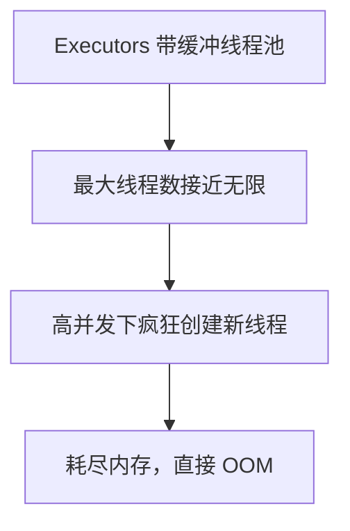

# 内存溢出情况二：误用带缓冲线程池

面试题：项目中什么情况下会出现内存溢出？怎么解决的？

承接上篇，还是误用线程池，但这次换一个工具类方法：`Executors.newCachedThreadPool`。代码跟情况一几乎一样，错误现象完全不同：情况一是任务塞满无界队列耗尽堆内存，这次是线程数失控耗尽系统线程资源。两个坑放一起记，面试问「怎么解决的」才答得全。

## 先给结论

- `Executors.newCachedThreadPool` 内部是 `corePoolSize = 0`、`maximumPoolSize = Integer.MAX_VALUE`，配合 `SynchronousQueue`：线程数没有上限。
- 任务处理不过来时不排队，而是不断创建新线程；线程数耗尽系统资源时抛 `OutOfMemoryError: unable to create native thread`。
- 和情况一的区别：情况一是任务数过多、无界队列被塞满，耗尽堆内存；情况二是线程数没有上限，耗尽系统线程资源。
- 解决方式一样：不用 `Executors` 自带的这两个方法，自己用构造方法控制队列类型和线程数上限。



## 是什么：换一个方法，换一种死法

代码和上篇几乎一样，只把调用的方法由 `newFixedThreadPool` 改成了 `newCachedThreadPool`。这个方法调用的时候也会有问题，只不过错误现象不太一样。先看它的实现：

```java
return new ThreadPoolExecutor(0, Integer.MAX_VALUE, 60L, TimeUnit.SECONDS, new SynchronousQueue<Runnable>());
```

这回并没有用无界队列，而是用了一个叫 `SynchronousQueue` 的队列，这是个有界队列，你可以认为它内部最多就放一个任务。所以肯定不会由于任务堆积导致内存溢出。但是别的问题来了：看前两个参数，第一个参数控制核心线程的数目，是 0，也就是没有核心线程，全部是临时线程；而临时线程最多有多少个？是整数的最大值，也就是说它对线程的数量限制是没有上限的。任务比较繁多时，它就会创建大量的线程来执行任务，同样造成内存溢出。

演示代码里加了一个计数器，看它能创建多少个线程，每创建一个新线程，计数加一：

```java
ExecutorService executor = Executors.newCachedThreadPool();
while (true) {
    System.out.println(c.incrementAndGet());
    executor.submit(() -> {
        try {
            TimeUnit.SECONDS.sleep(30);
        } catch (InterruptedException e) {
            e.printStackTrace();
        }
    });
}
```

要复现这个场景，要在 Linux 下来运行（演示用的是 Ubuntu 系统），并且为了让错误比较容易出现，先修改系统的两个参数：`pid_max` 和 `threads-max`，它们控制进程的最大数和线程的最大数，都改成比较小的值，512 和 1024。虽然是在 Windows 上写的代码，但通过 WSL 实际让这段代码在 Linux 下运行。跑起来后，创建了大约 177 个线程的时候就挂了。

## 深入细节：错误日志与两种溢出的对比

这回报的错仍然是 `OutOfMemoryError`，还是内存溢出了，不过错误信息不一样了：

```text
[0.383s][warning][os,thread] Failed to start thread - pthread_create failed (EAGAIN) for attributes: stacksize: 524288K, guardsize: 0K, detached.
Exception in thread "main" java.lang.OutOfMemoryError: unable to create native thread: possibly out of memory or process/resource limits reached
```

含义是说不能够创建一个本地线程了，可能是因为内存溢出了，也可能是内存或者资源，也就是处理进程资源里线程的那部分，不能创建新的线程了。这种也是一种内存溢出的错误，但是错误的原因和情况一不一样：

- 第一个例子中，是由于任务数过多，导致队列塞满，最终导致的内存溢出。
- 第二个例子中，是由于线程数没有上限，线程数耗尽了系统的线程资源，导致的内存溢出。

两种错误，解决方法都一样：不要用 `Executors` 自带的固定线程池方法和带缓冲线程池的方法，一定要自己来控制队列用什么队列、线程上限用多大的上限，自己来设置。

## 面试怎么答

一句话定义加机制加方案：`newCachedThreadPool` 的 `maximumPoolSize` 是 `Integer.MAX_VALUE`，配合 `SynchronousQueue` 不排队，任务一多就疯狂创建线程，最终 `unable to create native thread`；解法是手动构造 `ThreadPoolExecutor`，把线程数上限和队列都设成可控值。顺带对比 `newFixedThreadPool` 的队列堆积型 OOM，说明这两个工具类方法都不能用，阿里编码规范同样不建议。

常见追问：

- **问**：`SynchronousQueue` 不是有界队列吗，为什么还会溢出？
  **答**：有界指的是不存任务，溢出的是线程本身；每个线程都要占用栈内存等系统资源，线程数失控照样 OOM。
- **问**：为什么演示要改 Linux 的 `threads-max`？
  **答**：为了让系统线程资源更快耗尽，错误更容易复现；不修改也会溢出，只是要创建更多线程、等更久。

## 常见误区

- **误区一**：以为 `SynchronousQueue` 有界就不会 OOM。队列不堆积任务，但线程数无上限，系统资源照样耗尽。
- **误区二**：把两种 OOM 混为一谈。一个是堆内存被任务对象耗尽，一个是系统线程资源耗尽，错误信息不一样。
