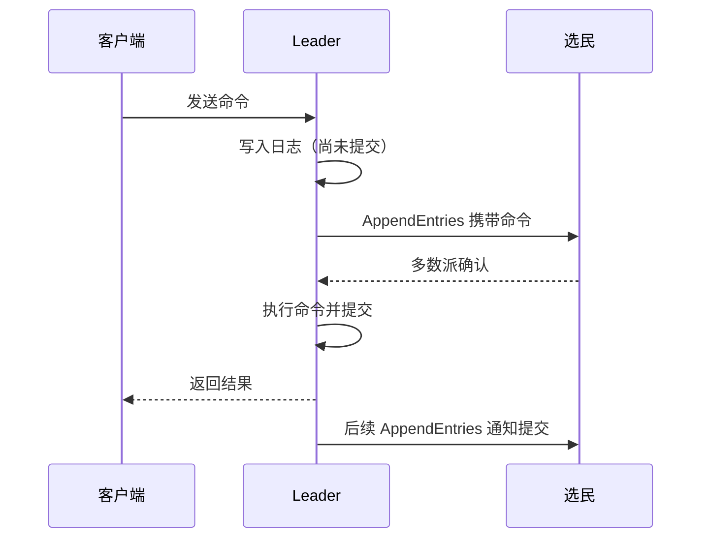

# Raft 算法：执行操作（日志复制）

面试题：Leader 选出之后，客户端的写请求怎么在集群里达成一致？

选举部分讲完了，这篇讲 Raft 的第二部分：执行操作。核心就一句话：先记录日志，多数派通过后才执行命令。模拟器把每一步都用虚线框和实线框标得清清楚楚，面试就按这个流程讲。

## 先给结论

- 执行操作一定发生在选出 Leader 之后：Raft 要求客户端只能跟 Leader 进行增删改的通信。
- 整个流程分两小部分：先记录日志，多数派通过之后，才执行具体的增删改命令（也就是提交），然后才能向客户端返回响应。
- 日志条目在 Leader 上先呈虚线框（只记录未提交），多数派确认后变实线框（已提交）；过半即提交，不用等所有节点。
- Leader 提交后，还要通过后续的 `AppendEntries` 请求通知 Follower 提交；Follower 宕机不缺数据，重启后 Leader 会把缺失的日志陆续补齐。

## 深入细节：跟着模拟器走一遍

前提先说清楚：客户端只能跟 Leader 通信，所以一定是选好了 Leader，客户端才能执行操作。整个执行操作又可以分成两个小部分：第一个部分是记录日志，日志记好了、多数派通过了，才能执行具体的增删改命令；等命令执行完（也可以叫做提交以后），就可以向客户端返回响应。

具体流程：

1. **客户端把命令发给 Leader。** 点下 request，就相当于要执行操作了。这时 Leader 那里出现一个虚线框框住的日志，用带颜色的框表示记录日志。注意框是虚线的，表示它只记录了日志，但是还没有执行命令。
2. **Leader 向所有 Follower 发送 `AppendEntries` 请求。** 这个请求前面说过有两个作用：一个作用是用来保活的，证明 Leader 自己还活着；另一个作用就是用来执行操作，它会把要执行的操作随着这个请求发给每一个选民。
3. **Follower 也记录日志。** 可以看到选民这边也变成了虚线框，意思就是选民这边日志也进行了记录，但同样注意，还没有确认。
4. **多数派通过即提交。** 选民的操作响应回到 Leader 以后，多数派通过（5 个节点的集群里，两个响应返回，加上 Leader 自己，共三个，就过了半数），Leader 就认为这个日志有效，日志从虚线框变成实线框。到这一步，就可以去执行增删改命令了，这个操作就算是提交了。提交完成了，不用等待更多的响应返回，就可以直接向客户端返回这次操作的结果，认为成功了。
5. **再通知 Follower 提交。** 注意这个时候 Leader 的日志确认了、操作也执行了，但这些选民还是虚线框，日志还没有确认，处于未确认状态。所以接下来还需要再来一次 `AppendEntries` 请求，告诉这些选民：你们的日志也可以生效了，可以执行接下来的增删改操作。这次之后，所有的框都变成了实线框，日志加操作执行完成。
6. **日志序号从 1 开始连续递增。** 第一次执行的操作记录在序号 1 里，下一次再执行就从序号 2 开始，再下一个是序号 3。

**Follower 挂掉的场景。** 如果挂掉一个选民，再发操作的时候，它的日志就不完整了。多发几个，它缺了两份日志。但这其实没关系：一旦这个选民恢复，随着 Leader 不断向选民发送 `AppendEntries` 请求，缺失的日志会在后续的请求里陆续补齐。模拟器里 S5、S2、S3 都挂过，重启之后它们的日志又被同步了回来。Leader 会不断尝试，不会放弃。

幻灯片上对这个过程总结了四点：① 客户端发送命令到 Leader，Leader 将命令写入日志；② Leader 向所有选民发送 `AppendEntries` 请求，把日志携带的操作发送给选民；③ 多数派通过后，意味着日志已经生效，由 Leader 来执行命令，这次操作成功、可以提交，由 Leader 向客户端返回结果；④ 在后续的 `AppendEntries` 请求中继续通知选民，选民也执行命令（提交），大家数据一致；如果选民挂了，Leader 会不断尝试，待选民重启，将缺失的日志陆续补齐。

## 面试怎么答

按「记录、复制、过半、提交、通知、补洞」的顺序讲：客户端只跟 Leader 通信；Leader 先把命令写入自己的日志（未提交状态），然后通过 `AppendEntries` 把操作复制给所有 Follower；多数派确认后，Leader 提交并响应客户端，之后再用后续的 `AppendEntries` 通知 Follower 提交；Follower 掉线不影响已提交日志，重启后由 Leader 补齐缺失日志。

常见追问：

- **问**：为什么多数派通过就能提交，不用等全部节点？
  **答**：只要多数派日志一致，这次操作就生效了；少数派后续可以通过 `AppendEntries` 补齐，可用性和一致性都能兼顾。
- **问**：日志序号有什么用？
  **答**：序号从 1 开始连续递增，标识操作的先后顺序，也是各节点比对日志完整性、补齐缺失日志的依据。

## 常见误区

- **误区一**：以为所有节点都确认才算提交。多数派通过即可提交，Leader 先响应客户端，Follower 的确认在后续的 `AppendEntries` 里补。
- **误区二**：以为 Follower 挂了数据就丢。已提交的日志有 Leader 持续同步，Follower 重启后会补齐，数据不丢。
