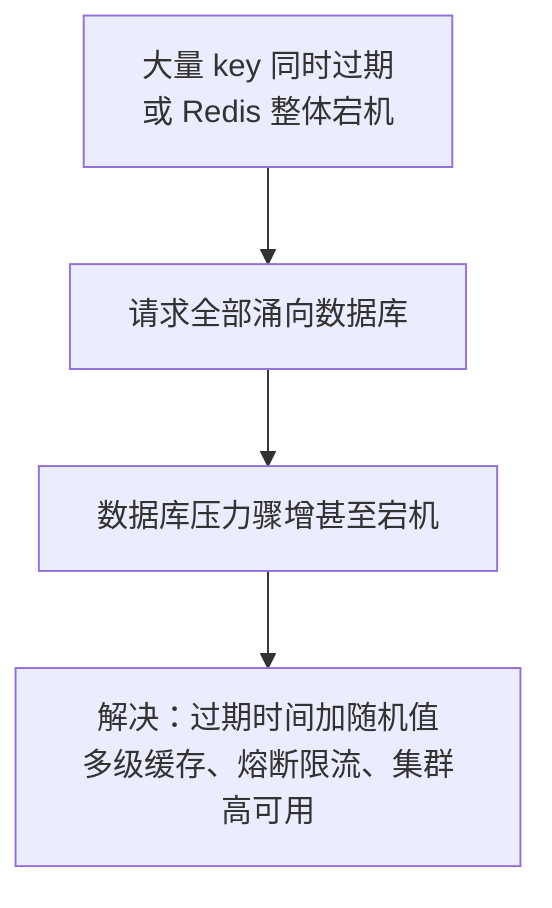

# Redis 缓存雪崩

面试题：什么是缓存雪崩？怎么解决？

缓存雪崩和上篇的缓存击穿只差一个字，坑法完全不同：击穿是一个热点 key 过期，雪崩是大量 key 一起出事。这篇把它拆成两种情况分开治，并且回答一个面试高频追问：击穿的加锁方案，为什么救不了雪崩。

## 先给结论

- 缓存雪崩分两种情况：① 大量 key 设置了相同的过期时间，集体失效，请求全部进入数据库，把数据库压垮；② Redis 服务器宕机，缓存保护没了，大量请求直接进数据库。
- 加锁解决不了雪崩：锁只能加在当前访问的单个或少数 key 上，给所有失效的 key 加锁不现实，缓存等于瘫痪。
- 情况一的解法：错开过期时间（加随机值，比如 1 到 5 分钟）；服务降级（暂停非核心查询，返回错误页面或空值）。
- 情况二的解法：高可用集群（主挂从顶，最提倡）；多级缓存（Redis 加本地缓存，复杂度高）；熔断和限流（及时止损，有损）。

## 深入细节：两种情况，分开治

**情况一：大量 key 同时过期。** 由于我们给大量的 key 设置了一个相同的过期时间，比如这些 key 都设置在 12 点过期。一旦到达过期的时间点，这些 key 就会集体失效，访问它们的请求全部进入数据库，数据库访问量瞬间激增，最终压垮整个数据库。

有人问：上篇讲的加锁方式，能不能解决雪崩？有些面试题案例说缓存雪崩也可以用加锁解决。不行，绝对不行，两个场景不一样。

雪崩是大量的 key 一块儿失效，而加锁只是加在你当前访问的这个 key 上，阻止别的客户端访问同一个 key。你说我给所有失效的 key 都加上锁，那显然不现实：你的访问并发量得有多低？如果给所有 key 都加锁了，缓存也相当于瘫痪了。所以加锁只能是针对一个 key 或者几个 key，有大量 key 同时失效时没办法给这么多 key 同时加锁，要具体情况具体分析。

解法有两个：

1. **错开过期时间。** 把过期时间随机加一个 1 到 5 分钟。比如 K1 是 12 点过期，K2 就不是 12 点过期，是 12 点 01；K3 可能 12 点 05。这样让它们的过期时间错开，就不会造成大量的 key 集体失效。
2. **服务降级。** 如果雪崩现象已经非常严重，可以做一个服务降级：暂停一些非核心数据的缓存查询，也不查数据库，直接返回一个错误页面或者返回一个空值，只要不影响核心业务就可以。这是一种有损方案。

**情况二：Redis 服务器宕机。** Redis 服务器自己挂了，缓存没有保护了，大量请求照样会进入数据库。这种情况有四个思路：

1. **事先预防（最为提倡）。** 搭建一个高可用的 Redis 集群，不能因为一个 Redis 服务器宕机，导致整个应用系统出现雪崩。一旦主 Redis 服务器挂了，用从 Redis 做故障切换顶上去，防止 Redis 宕机引起的雪崩。
2. **多级缓存。** 在 Redis 缓存之外再加一个本地缓存，两个搭配着用；Redis 缓存一旦有问题，本地缓存还可以顶一时。缺点是实现复杂度更高，两个缓存之间的一致性不容易控制，对开发人员的能力要求更高。
3. **熔断（有损）。** 雪崩已经出现的情况下尽量及时止损：通过监控发现了雪崩出现，就暂停缓存的访问，直到高峰期过去、实例恢复了，再让缓存可以访问。暂停期间返回预定义的信息，比如错误页面、空值之类的。
4. **限流（有损）。** 同样通过监控：如果发现数据库这边访问量超过了阈值，就限制访问数据库的请求数，人为控制不让那么多请求一下子打到数据库，避免数据库压力超过极限。

## 面试怎么答

先分类：雪崩分两种，大量 key 集体过期，和 Redis 宕机。再分别给方案：集体过期用错峰过期（随机加 1 到 5 分钟）加服务降级；宕机用高可用集群预防、多级缓存兜底、熔断限流止损。最后主动强调一句：加锁是击穿的解法，治不了雪崩，锁的粒度决定它只能管单个或少数 key。这个点面试官最爱挖坑。

常见追问：

- **问**：缓存击穿、穿透、雪崩的区别？
  **答**：击穿是单个热点 key 过期，缓存本来有；穿透是 key 在数据库中也不存在，请求每次都打到数据库；雪崩是大量 key 同时失效或 Redis 整体宕机。三者的量级和解法完全不同。
- **问**：随机值加多大合适？
  **答**：课程给的范围是 1 到 5 分钟，把集体失效打散到几分钟内，数据库完全承受得住。

## 常见误区

- **误区一**：以为加锁能治雪崩。锁的粒度是单个 key，治不了集体失效，这是击穿和雪崩最容易被混的地方。
- **误区二**：以为熔断限流是首选。它们是有损止损手段；事前预防（高可用集群）和错峰过期才是首选，熔断限流是雪崩已经发生时的补救。
