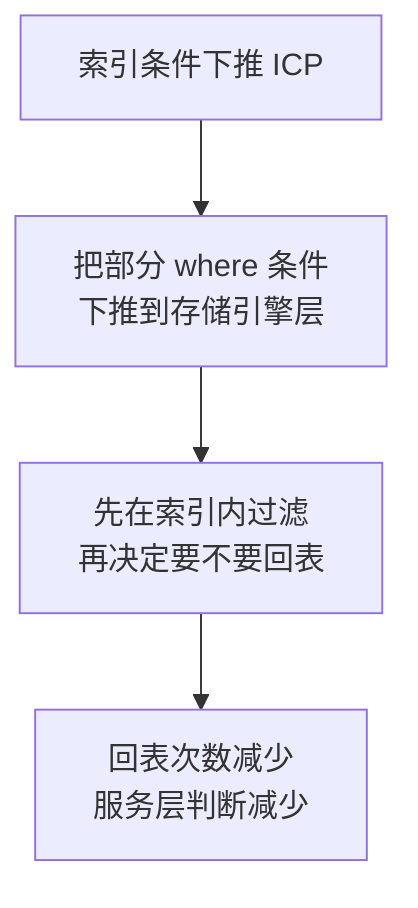

# 索引条件下推：用不上索引的条件，下推到引擎层先过滤

## 面试题考什么

索引失效的问题聊到深处，面试官往往会落到一个具体场景上：表上建了组合索引（省、市、县），执行 `WHERE province = '上海' AND county = '中西区'`，explain 显示 key 用了组合索引，可查询还是要 2 秒多。这时候该答什么？答案是索引条件下推（Index Condition Pushdown，ICP），MySQL 5.6 引入的一个默认优化，专门处理「条件走了索引、查询还是慢」这一类问题。

## 先给结论

索引条件下推把本来要交给 MySQL 服务层逐条判断的查询条件，下推到引擎层先过滤一遍：能用上索引的条件在引擎层执行，用不上索引的条件只对过滤之后剩下的少量记录在服务层判断。同一条 SQL，开启时 0.08 秒返回 23 行，关闭后 2.67 秒，差在服务层要处理的记录数上。判断它有没有生效，看 explain 的 Extra 列有没有 `Using index condition`。



## 是什么：组合索引最左前缀的补充规则

还是用 big_person 表的组合索引（province、city、county）来说事。四条 SQL，条件各不相同：

```sql
explain SELECT * FROM big_person WHERE province = '上海';
explain SELECT * FROM big_person WHERE province = '上海' AND city='嘉兴市';
explain SELECT * FROM big_person WHERE province = '上海' AND city='嘉兴市' AND county='中西区';
explain SELECT * FROM big_person WHERE province = '上海' AND county='中西区';
```

四条的执行计划里，key 都指向了那条组合索引，从「有没有用索引」这个角度讲都没问题。但一条 SQL 有多个条件时，并不是每个条件都能用上索引。

explain 里 key 后面有个 key_len，表示这次查询实际用到的索引字节长度。组合索引每个字段占 67 字节，用到一个字段就是 67，用到两个是 134，三个全用上是 201。前三条对得上：第一条只有省，67；第二条省、市，134；第三条三个字段全上，201。

问题出在第四条：条件里明明有省和县两个，key_len 却只有 67。说明县这个条件根本没走索引，引擎只在索引里用了省的信息。

规则是这样的，它是对最左前缀的补充：多个条件必须按创建索引时从左到右的顺序连续出现，中间不能断。省、市、县齐全没问题，省、市连续也没问题，但省和县中间缺了市，从断开的位置起后面的条件就用不上索引。除了断档，从哪个条件开始出现范围查询，那个条件之后的条件同样用不上索引。

## 为什么需要这个优化

MySQL 做条件判断分两个位置：引擎层和服务层。索引实现在引擎层，服务层没有索引可用，逐条判断的性能很低。

第四条 SQL 里，省的条件走索引、在引擎层执行；县的条件用不上索引，只能交给服务层。MySQL 5.6 之前，服务层要拿县的条件去比对每一条记录，百万级的表就是一百万次比较，非常慢。

5.6 开始的索引条件下推是这么做的：引擎层先用能用上索引的省条件过滤一遍，只把满足省条件的那些记录对应的县条件交给服务层处理。要比较的记录数从百万级降到满足省条件的量级，代价大幅下降。

为什么叫「下推」？服务层在上，引擎层在下，把原本属于上层的判断往下压，所以叫索引条件下推。

## 深入细节：开与关的对比

现在 MySQL 都是 5.6 以上，ICP 默认开启。想看它关掉什么样，可以手动关：

```sql
SET optimizer_switch = 'index_condition_pushdown=off';
```

关掉之后再执行 `SELECT * FROM big_person WHERE province = '上海' AND county='中西区';`，explain 的 Extra 变成 `Using where`，rows 从 1 涨到 59858，实际执行要 2.67 秒。重新打开（默认就是开的），Extra 多出 `Using index condition`，rows 回到 1，同样的查询非常快。

两个细节值得记住：rows 从 59858 变 1，说明 ICP 让优化器估算的需要检查的记录数降了下来；实际耗时从 2.67 秒到 0.08 秒，说明省下的都是服务层逐条比较的开销。

## 面试怎么答

被问到索引条件下推，按四步答：

1. **它是什么**：MySQL 5.6 引入的优化，把无法使用索引的条件下推到引擎层，先利用能走索引的条件过滤，再让服务层处理过滤后的少量记录。
2. **它解决什么**：组合索引中间断档（比如省和县之间缺了市）或者出现范围查询时，后面的条件用不上索引，只能服务层逐条判断的问题。
3. **怎么确认生效**：explain 的 Extra 列出现 `Using index condition`；关闭它用 `SET optimizer_switch = 'index_condition_pushdown=off'`，关闭后 Extra 变成 `Using where`。
4. **怎么判断条件走没走索引**：看 key_len，组合索引每个字段 67 字节，67、134、201 分别对应用到一、二、三个字段；key_len 小于预期就说明有条件是断档之后或用不上的。

追问也多半在这个范围里：ICP 是哪个版本引入的（5.6，默认开启）；它和索引覆盖的区别是什么（索引覆盖是查询的列在二级索引里全能找到，不用回表；ICP 是条件下推，两者可以同时发生）。

## 常见误区

最典型的一个：看到 explain 的 key 列有值，就认为这条 SQL 每个条件都走了索引。key 列只说明整条语句用上了这条索引，具体每个条件用没用上，要看 key_len。这也是上面第四条 SQL 慢的根源：索引是走了，但县的条件在服务层一条条比，没有 ICP 就是全场扫描式的逐条比较。
