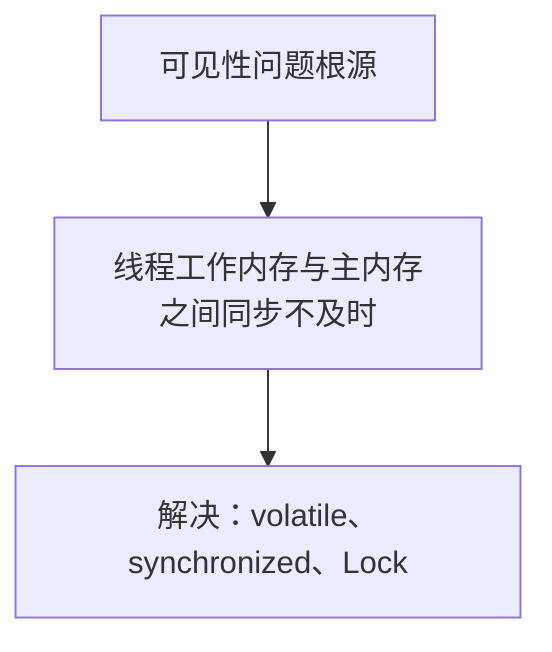

# volatile 为什么能保证可见性：从一次「永远循环」说起

## 面试题考什么

面试问 volatile，一般会问它能不能保证线程安全、它怎么保证可见性。课程里做过一个经典实验：一个线程执行 `while (!stop)` 循环，另一个线程 0.1 秒后把 stop 改成 true，结果这个循环停不下来，程序「永远循环」；给 stop 加上 volatile，程序立刻正常退出。这个现象背后的原因，比「可见性」三个字更值得说清楚。

## 先给结论

这个例子里循环停不下来，根源不是写线程没把新值同步回内存，而是循环体的字节码被 JIT 当成了热点代码，编译优化后的机器码里不再读取这个变量，内存里的新值对循环完全无感。volatile 能解决问题，是因为 JIT 看到变量被 volatile 修饰，就放弃对它所在的代码做这类优化，循环每次都老老实实去内存读最新值。



## 是什么：一次复现

代码结构很简单：

```java
public class ForeverLoop {
    static boolean stop = false; // 非 volatile 变量

    public static void main(String[] args) {
        new Thread(() -> {
            try {
                Thread.sleep(100);
            } catch (InterruptedException e) {
                e.printStackTrace();
            }
            stop = true;
            get().debug("modify stop to true...");
        }).start();

        foo();
    }

    static void foo() {
        int i = 0;
        while (!stop) { // 无法感知 stop 的修改
            i++;
        }
        get().debug("stopped... c:{" + i + "}");
    }
}
```

运行结果：线程把 stop 改成 true 了，循环却一直停不下来。

## 为什么：先排除一个流行但错误的解释

有一种流传很广的解释：CPU0 修改变量时只改了自己缓存里的副本，没有同步到内存，所以 CPU1 读到的永远是旧值。按这个说法，任何其他线程应该也都读不到最新值。

实验可以直接证伪。再加一个线程，让它晚 0.1 秒读 stop 并打印，读到的是 true；再加第二个线程去读，两个读线程都读到了 true。只有那个疯狂循环的线程读不到。说明写线程确实把值同步回了内存，问题不在「没写回」，而在循环本身。

## 深入细节：JIT 把循环改没了

代码最终要交给 CPU 执行，CPU 要到物理内存里读 stop 的值，再决定循环继不继续。麻烦在于这个循环的频率高到夸张：简单测过，0.1 秒能循环一千万次，每次都走一趟内存，一次内存读写几百纳秒，累积起来不是小数目。

JIT（即时编译器）就是这时候介入的，它的职责本来就是对热点字节码做优化，频繁调用的方法、反复执行的循环都算热点代码。循环次数超过几十万次之后，JIT 发现这个循环每次读到的都是 false，于是做了一个很大胆的优化：假定它永远是 false，把原始字节码替换成编译好的机器码，以后直接让 CPU 跑机器码，省掉逐行解释的过程。

问题就出在这。机器码里已经没有「读 stop」这个动作了，另一个线程把内存里的 stop 改成 true，和这段循环再无关系，循环自然停不下来。其他线程的代码没被优化过，照常能读到 true。

这个解释可以用两个实验佐证：

- 加 JVM 参数 `-Xint`，只用解释执行、禁用 JIT。循环正确退出了，0.1 秒跑满一千万次。说明只要不做热点替换，循环就能读到最新值。
- 把修改 stop 的时间缩短，循环次数掉到一万多次，够不着热点阈值，JIT 认为这不是热点代码、不做替换，循环同样能正确停止。

两个办法能跑通，但都不是根本解法。`-Xint` 全局关掉 JIT，C1、C2 编译带来的数倍到上百倍效率提升全没了，为一个变量牺牲整体性能不划算；缩短时间只是碰运气绕开阈值。

根本解法是 volatile：

```java
public class ForeverLoop {
    static volatile boolean stop = false; // 使用 volatile 关键字

    public static void main(String[] args) {
        new Thread(() -> {
            try {
                Thread.sleep(100);
            } catch (InterruptedException e) {
                e.printStackTrace();
            }
            stop = true;
            get().debug("modify stop to true...");
        }).start();

        foo();
    }

    static void foo() {
        int i = 0;
        while (!stop) {
            i++;
        }
        get().debug("stopped... c:{" + i + "}");
    }
}
```

不加任何 JVM 参数，循环正确退出，而且这次足足跑了一亿次。原因就是开头说的：JIT 看到 volatile 就放过这段代码，不做热点替换，循环每次都去内存读 stop 的最新值。从 JMM 的角度讲，volatile 写会刷新到主内存、读从主内存读，并在这两个操作之间建立 happens-before 关系，写线程的修改对后续读一定可见。

## 面试怎么答

这个问题分两层答更稳：

1. **标准机制层**：volatile 保证可见性，靠的是写操作刷新到主内存、读操作从主内存读，配合 happens-before 规则，保证一个线程的写对后续读可见。
2. **实验暴露的优化层**：高频循环会被 JIT 当热点代码优化，编译后的机器码可能不再重复读取变量，这是「永远循环」类问题的直接原因；volatile 修饰的变量会让 JIT 放弃这类优化，所以问题消失。

追问大概率有两个方向。一是「为什么这个场景只加 volatile 不加锁就够了」：因为这里只有可见性诉求，没有任何复合操作，锁能解决但代价更大。二是「那可见性问题是不是 CPU 缓存不同步导致的」：可以用上面的实验回应，其他线程都能读到新值，只有被优化的循环读不到，根因在 JIT 热点替换这一层。

## 常见误区

- 把可见性问题一股脑归给「CPU 缓存副本没同步」，上面多线程读值的实验已经证伪了这条路径。
- 认为关掉 JIT 或者把修改时间调短是正解，前者牺牲整体性能，后者只是碰运气，真正该用的是 volatile。
