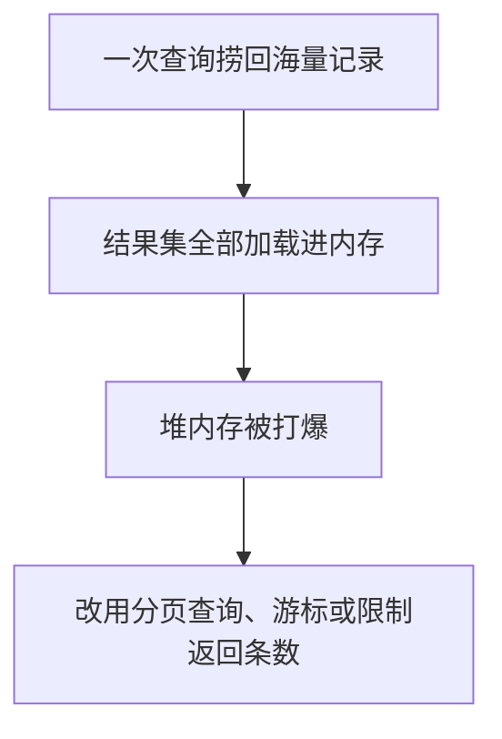

# 一次查询太多数据：百万条记录能把堆打穿

## 面试题考什么

「项目中什么情况下会内存溢出，怎么解决的」这道题，除了误用线程池，出现频率最高的答案就是一次查询返回的数据太多。它可怕的地方在于：本地测试跑几十条数据一切正常，上了生产一条全量查询就能把堆吃掉。这篇把这个场景量化一下，把账算清楚。

## 先给结论

单次查询返回记录过多，会把一个大对象集合一次性压进堆里。按一个典型商品对象 381 字节估算，一百万条记录就是 363MB 左右，十个用户同时查，3GB 内存就没了，服务器堆再大也经不起这么造。预防手段是加条件、加 limit，不要写全量查询的方法，也不要调用别人写的全量查询。



## 是什么：一次商品列表查询

假设一个电商应用要查商品列表，每个商品用 Product 表示，字段有编号、名字、价格和简要描述，列表页这些信息足够：

```java
static public class Product {
    private int id;
    private String name;
    private int price;
    private String desc;
}
```

要估算一个商品对象占多少内存、一个商品集合占多少内存，得用一个工具：JOL。用法很直接，把对象创建好交给 `ClassLayout.parseInstance` 解析，再调 `instanceSize` 拿实例大小。

## 为什么危险：一层层算这笔账

### 第一层：对象自身

直接测，一个 Product 对象自身占 32 字节。

但这 32 字节是不完整的。Product 里有 String 这种引用类型，引用指向的真正对象没算进来，name 和 desc 两个字符串要另算。

### 第二层：字符串对象自身

挑两个典型长度的字符串，一个当商品名字，一个当商品描述，电商平台上这俩都不可能短：

```java
long a = ClassLayout.parseInstance(new Product()).instanceSize();
System.out.println(a); // 输出对象占用内存大小

String name = "联想小新Air14轻薄本 特色香醇15 14英寸全屏学生笔记本电脑(15-113567 16G 512G MX450独显 高色域)";
long b = ClassLayout.parseInstance(name).instanceSize();
System.out.println(b);

String desc = "【全金属全面屏】学生商务办公，全新11代处理器，MX450独显，100%sRGB高色域，指纹识别，快充（更多好货）";
long c = ClassLayout.parseInstance(desc).instanceSize();
System.out.println(c);

// 一个对象占用的内存
long avg = a + b + c + 16 + name.getBytes(StandardCharsets.UTF_8).length + 16 + desc.getBytes(StandardCharsets.UTF_8).length;
System.out.println(avg);

// ArrayList 24, Object[] 16 共 40
System.out.println((1_000_000 * avg + 40) / 1024 / 1024 + "MB");
```

每个 String 对象自身 24 字节。24 字节同样不完整，String 内部的 value 是 byte[]，数组的内存没算在这 24 里。

### 第三层：byte 数组

数组的大小好算，`getBytes` 拿到内容，按 UTF-8 算长度，另外数组对象自身还要 16 字节，用于对象头和长度这些信息。两个字符串的 byte 数组分别占 144 和 157 字节。有个反直觉的点：上面那个字符串明明更长，占的字节反而少，因为它里面英文字符多，下面那个中文字符多，UTF-8 下一个中文三个字节，一个英文一个字节。

### 合计与放大

把对象自身、两个字符串对象、两个 byte 数组加在一起，一个商品对象平均按 381 字节算。不同商品字符串长度不一，这是个平均值。

再看容器：一个 ArrayList 自身 24 字节，内部存元素的 Object[] 数组按 16 字节算，加起来 40 字节，相对商品本身可以忽略。

电商应用没有一百万商品说不过去，就按一百万算：`(1_000_000 * avg + 40) / 1024 / 1024`，结果是 363MB。一次查询，三百多兆没了。估算并发更直观：十个用户同时查，大约 3GB，用不了多少用户就能把服务器内存耗尽。

## 深入细节：两个容易放松警惕的点

第一，全量查询在测试环境是不暴露的。本地数据就几十条上百条，跑起来毫无感觉；同一条方法进了生产，一次返回一百万条，直接出问题。代码没变，变的是数据量。

第二，加了 where 条件也不等于安全。条件有可能失效，比如编码失误导致条件没正确拼接到 SQL 上，查出来的记录数依然可观。所以除了加条件，还要加 limit 限制最多返回的记录数。双保险，别把希望全押在条件上。

真要处理大批量数据，更稳妥的做法是分页查询，或者用流式游标分批拉取、边拉边处理，避免一次性把整个结果集搬进堆里。

## 面试怎么答

答这道题按「场景、量化、预防」三层说：

1. **场景**：一次查询返回数据量太大，大对象集合一次性进堆，导致 OOM。和线程池误用、动态生成类过多并列，是项目里最常见的溢出原因之一。
2. **量化思路**：对象自身大小用 JOL 测，引用类型逐层往下算（对象、字符串、byte 数组），得到单条记录的平均字节数，乘记录数，再乘并发用户数，就能估出一次查询要吃掉多少堆。本例单条 381 字节，百万条 363MB。
3. **预防**：加条件的同时必须加 limit；大批量场景用分页或流式游标；别写全量查询的方法，也别调用别人写的。

追问一般是「怎么定位」：堆 dump 出来看大对象，或者按单条大小乘记录数反推是哪一次查询把堆撑爆的。

## 常见误区

- 认为加了 where 条件就万事大吉，忽略条件可能没拼上，必须再加 limit。
- 拿测试环境的表现推断生产，数据量差几个量级，结论完全不成立。
- 估算对象大小时只算对象自身，漏掉引用指向的字符串和数组，低估好几倍。
