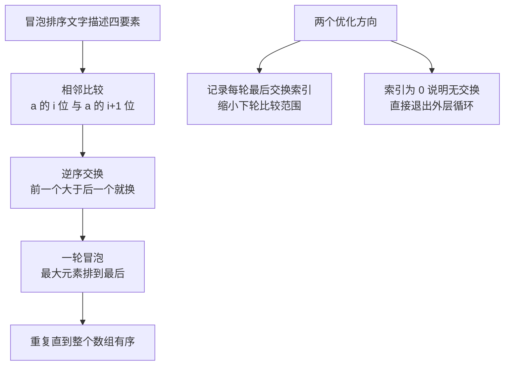

# 冒泡排序总结：文字描述和两个优化方向

## 面试题考什么

冒泡排序的考法不止「写代码」。面试官经常会换一种形式：不让你写，让你用语言描述冒泡排序是怎么做的；或者写完追问怎么优化。这篇把这两块一次说清，文字描述背下来，优化方向说出门道，这题就完整了。

## 先给结论

冒泡排序的文字描述是：依次比较数组中相邻两个元素的大小，如果前一个大于后一个，就交换两个元素；两两都比较完一遍，称为一轮冒泡，一轮的结果是让最大的元素排到最后；重复以上步骤，就能让整个数组有序。优化有两个方向：记下每轮最后一次交换的索引，用它缩小下一轮比较的范围，减少不必要的比较；如果这个索引为 0，说明本轮没有交换、数组已经有序，直接退出外层循环，减少不必要的冒泡轮数。

## 是什么：文字描述

以升序为例，冒泡排序的描述可以这么说：依次比较数组中相邻两个元素的大小，若 `a[i] > a[i+1]`，则交换两个元素，两两都比较一遍称为一轮冒泡，结果是让最大的元素排至最后；重复以上步骤，直到整个数组有序。

这段描述必须熟。面试时的一种问法就是不写代码、只用语言讲算法，能不能在几十秒内把「相邻比较、逆序交换、一轮一个最大值归位、重复到有序」讲清楚，是基本功的体现。

## 为什么这样能排好序

每一轮两两比较加交换，本质上是把当前未排序区间里最大的元素一步步「冒」到最后：大的往后换，一轮下来最大值必然落在区间末尾。n 个元素最多 n 减 1 轮，每个元素归位，数组就有序了。这也是它名字的由来。

## 深入细节：两个优化方向

优化方式有两个方面，都围绕「最后一轮交换的索引」这一个信息。

第一个方向是减少比较次数。每轮冒泡时，记下最后一次交换发生的索引位置，这个索引可以作为下一轮冒泡的比较次数。道理很直观：最后一次交换之后的位置，后面的元素两两相邻都已经是有序的，没必要再比。

第二个方向是减少冒泡轮数。最后一次交换的索引还有一层含义：如果它的取值为 0，说明这一轮根本没有发生交换；没有交换就意味着整个数组已经有序，这时候退出外层循环就行，剩下的轮数全是白跑。

一个索引，同时压掉了比较和轮数两边的浪费，这就是冒泡优化最经典的写法。

## 面试怎么答

先口述文字描述，再补优化，顺序正好是面试的常见节奏：

1. **描述**：相邻两个元素比大小，前大于后就交换；比完一遍是一轮，最大值归位；重复到整个数组有序。
2. **优化一（省比较）**：记录每轮最后一次交换的索引，下一轮只比到这个位置。
3. **优化二（省轮数）**：该索引为 0 说明本轮无交换、数组已有序，退出外层循环。

追问通常往复杂度上引：最好情况下，数组本来就有序，加优化后一轮扫描、无交换即退出，时间复杂度 O(n)；最坏和平均仍是 O(n²)。空间复杂度 O(1)，原地交换，是稳定的排序算法，相等元素的相对位置不会变。

## 常见误区

只答「冒泡就是两两比较交换」就收尾，不提优化。写完代码被追问「还能不能优化」时答不上来，是很常见的失分点；即便不手写，也要能把两个优化方向说清楚。
