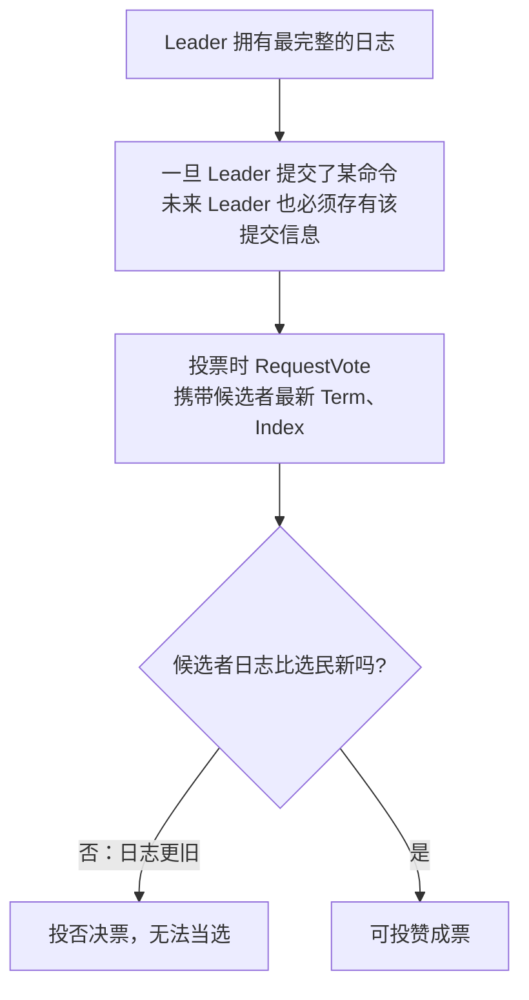

# Raft 保证安全之一：Leader 日志的完整性

## 面试题考什么

Raft 的「保证安全」部分，面试常问两个问题：Leader 凭什么被认为拥有最完整的日志？如果 Leader 挂了，下一任 Leader 怎么保证不丢已提交的命令？这两个问题都指向同一个机制：日志按任期和索引排序，投票时比对候选者的新鲜度，日志不够新的候选者选不上 Leader。

## 先给结论

保证安全分两个方面：一是保证 Leader 的日志是完整的，二是保证选民（Follower）日志与 Leader 一致。本篇讲第一个方面。Leader 被认为拥有最完整的日志；即使当前 Leader 挂了，下一任 Leader 也必须拥有最新最完整的日志，因为 Leader 完成某条命令的提交，意味着这条命令已经被多数派记录并通过，下任 Leader 必然从多数派中产生，也就必然持有这条命令的提交信息。投票时，选民会把候选者随请求发来的最新 Term 和 Index 与自己的比对，候选者的日志还没选民的新，就投否决票。

## 是什么：Leader 完整性的两层含义

第一层：当前的 Leader 被认为拥有最完整的日志，它的日志最全。

第二层更进一层：不光当前 Leader 日志要完整，即使它挂了，下一任 Leader 也得拥有最新最完整的日志。一旦 Leader 完成了某条命令的提交，未来的 Leader 也必须存有该条命令的提交信息。

第二层为什么成立？一个命令被 Leader 标记为已提交，说明它已经被多数派节点记录并且通过了。下任 Leader 一定是从这次多数派里选出来的，这些节点的日志都提交了、都全，所以新 Leader 必然带着这条命令的提交信息，已提交的命令不会丢。

## 为什么：日志怎么排序，投票怎么比

日志按 Term（任期号）和 Index（索引号）排序。索引号每记录一条日志就加一，不断递增且连续。选举时，候选者会把自己最新的 Term 和 Index 随 RequestVote 请求发给选民，选民拿这两个数和自己的最新日志比对：候选者的日志更新才投票，不如自己新就投否决票。Term 的优先级更高，先比 Term，再比 Index。

拿右侧的五节点日志图对照看。图中带颜色的格子里的数字是 Term 号，上方的 1 到 9 是索引号。

假设现任 Leader 挂了，S2 先超时，发起投票请求请其他节点选它当下一任 Leader。它把自己的 Term 和 Index 发给 S1：Term 两边都是 3，但 S2 的最新索引是 7，S1 的最新索引已经到 8。S1 的日志更新，凭什么投 S2？于是投否决票。S2 选不上。

再看 S5。同样假设 Leader 挂了，S5 先超时发起投票请求。它也不行，因为它的最新 Term 才 2，其他节点的 Term 都到 3 了，Term 优先级更高，所有人都会给它投否决票。

而如果是 S3 发起的投票请求，所有人都会投赞成票：它的 Term 最高，索引也最全，拥有最完整的日志。

## 深入细节：完整性是怎么被投票机制守住的

这个例子的价值在于它说明：Leader 不是随便挑一台服务器就能当的，必须挑日志最完整的。投票环节的 Term、Index 比对，就是这道筛选的具体实现。

Term 更高说明经历了更多轮选举、见识过更多已提交的日志；索引更大说明同任期下记录的日志更多。两个数组合起来，等价于「谁更接近已提交的最新状态」。多数派里 Term、Index 最领先的节点当选，已提交命令随多数派一起进入新 Leader 的日志，安全性成立。

## 面试怎么答

被问到 Raft 怎么保证安全，先给整体框架再展开 Leader 这一侧：

1. **两方面**：保证 Leader 日志完整，保证选民日志与 Leader 一致。
2. **完整性**：Leader 被认为拥有最完整日志；Leader 提交过的命令，未来 Leader 也必须持有提交信息，因为已提交意味着多数派记录并通过，新 Leader 必出自多数派。
3. **怎么落实**：日志按 Term 和 Index 排序，RequestVote 携带候选者最新的 Term 和 Index，选民比对后决定投不投；候选者日志不如选民新，投否决票，Term 优先级高于 Index。
4. **举例**：Term 3、Index 7 的候选者敌不过 Term 3、Index 8 的选民；Term 2 的候选者直接出局；Term 最高、日志最全的候选者全票当选。

追问可能往选民侧走（补充或覆盖、AppendEntries 携带上一个日志做什么），那是选民一致性的内容，下一篇专门讲。

## 常见误区

认为选 Leader 只看谁先超时、谁先发起请求。先超时只决定谁先发起投票，当选与否取决于 Term 和 Index 比对，日志不够新，先发起也选不上。
