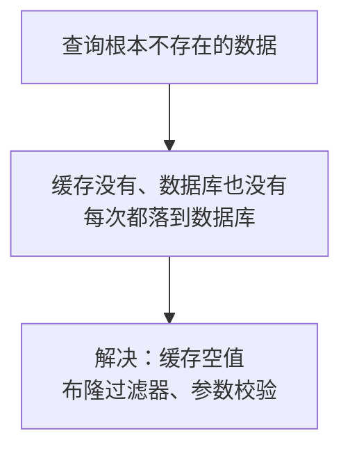

# 缓存穿透：缓存和数据库都没有的 key，每次都被打穿

## 面试题考什么

缓存三兄弟（击穿、雪崩、穿透）里，穿透是面试追问率最高的一个。原因有两个：一是它和击穿、雪崩的差别面试官爱考，二是它最容易被恶意请求利用，解决办法（缓存空值、布隆过滤器）几乎是必答题。这篇把定义、区别、方案一次讲全。

## 先给结论

缓存穿透指一个 key 在缓存和数据库里都不存在，每次访问这个 key 都会穿过缓存打到数据库。它和击穿、雪崩最大的区别是：后两者数据库里是有数据的，只是缓存里暂时缺失，高峰过去能自然恢复；穿透是数据库里根本没有这条记录，想恢复也没有数据可恢复，所以必须主动防。两种解决办法：数据库没有的记录，也在缓存里放一个空值占位；或者上布隆过滤器，提前把不存在的 key 过滤掉。

## 是什么：穿透的定义

定义一句话：如果一个 key 在缓存和数据库都不存在，那么访问这个 key 每次都会进入数据库。

过程走一遍就明白。第一次查询，缓存里没有，去查数据库；按以往的经验，查到了结果会放回缓存，但这个 key 数据库里也没有，什么也没查到，缓存里依然什么都没有。第二次查询来了，缓存里还是没有，继续查数据库。如此往复，每次访问都穿透到数据库，缓存完全失去保护作用。

## 为什么危险：会被恶意利用

正常用户查一个不存在的 key，发现没有就不查了，去查别的 key。恶意请求不一样：它发现某个 key 不存在，越不存在越要查，故意拿这种 key 反复请求，给数据库制造压力，让数据库无法正常工作。这是缓存穿透最典型的危害场景。

它和击穿、雪崩的区别也在这里：

- 击穿是热点 key 失效，雪崩是大量 key 同时失效，共同点是数据库里都有这些数据，只是缓存里暂时缺了。
- 缺了不要紧，高峰期过去，其他线程从数据库把数据查出来放回缓存，缓存又能起作用，所以击穿和雪崩都能自然恢复。
- 穿透的 key 数据库里根本没有记录，没有数据可恢复，不处理就会一直被打。

## 深入细节：两种解决办法

### 办法一：缓存空值

原来的做法是数据库没有的记录就不缓存。为了防穿透，反过来做：数据库里没有的记录，也把这个不存在的 key 关联一个空值放进缓存。这样第一次查询放个空值占位，第二次查询缓存里就有了，缓存重新起到保护作用，只是查出来是空值，业务上再判断一下，把空结果返回给调用方即可。

缺点很明显：这样的 key 没有任何业务意义，数据库里根本没有对应记录，纯粹为了解决穿透多存了一份，白白占用缓存空间。

### 办法二：布隆过滤器

第二种方案是用布隆过滤器。它可以作为 Redis 的 module（相当于插件）加进 Redis，作用是判定某个 key 不存在：如果一个 key 不在布隆过滤器的集合里，它一定能检出这个 key 不存在，然后直接过滤掉，不让请求继续前进到缓存和数据库。

布隆过滤器放在缓存和数据库之前，请求的最前面。key 判定为不存在，直接返回，不再访问缓存和数据库；只有判定存在的请求，才继续走缓存、数据库的流程。

用它有三个要点：

1. 要判定 key 存不存在，需要把所有 key 预先加载到布隆过滤器里，它得先知道有哪些 key，才能在其基础上检查。
2. 布隆过滤器不能删除，所以查询一条已经被删掉的数据，还是会发生穿透。
3. 针对删除问题有其他方案，比如计数布隆过滤器，这里不展开，作为扩展点了解即可。

## 面试怎么答

答这题按「定义、区别、方案」三段走：

1. **定义**：key 在缓存和数据库都不存在，每次访问都打到数据库。
2. **区别**：击穿、雪崩是缓存暂时缺失、数据库有数据、能自然恢复；穿透是数据库没数据、不能自然恢复，还可能被恶意请求利用。
3. **方案**：缓存空值（简单，但白占空间）；布隆过滤器（提前过滤，注意需要预加载全部 key，且不能删除）。

追问一般两个：缓存空值设多久过期时间（短过期时间，平衡空间与一致性，具体时长看业务）；布隆过滤器为什么不能删除（位结构归并多个 hash，多个 key 共享位，无法单独清掉某一个的影响）。

## 常见误区

把穿透和击穿混为一谈，回答时只讲热点 key 失效。两者根因不同：穿透是数据根本不存在，击穿是数据存在但缓存过期，解决方案也完全两套。
