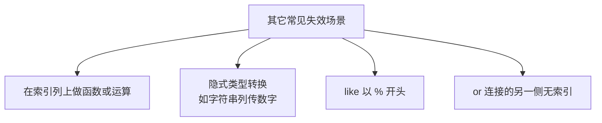

# 索引生效失效的更多例子：覆盖、连接，以及别迷信网上结论

## 面试题考什么

索引生效失效这一块，面试官除了问最左前缀、函数、类型转换这些常见规则，还爱拿几个「网上传言」来试探：OR 一定不走索引吗？IN 一定走索引吗？NOT IN 一定不走索引吗？这些问题的答案都跟版本、数据分布、select 的列有关。这篇把几个典型例子和背后的判断原则讲清楚。

## 先给结论

索引覆盖：查询的列在二级索引里全能拿到，就不需要回表，Extra 出现 `Using index`，性能更好。表连接：连接字段上两边都要建索引。至于网上那些「OR 不走索引」「NOT IN 不走索引」的说法，都不成立，5.7.27 下测出来的是：IN 走索引；NOT IN 在 select * 时走全表，但在发生索引覆盖时也走索引；OR 在主键字段上走主键索引，在多个列上可以走索引合并。唯一靠谱的判断标准是 explain 的实际输出，也就是优化器的结果。



## 是什么：索引覆盖

先复习 MySQL InnoDB 的两种索引。主键索引也叫聚簇索引，根据主键的值建立，叶子节点上包含除主键外其他所有字段的信息。二级索引根据所选列的值建立，叶子节点上除了该列的值，还包含主键的值。

对比这两条 SQL：

```sql
explain SELECT * FROM big_person WHERE province = '上海' AND city = '宜兰县' AND county = '中西区';
explain SELECT id,province,city,county FROM big_person WHERE province = '上海' AND city = '宜兰县' AND county = '中西区';
```

条件完全一样，都是省市县，都会走之前建的那条组合索引（它属于二级索引）。区别在于第一条是 `SELECT *`，要查所有字段；第二条只查 id、province、city、county。

第二条更快。因为省市县组合索引里这些信息全都有：省市县不用说，叶子节点上还有主键值 id。四个列的信息在二级索引里就全拿到了，不用再回到主键索引去找其他列。

第一条不行。`SELECT *` 显然是想拿别的列，二级索引里没有，只能拿着二级索引里的主键值回到主键索引再查一次，等于走了两次索引。这种在二级索引就能找到所有信息、不用回表做第二次查询的场景，就叫索引覆盖。

看执行计划也能分辨：两条都走了组合索引，区别在 Extra 列。第二条有 `Using index`，说明发生了索引覆盖，只在二级索引里就找到了需要的信息；第一条没有这个信息，说明多了一次回表查询。以后看执行计划，Extra 里出现 `Using index`，就说明发生了索引覆盖。

## 为什么：表连接要建索引

表连接的场景记住一个结论：需要在连接字段上建立索引，两张表作为连接的那个字段都得建。如果连接字段上没有索引，优化器会选一个比较糟糕的连接算法，性能相对较低；建了索引之后，表连接的性能也会得到提升。

## 深入细节：三个「别迷信」的例子

先在 first_name 上建个单列索引：

```sql
create index first_idx on big_person(first_name);
```

**例子一：同样的范围条件，走不走索引看数据分布。**

```sql
SELECT * FROM big_person WHERE first_name > 'Jenni';
SELECT * FROM big_person WHERE first_name > 'Willia';
```

两条看起来条件形式一模一样，实际行为不同：`> 'Jenni'` 不会走索引，`> 'Willia'` 会走。原因是走不走索引跟实际记录数有关系：大于 Jenni 的人名在 100 万条里占的比重很大，优化器认为就算走索引也提升不了效率，索性不走；大于 Willia 的人名占比小，属于少量记录，于是用上索引。所以不能把索引使用想简单了，它和数据分布直接相关。

**例子二：OR 不是一定不走索引。**

```sql
explain select * from big_person where id = 1 or id = 190839;
explain select * from big_person where first_name = 'David' or last_name = 'Thomas';
```

第一条走索引，走的是主键索引。第二条也走，而且两个索引都走了：first_name 命中新建的 first_idx，last_name 命中那条 last_name 在前的组合索引（符合最左前缀），执行计划里是两个索引合并的策略。所以「只要有 OR 索引就失效」的说法不成立。

**例子三：IN 与 NOT IN。**

```sql
explain select * from big_person where first_name in ('Mark', 'Kevin', 'David');
explain select * from big_person where first_name not in ('Mark', 'Kevin', 'David');
```

IN 走了索引。NOT IN 在 `select *` 的情况下没走索引。但注意 select 子句也会影响结果：如果不取全部列，而是取二级索引里就有的字段，发生了索引覆盖，NOT IN 也会走索引。所以 NOT IN 要分情况，发生索引覆盖时会走，没有覆盖时确实不走。

三个例子都在说同一件事：版本、数据分布、查询的列都会影响优化器的选择，不能想当然。以上实验基于 MySQL 5.7.27，查看版本用 `select @@version;`。像 `!=`、`is null`、`is not null` 这些操作符用不用索引，也都跟版本、实际数据有关，最终以优化器的结果为准，也就是以 explain 的结果为准。

## 面试怎么答

按「规则 + 反例 + 原则」三层答：

1. **索引覆盖**：查询列在二级索引里全有就不回表，Extra 显示 `Using index`，这是能主动设计的优化点；`SELECT *` 往往拿不到这个好处。
2. **连接字段建索引**：两张表的连接字段都要建，否则优化器选的连接算法很糟糕。
3. **别背结论**：OR、NOT IN 用不用索引都分情况，跟 MySQL 版本、数据分布、是否覆盖有关；判断依据是 explain，不是网上的说法。

追问方向一般是「怎么判断一条 SQL 有没有走索引」：看 key、key_len、rows，最重要的是看 Extra 里的 `Using index`、`Using index condition`、`Using where`、`Using sort_union` 这些信息。

## 常见误区

把网上的结论当定理背。课程里专门做过这组实验，`OR 不走索引`、`NOT IN 不走索引` 在 5.7.27 下都被推翻了。真正该背的是方法：改完 SQL 就 explain，以优化器的结果为准。
