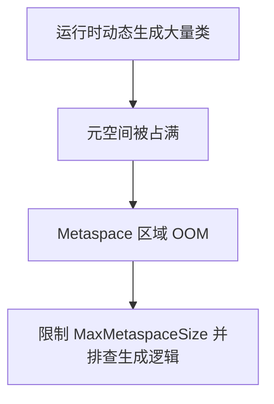

# 动态生成类太多：元空间也会被撑爆

## 面试题考什么

回答「项目中什么情况下会内存溢出」这道题，前三个常答的是误用线程池、一次查询数据太多、动态生成类过多。前两个是堆的问题，第三个落在元空间。这个场景的真实来源是 Groovy、动态代理、jsp 这类会运行时生成类的技术，面试里说出来很有说服力，因为它是真的能在生产上遇到的坑。

## 先给结论

每次执行脚本都会动态生成一个类，这些类由 GroovyShell 自己的类加载器加载；只要类加载器还在，类就不能卸载，元空间的内存就释放不掉。把 GroovyShell 做成静态变量，生命周期长得跟类一样，类加载器永远回收不了，元空间越用越少，最终 OutOfMemoryError: Metaspace。解决思路是缩短这个对象的生命周期，别把它做成静态变量，让它在每次循环后可以被回收，随之类加载器和动态生成的类一起被卸载。



## 是什么：一段会撑爆元空间的脚本调用

实际开发里经常会用到第三方脚本语言，比如 Groovy，写一个 Groovy 脚本，再让 Java 代码去调用它。演示代码如下：

```java
public class TestOOMTooManyClass {
    static GroovyShell shell = new GroovyShell();
    public static void main(String[] args) {
        AtomicInteger c = new AtomicInteger();
        while (true) {
            try (FileReader reader = new FileReader("script")) {
                shell.evaluate(reader);
                System.out.println(c.incrementAndGet());
            } catch (IOException e) {
                e.printStackTrace();
            }
        }
    }
}
```

先创建一个 GroovyShell 对象，然后不断执行脚本：用字符流把 script 文件的内容读进来，丢给 GroovyShell 的 evaluate 方法执行。为了让问题尽早暴露，给 JVM 加上限制元空间上限的参数（`-XX:MaxMetaspaceSize=24m`），再加个计数器打印执行次数。

跑起来之后，大约一千两百多次的时候出现了 OutOfMemoryError，错误信息指向的正是 Metaspace。

GroovyShell 的构造过程也可以顺手看一眼：

```java
public GroovyShell() { this(null, new Binding()); }
public GroovyShell(ClassLoader parent, Binding binding) { this(parent, binding, CompilerConfiguration.DEFAULT); }
public GroovyShell(ClassLoader parent, Binding binding, final CompilerConfiguration config) {
    if (binding == null) {
        // ... 构造函数内部逻辑 ...
    }
}
```

## 为什么：类不卸载，元空间就不释放

GroovyShell 内部有一个类加载器，专门用来加载运行期间执行脚本时动态生成的类。每次调用 evaluate 执行脚本，它都会动态生成一个类，这个类主要是为执行脚本生成的。这些类不是系统类加载器或应用程序类加载器加载的，而是 Groovy 自己编写的类加载器加载的。

关键在于类的卸载条件很苛刻：类加载器、类本身、类的实例对象，三者全部都不再使用，元空间占用的内存才会释放。只要类加载器还在，类就在，类不能卸载，元空间就释放不掉。

这个例子正好卡在这里。每循环一次，新生成的类其实就已经不再使用了，但 GroovyShell 这个对象被做成了静态变量，静态变量的生命周期很长，相当于跟类对象同生共死，垃圾回收回收不了它。对象回收不了，它内部的成员变量（也就是那个类加载器）自然也回收不了，类加载器回收不了，元空间的内存就怎么都释放不掉。于是元空间越来越少，直到溢出。

## 深入细节：缩短生命周期就能解决

针对这个例子，解决办法很直接：让 GroovyShell 这个对象的生命周期不要这么长，不要做成静态变量，改成在循环里作为局部变量创建。局部变量意味着每循环完一次，这个对象不再使用，需要内存时它就能被回收；对象回收了，它内部的成员变量（类加载器）以及类加载器中动态生成的那些 class 也都能被回收；类加载器和类都完成回收，元空间的内存就释放出来了。

改完之后跑一次，顺手开个 JConsole 连上去，用图形界面观察元空间的内存占用。可以看到元空间一度占到 23MB 多、接近上限，但一旦内存不够就触发了一次回收，类被卸载，元空间的占用一下子掉下来。整个过程是不断波动的，但不再耗尽：内存不够时类卸载触发元空间释放。循环跑到七八千次也没出现内存不足。

## 面试怎么答

按「场景、根因、解法」三段答：

1. **场景**：项目里用了会动态生成类的技术（Groovy、动态代理、jsp 等），运行一百多万次到几千次后报 OutOfMemoryError: Metaspace。
2. **根因**：每次执行动态生成一个类，类由自定义类加载器加载；类加载器还活着，类就不能卸载，元空间无法释放；把入口对象做成静态变量，等于让类加载器永久存活。
3. **解法**：缩短生命周期，别用静态变量持有这类对象，让对象、类加载器、类三者能一起被回收；必要时调大 `-XX:MaxMetaspaceSize`，但那只是延缓，不是根治。

补充一点会加分的判断：看错误信息区分是哪块内存出的问题。堆溢出和元空间溢出的排查路径完全不同，元空间溢出要先查有没有类在持续生成。

## 常见误区

看到 OutOfMemoryError 就认定是堆不够，直接加堆内存。这次的错误信息指向 Metaspace，加堆一点用都没有；反过来，误把元空间溢出当堆溢出处理，会白白浪费一轮排查。
