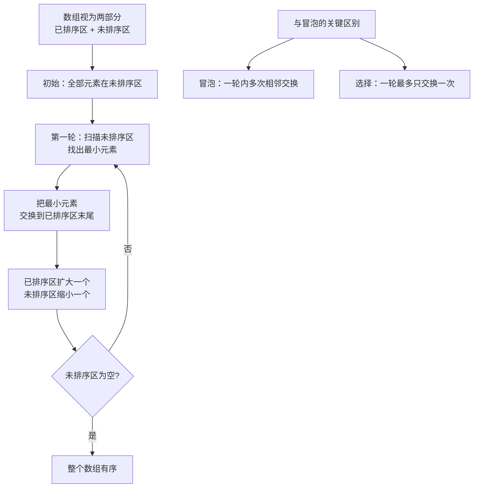

# 选择排序演示：每一轮挑出最小的放前面

## 面试题考什么

冒泡讲完，面试官常常顺手再问一句：还有哪些 O(n²) 的排序，说说选择排序的思路。选择排序的考法和冒泡一样有两类：一类是让你写代码，另一类是让你用语言描述过程。这篇只讲思路和演示，把每一轮「挑最小值、交换到已排序部分」的动作说清楚，代码是下一篇的内容。

## 先给结论

选择排序把整个数组视为两个部分：已排序部分和未排序部分，一开始所有元素都在未排序部分里。每一轮从未排序部分中找出最小值的元素，把它交换到已排序部分中；不断重复这个过程，最终数组就有序。n 个元素需要经历 n 减 1 次选择，第八轮之后剩下的那个元素位置自然固定。



## 是什么：思路拆解

选择排序的思路可以拆成三步循环：

1. 把数组看成已排序和未排序两部分，初始时全部元素都在未排序部分。
2. 每一轮在未排序部分里从头扫一遍，找出最小值的元素。
3. 把这个最小元素交换到已排序部分的末尾（也就是当前轮次对应的位置）。

重复上面这三步，已排序部分不断扩大，未排序部分不断缩小，直到未排序部分为空，整个数组有序。

它和冒泡的区别一眼可见：冒泡靠相邻元素不断交换把最大值推到末尾，一轮内部交换很多次；选择排序一轮只做一次交换，把找到的最小值换到该在的位置。

## 为什么：跟着演示走一遍

用初始数组 `[5, 3, 7, 2, 1, 9, 8, 4]` 走一遍。

**第一轮**：所有元素都在未排序部分。先假定第一个元素 5 是最小的，跟后面的元素比：5 跟 3 比，3 更小，把最小元素改成 3；3 跟 7 比，还是 3 小；3 跟 2 比，2 更小，改成 2；2 跟 1 比，1 更小，改成 1；1 跟 9、跟 8、跟 4 比，都是 1 小。比完一圈，最小值是 1。把 1 交换到索引 0 的位置，它进入已排序部分。此时数组变成 `[1, 3, 7, 2, 5, 9, 8, 4]`，索引 1 往后仍然属于未排序部分。

**第二轮**：在剩余的未排序部分里再找最小元素。先假定 3 最小，跟 7 比还是 3 小；跟 2 比，2 更小，改成 2；2 跟 5 比、跟 9 比、跟 8 比、跟 4 比，都是 2 小。这一轮的最小值是 2，把它交换到索引 1 的位置，已排序部分扩大到两个元素。数组变成 `[1, 2, 7, 3, 5, 9, 8, 4]`。

**后续轮次**：按同样的方式继续。第三轮选出 3，第四轮选出 4，第五轮选出 5，第六轮选出 7，第七轮选出 8。第七轮把 8 选中之后，9 的位置相对也就固定了，不需要再比。整个数组 8 个元素，经历 7 次选择（元素个数减一）就达到有序。

## 深入细节：两个容易忽略的点

第一，每轮的比较范围从「当前轮次的起始位置」开始，到末尾结束，比完一轮就确定一个位置。所以比较次数是固定的：无论数组原来长什么样，第 k 轮都要在剩下的 n 减 k 个元素里扫一遍，总比较次数固定为 n(n-1)/2。这是它和冒泡最大的差异，冒泡加了优化可以在接近有序时提前退出，选择排序没有这个优化空间。

第二，交换次数最多是 n 减 1 次，比冒泡少得多。如果最小元素本来就在当前位置，这轮甚至不需要真交换（代码里加个判断跳过即可，课程演示里第五轮、第七轮就是这种情况）。

代码写出来就是这样：

```java
private static void selection(int[] a) {
    for (int i = 0; i < a.length - 1; i++) {
        int s = i;                  // 假定 i 位置是最小值索引
        for (int j = s + 1; j < a.length; j++) {
            if (a[s] > a[j]) {       // 发现更小的，更新 s
                s = j;
            }
        }
        if (s != i) {
            swap(a, s, i);          // 一轮最多只交换一次
        }
        System.out.println(Arrays.toString(a));
    }
}
```

## 面试怎么答

被要求描述选择排序，按四句说完：

1. 数组分成已排序和未排序两部分，初始全在未排序部分。
2. 每轮从未排序部分找出最小元素。
3. 把它交换到已排序部分的末尾。
4. 重复 n 减 1 轮，数组有序。

追问一般落在复杂度上：比较次数固定 n(n-1)/2，时间复杂度最好、最坏、平均都是 O(n²)；最多交换 n 减 1 次；空间复杂度 O(1)，原地排序。稳定性这一点要如实说：选择排序通常是不稳定的，因为交换动作会把前面的元素直接换到后面，相等元素的相对位置可能被打乱（比如 `[5, 5, 2]` 第一轮把 2 换到首位，两个 5 的相对次序就变了）。

## 常见误区

把选择排序和冒泡排序混为一谈，答成了「相邻比较交换」。区分点很简单：冒泡比的是相邻两个元素、一轮可以交换很多次；选择排序比的是当前元素与已记录的最小值、一轮最多交换一次。

## 课件配套可视化 Demo

> 本算法的交互式可视化页面已随本系列一并打包：[demos/day01_selection_sort.html](demos/day01_selection_sort.html)（纯 Canvas 实现，无需任何外部依赖，直接用浏览器打开即可）。

页面用柱状图展示每轮在未排序区中找出最小值，并与未排序区首位交换的过程。本系列 108–122 选择排序博客（实现、与冒泡对比）可用同一页面对照。
