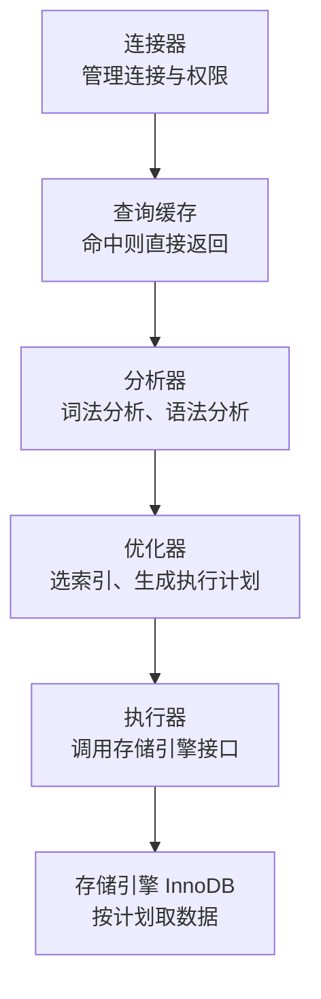
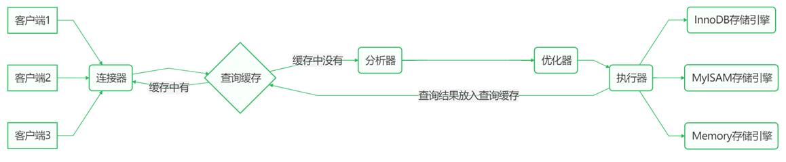

# 一条查询 SQL 在 MySQL 里是怎么跑完的

## 面试题考什么

「执行一条 `select * from user where id = 1` 发生了什么」是考察 MySQL 整体架构的经典题。它不考某个具体知识点，考的是你能不能把从客户端到存储引擎这条链路完整说出来。答不出来的常见原因是只记得「走索引」，说不清索引之前和之后各有哪些组件。

## 先给结论

一条查询 SQL 的执行流程是：客户端 → 连接器（建立连接、检查权限、控制超时）→ 查询缓存（命中直接返回，MySQL 8.0 已移除）→ 分析器（词法、语法分析）→ 优化器（选索引、决定连接顺序）→ 执行器（按存储引擎类型调接口）→ 存储引擎（真正读写数据、实现索引和表）→ 返回结果，并把 SQL 作为键、结果作为值存入查询缓存。

## 是什么：客户端与服务器的分界

MySQL 可以看成两大部分：客户端和服务器。客户端有命令行客户端、图形界面客户端，也可以是 Java 的 JDBC 客户端。客户端要执行 SQL，必须先连上服务器，负责连接的是服务器这边的连接器组件。

连接器的职责有三项：

1. 建立客户端与服务器之间的连接。
2. 检查权限，主要是看这个数据库用户能不能登录 MySQL 数据库。
3. 控制连接超时。不能连着什么都不干白占服务器资源，超时时间由 MySQL 的 `wait_timeout` 参数控制，默认是 8 小时。

## 为什么：中间每一层各干什么

### 查询缓存

连接建立好之后，先到 MySQL 的查询缓存里看这条 SQL 有没有对应的查询结果。每次查询之后，MySQL 会把 SQL 作为键、查询结果作为值，以键值对的方式存入查询缓存。命中就直接通过连接器返回给客户端，没命中才继续后面的流程。

这个组件用处不大。只做查询时还有些用处，一旦做了修改操作，比如对 user 表执行 insert、update、delete，查询缓存就会失效；而且不管增删改几条记录，都是以表为单位让这张表所有相关的缓存信息全部失效，粒度太粗。所以 MySQL 8.0 之后这个组件直接被去掉了，5.6、5.7 里还有。

### 分析器

缓存里没有，就先对 SQL 做词法分析，再做语法分析。词法语法都没问题才继续往下走。

### 优化器

优化器做的事前面其实一直在用，内部逻辑和 explain 类似：分析这条 SQL 能不能用索引；如果有表连接，决定表的连接次序、哪个表是驱动表等等，总之做一系列优化。

### 执行器

优化结果交给执行器去真正执行。执行器会根据存储引擎的类型去调用存储引擎的接口。MySQL 支持多种存储引擎，会根据表的类型选择不同的引擎，比如 InnoDB、MyISAM、Memory 等等，执行器按类型调用各自的接口。

### 存储引擎

存储引擎这边才真正到数据文件里去读数据。索引和表都是在这一层实现的。就这条 SQL 而言，id 应该是 user 表的主键，所以会走主键索引，根据主键值找到叶子节点上相应的记录。

记录找到之后，由执行器调用存储引擎接口拿到结果返回，同时把 SQL 作为键、结果作为值存入查询缓存，一次查询的完整流程就走完了。

## 深入细节：这条链路里最容易被追问的两点

第一点是权限检查的位置。连接器负责的是「登录权限」，也就是能不能连上数据库；执行器阶段还有一次权限校验，判断你对这张表有没有查询权限，两次不一样。

第二点是「存储引擎是可插拔的」。执行器不自己去读数据文件，它只按接口规范调用引擎，索引的实现、表的实现都在引擎层。这也解释了为什么 InnoDB 和 MyISAM 在索引结构、事务支持上差异那么大，却能挂在同一套 MySQL 服务层之下。

## 面试怎么答

按链路顺序一口气说完，别跳步：

1. 客户端发起请求，先经过连接器建立连接、检查权限，超时由 `wait_timeout` 控制，默认 8 小时。
2. 查查询缓存，命中直接返回；8.0 之后这个组件已移除，因为修改操作会以表为单位让缓存全部失效。
3. 分析器做词法、语法分析。
4. 优化器决定用哪个索引、表的连接顺序，生成执行计划。
5. 执行器根据存储引擎类型调用引擎接口。
6. 存储引擎真正读写数据，索引和表在这一层实现；本例 id 是主键，走主键索引定位叶子节点上的记录。
7. 结果返回并写入查询缓存。

追问一般是查询缓存为什么被移除（失效粒度是整表，写多读少的场景几乎没有收益），以及连接器、执行器各自的权限检查有什么区别。

## 常见误区

把「走索引」当成流程的全部。索引只是优化器和存储引擎这两步里的事，连接器、分析器、执行器各自都有职责，少了任何一环这条链路都不完整。另外别忘了 8.0 之后查询缓存已经不存在，答流程时还带着它会被认为是按老版本背的。

## 课件配图
> 以下配图取自阶段七课件对应讲义，与上文讲解一一对应，可作为图文对照辅助理解。
**查询语句执行流程**（课件讲义图示）

