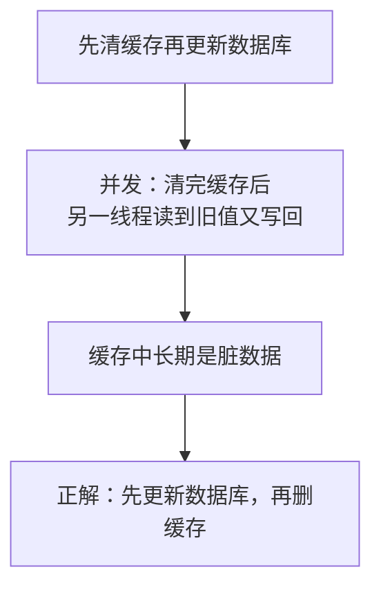

# 缓存一致性：为什么必须先更新库再删缓存

## 面试题考什么

「缓存和数据库怎么保证一致性」是后端面试的高频题，而且一定会有追问：更新的时候，先操作数据库还是先操作缓存？为什么？这一篇先把结论立住，并用「先清缓存再更新库」的反例把原因讲透。

## 先给结论

使用旁路缓存（Cache Aside）策略时，修改和删除数据必须先更新数据库，再删缓存。如果反过来先清缓存再更新库，即使两步都执行成功，也会出现缓存里是旧值、数据库里是新值的不一致，而且后续所有查询都会一直读到旧数据。

## 是什么：旁路缓存的规则

先界定一下问题：这里说的缓存一致性，指缓存中的数据与数据库中的数据二者之间的一致性。

旁路缓存（Cache Aside）是一种使用缓存的策略，平时大家用缓存的方式其实就是按它来的，只是可能没听过这个名词。它的规则分两类：

**查询时的规则**：先读缓存；命中就直接返回；缺失就查数据库，把查询结果放入缓存，再返回。也就是说，由查询操作把数据库的数据同步到缓存里。

**增删改的规则**：新增数据直接存数据库，不用改缓存，因为将来查询时会顺带把新数据查出来放进缓存；修改和删除则要多做一件事，就是把缓存的数据清掉，否则修改前的旧数据会一直被查到。

## 为什么：清缓存和更新库的顺序不能反

修改、删除既得更新库又得清缓存，这两步谁先谁后？必须先更新库，再删缓存。

反过来会出事。举个反例：假设先清缓存再更新库，有两个客户端，A 做查询，B 做更新，顺序如下：

1. B 先清除缓存。
2. A 在缓存被清空之后执行了一次查询数据库的操作，此时 B 的更新还没执行，A 查到的是旧数据 x=1。
3. A 把查到的旧数据放入缓存，缓存里存的是 x=1。
4. B 这才把新数据存入数据库，数据库里变成 x=2。
5. 后续查询一律先查缓存，缓存里已经有这条数据了，所以查到的永远是 x=1 这个旧值。

结果就是：缓存里是旧的 x=1，数据库里是新的 x=2，二者不一致，而且后续查询一直拿到旧值。

关键在第 2 步。清缓存和存库不是原子操作，中间可能被别的指令插队。A 的查询正好插在清空缓存之后、更新数据库之前这个窗口里，它把旧值读出来又写回了缓存，等于 B 刚清掉的缓存又被脏数据填回去了。

## 深入细节：为什么先更新库能规避这个问题

先更新库再删缓存时，插队窗口依然存在，但性质变了：即使查询在更新库之前读到旧值，它写回缓存的动作发生在删缓存之前，之后删缓存会把这条数据清掉，下一次查询就得回源数据库拿新值。最坏情况是短暂读到旧值，不会像先清缓存那样留下一个永久性的脏数据。

换句话说，先清缓存那个顺序的问题是「把旧值写回缓存」这个动作发生在「清缓存」之后，删缓存已经执行完了，没人再帮你清理；而先更新库的顺序里，删缓存是最后一步，它总能兜住底。

## 面试怎么答

按「规则 + 顺序 + 反例」三段答：

1. **规则**：旁路缓存，查询时先读缓存、缺失回源并回填；新增直接存库；修改删除要清缓存。
2. **顺序**：必须先更新数据库，再删缓存。
3. **反例**：先清缓存再更新库时，若查询线程在「清缓存」与「更新库」之间插队，会把旧值读出来重新写进缓存，导致缓存旧值、库里新值，且后续查询一直读到旧值。

追问一般两个方向。一是「是不是先更新库就绝对一致了」，答案是仍存在极小概率的不一致（比如删缓存失败），工程上常用重试、延时双删、订阅 binlog 补偿等手段收敛，但先更新库再删缓存是代价最小、最主流的做法。二是「为什么是删缓存而不是更新缓存」，因为更新缓存的代价更高，且并发写时可能出现更新顺序错乱导致脏数据，删除让下一次查询自己回源重建更简单可靠。

## 常见误区

认为「两个操作都成功就不会不一致」。这个反例里，清缓存和存库每一步都成功了，不一致照样发生，因为它俩之间没有原子性，中间那段时间里别的线程插进来做了读写。一致性的关键不在单步成败，在顺序和窗口。
