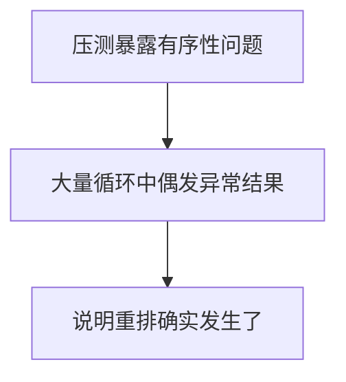

# 用 JCStress 压测重排序：三个用例见真章

## 面试题考什么

上一篇说了指令重排序要靠压测才能暴露，这一篇就是真刀真枪跑一遍。面试官感兴趣的点有三个：压测怎么跑起来、结果怎么读、以及一个很有迷惑性的问题，volatile 加在哪个变量上才管用。这篇三个用例正好覆盖这三点。

## 先给结论

把 jcstress 的打包插件配上、打包成 jcstress 的 jar 包运行，就能跑起来。三个用例的结论是：不加 volatile 时，(1, 0) 这个只可能由重排序产生的结果确实出现了；用 volatile 修饰 y 之后，把 (1, 0) 声明为 FORBIDDEN，跑完没有任何错误，重排序被挡住了；但把 volatile 加在 x 上则不行，(1, 0) 照样出现。volatile 加在哪个变量上，结果完全不同。



## 是什么：把压测跑起来

运行测试用例需要加一个打包插件（配合压测工具使用的 maven 打包插件），把插件坐标加进 pom.xml。之后用 package 把整个项目打包，会在 target 目录下生成一个 jcstress 的 jar 包。运行命令直接放在 target 目录下执行即可。

因为要组合几组不同的 JVM 参数、每组还要跑多轮，运行需要花一段时间。

## 为什么：三个用例，三种结果

### 用例一：不加 volatile

标注声明可接受的结果里包含 (0, 0)、(1, 1)、(0, 1)，而 (1, 0) 被声明为「值得关注」：

```java
@JCStressTest
@Outcome(id = {"0", "0", "1", "1", "0", "1"}, expect = Expect.ACCEPTABLE, desc = "ACCEPTABLE")
@Outcome(id = {"1", "0"}, expect = Expect.ACCEPTABLE_INTERESTING, desc = "ACCEPTABLE_INTERESTING")
```

两个 actor 方法和上一篇一样，一个写、一个读：

```java
@Actor
public void actor1() {
    x = 1;
    y = 1;
}
```

```java
@Actor
public void actor2(II_Result r) {
    r.r1 = y;
    r.r2 = x;
}
```

跑起来之后，(1, 0) 出现了。这一轮总共跑了 5 亿次左右，其中 (1, 0) 出现了 42 万多次，虽然只占总数的 0.08%，但毕竟出现了，说明指令重排序真实发生了。

面板输出大致是这个样子：

```text
RESULT  SAMPLES  FREQ  EXPECT  DESCRIPTION
0, 0  23,728,288  96.78%  Acceptable  ACCEPTABLE
0, 1  28,379  0.12%  Acceptable  ACCEPTABLE
1, 0  7,917  0.3%  Interesting  INTERESTING
1, 1  752,924  3.07%  Acceptable  ACCEPTABLE
```

### 用例二：volatile 修饰 y

第二个用例用 volatile 修饰 y，用来阻止刚才的重排序。这一版的预期值换了个写法，把 (1, 0) 设成 FORBIDDEN，意思是只要出现 (1, 0) 就直接以错误方式提示：

```java
@JCStressTest
@Outcome(id = {"0", "1", "1", "0", "1"}, expect = Expect.ACCEPTABLE, desc = "ACCEPTABLE")
@Outcome(id = {"1", "0"}, expect = Expect.FORBIDDEN, desc = "FORBIDDEN")
```

运行只需要把命令最后的类名改成对应用例即可。跑的时候能注意到一个变化：每秒的吞吐量下降了，之前能跑到 2000 多万次，现在降到 1000 多万次，原因就是用了 volatile，很多优化没法做了。

最终结果里没有任何错误：

```text
Failed tests: No matches.
Error tests: No matches.
```

只要没出现错误，就说明不会再出现 (1, 0) 这种情况，也就是重排序被禁止了。

### 用例三：volatile 修饰 x

第三个用例把 volatile 换到 x 上，标注回到「值得关注」：

```java
@JCStressTest
@Outcome(id = {"0", "0", "1", "1", "0", "1"}, expect = Expect.ACCEPTABLE, desc = "ACCEPTABLE")
@Outcome(id = {"1", "0"}, expect = Expect.ACCEPTABLE_INTERESTING, desc = "ACCEPTABLE_INTERESTING")
```

这次不用看完也能下结论：(1, 0) 又出现了。

```text
RESULT  SAMPLES  FREQ  EXPECT  DESCRIPTION
0, 0  16,796,697  96.76%  Acceptable  ACCEPTABLE
0, 1  28,857  0.17%  Acceptable  ACCEPTABLE
1, 0  1,169  0.01%  Interesting  ACCEPTABLE_INTERESTING
1, 1  532,125  3.07%  Acceptable  ACCEPTABLE
```

也就是说，volatile 加在 x 上起不到阻止重排序的效果。

## 深入细节：为什么加的位置有讲究

三个用例串起来，问题就变成：为什么 volatile 加在 y 上管用、加在 x 上不管用？

答案在 volatile 阻止重排序的方向上。用例二的写法里，y 是 volatile 变量，`y = 1` 是 volatile 写，它前面的普通写 `x = 1` 不允许被重排到它后面，于是赋值顺序被固定成先 x 后 y；读线程里 y 也是 volatile 读，读 y 之后的普通读不会跑到读 y 前面去，读取顺序也被固定。两头都锁住，(1, 0) 就不可能出现。

加在 x 上时，被保护的是 x 相关的顺序，y 的写入和读取顺序没被约束，重排序照样能发生。这部分的具体原理下一篇专门分析。

## 面试怎么答

按「怎么跑、怎么读、什么结论」答：

1. **怎么跑**：引入 jcstress-core 依赖和配套打包插件，package 后在 target 目录生成 jcstress 的 jar 包，按命令运行，它会组合多组 JVM 参数跑很多轮。
2. **怎么读**：结果面板列出每种结果组合的样本数、占比和 EXPECT；`ACCEPTABLE` 是预期内，`ACCEPTABLE_INTERESTING` 是值得关注（出现了就说明有重排序），`FORBIDDEN` 是不允许出现、出现即报错。
3. **结论**：不加 volatile 时 (1, 0) 会出现，占比很低但确实存在；volatile 修饰 y 后把它声明为 FORBIDDEN，跑完无错误、重排序被禁止；volatile 只加在 x 上则无效，(1, 0) 依旧出现。

追问大概率是「加 volatile 之后为什么吞吐量下降」，答案是用 volatile 之后编译器和 CPU 的很多优化不能做了，代价是实打实的。

## 常见误区

以为「只要有一个变量加了 volatile，这段代码就不会重排序」。用例三就是反例：加在错误的变量上，(1, 0) 照样出现。volatile 保护的是与它自己相关的那组读写顺序，不是整段代码。
