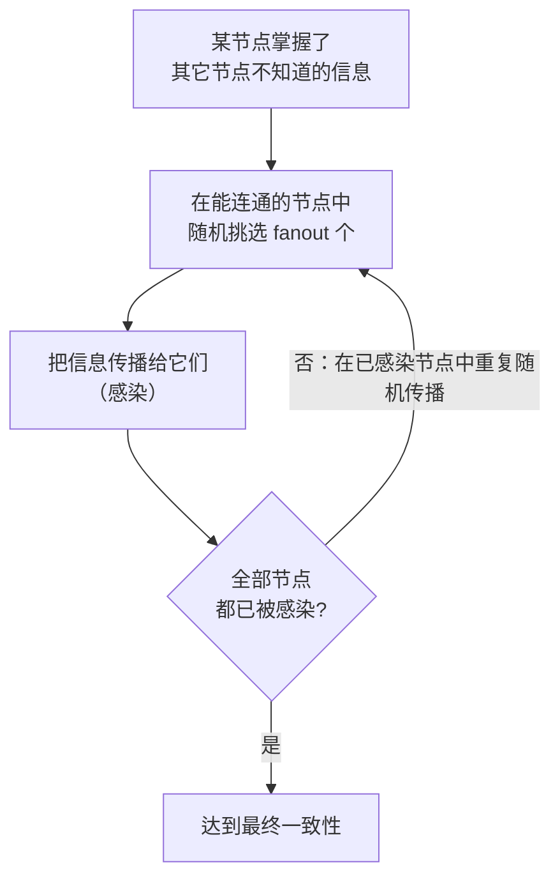
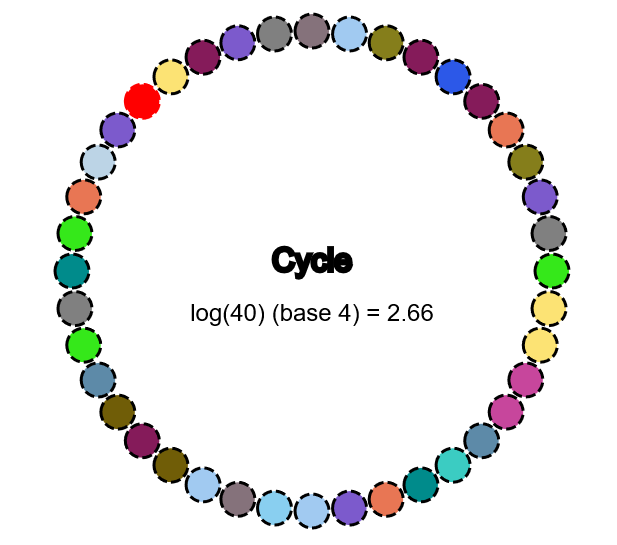
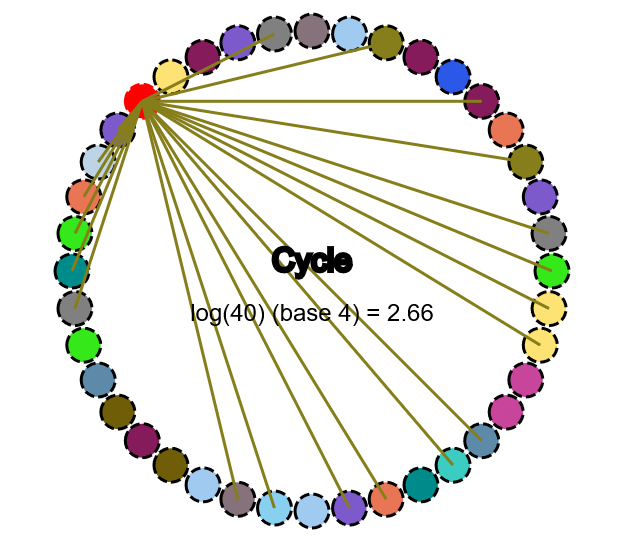
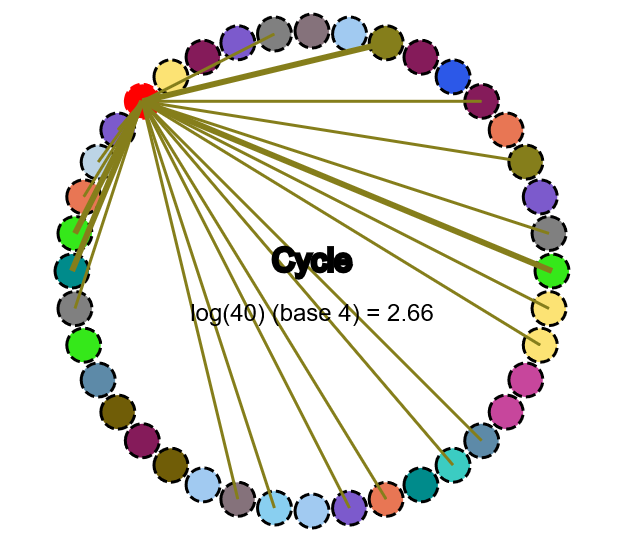
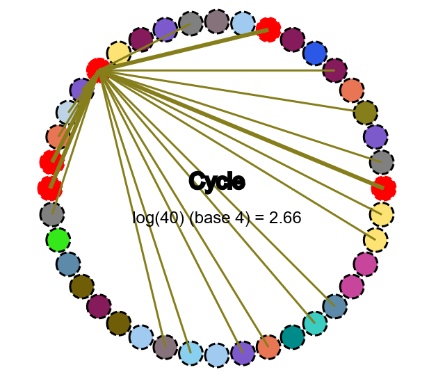
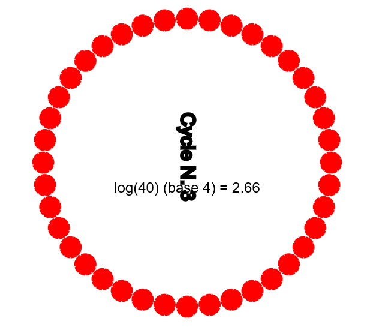
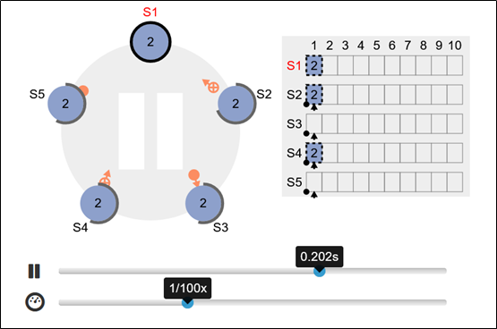

# Gossip 协议：像流言一样把信息传遍集群

## 面试题考什么

聊完 Paxos、Raft 这些强一致性算法，面试官常会追问一句：有没有不是强一致、但扩展性更好的方案？Gossip 协议就是标准答案，Redis Cluster、Consul、Cassandra 里都有它的身影。这道题考的是它与强一致性协议的定位差异，以及传播轮数那个对数公式。

## 先给结论

Gossip 与 Paxos、Raft 不同：后两者是共识算法，为强一致性服务；Gossip 的目标是最终一致性。它模拟流言、传染病的传播：每个节点周期性随机挑 f 个（fanout）节点把信息散播出去，收到信息的节点继续如法炮制。传播轮数约为 log_f(N)，f 是每次传播的成员数，N 是集群成员总数。它的优点是扩展性高、容错性好、节点地位对等（鲁棒性强）。

## 是什么：Gossip 的定义

看它的英文定义：Gossip 协议是计算机点对点的通信过程，基于传染病传播的思想。Gossip 本意是「流言、八卦」。不管是流言还是传染病，共同特点是能把信息快速地传播给集群中的每个成员：办公室里有人说了一条八卦，很快就传遍每个同事；一个人感冒，也可能很快传给其他人。

具体做法：每个节点在自己能连通的节点里随机挑选 f 个，把新信息发过去；收到信息的节点下一次也挑 f 个继续散播，一轮一轮扩散下去。

## 为什么：传播轮数是对数级的

传播速度可以用公式 log_f(N) 估算。f（fanout）代表每次传播几个成员，N 代表集群成员总数。

举例：集群有 4 台机器，其中一个节点拿到了别人都不知道的新信息，想同步给其他机器，每次发给 4 个能连通的成员。算下来大约是 2.66，也就是大约三轮传播，就能让集群中所有其他节点都知道这条新信息。实际传播次数会略高于这个结果，因为随机挑选成员时可能挑到已经知道该信息的重复成员。

用一个模拟器演示更直观。集群 40 个节点，先点一个节点让它变成红色，它就是「零号病人」。接下来它在绿色连线连通的节点里挑 4 个（这个 4 就是 fanout）散播信息，被选中的 4 个也变成红色，然后各自重复这个过程挑 4 个往下传。第一轮 4 个，第二轮更多人被感染，第三轮、第四轮之后，集群中所有 40 台机器都知道了这条新信息。

## 深入细节：三个优点

**扩展性高**。传播次数不会随集群成员增长而快速增长。40 个成员时大约 3 轮（实际传了 4 轮）达到最终一致；把节点数翻倍到 80，按公式算 log₄(80) 约 3.16，也就 3 到 4 次能把信息传遍集群。模拟器里跑一遍，80 个节点实际经历了 5 轮达到最终一致，节点数翻倍，传播轮数只多了 1 次。

**容错性好**。即使某些节点之间发生故障无法通信，也不影响最终一致性。A 和 B 之间网线断了、没法直接通信没关系，只要 A 能发给其他机器，而其他机器中又有能和 B 连通的，信息最终一定会散布到 B。这正是流言传播「可怕」的地方，也是它容错的原因。

**鲁棒性（robust）**。中文意思就是皮实、扛造。集群中的节点是对等的，没有哪个节点特殊，不是中心化的思想，不像 Raft 那样要先选出一个 Leader。所有节点地位相同、等价，即使一些节点挂了、或者新加了节点，也不会影响其他节点的信息传播，不需要中心节点。

## 面试怎么答

按「定位、机制、公式、优点」四段答：

1. **定位**：Gossip 追求最终一致性，Paxos、Raft 追求强一致性，两者目标不同，不是替代关系。
2. **机制**：每个节点周期性随机挑 f 个节点散播消息，收到消息的节点继续散播，逐步扩散。
3. **公式**：传播轮数约 log_f(N)，f 是 fanout，N 是集群规模；40 节点 fanout 4 时理论 2.66 轮，实际因重复挑选会略多。
4. **优点**：扩展性高（节点翻倍轮数只加 1）、容错性好（部分链路故障不影响最终一致）、去中心化对等（无 Leader，节点增减无影响）。

追问方向一般是落地场景：Redis Cluster 用 Gossip 做节点间元信息交换和故障发现，Consul 用它做成员管理和健康检查；代价是消息冗余、收敛有延迟，所以只适合元信息传播这类场景，业务数据一致性不靠它。

## 常见误区

把 Gossip 当成强一致性协议来用。它只能保证最终一致，且在收敛期间不同节点看到的数据可能不同。另外别把理论轮数当成实际轮数，随机挑人会重复，实际轮数总是略高于 log_f(N)。

## 课件配图
> 以下配图取自阶段七课件对应讲义，与上文讲解一一对应，可作为图文对照辅助理解。
**Gossip 协议**（课件讲义图示）

**讲义配图**（课件讲义图示）

