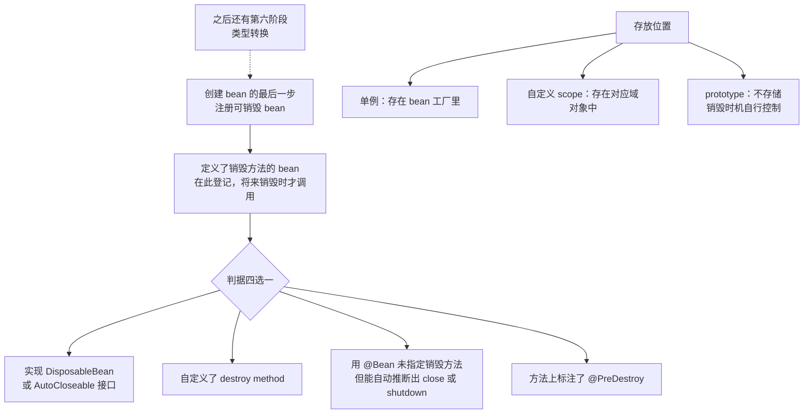

# 创建 bean 的最后一步：注册可销毁 bean，以及类型转换

## 面试题考什么

Spring Bean 生命周期问到「创建 bean 之后还有什么步骤」，能答出「注册可销毁 bean」和「类型转换」的人不多，但这恰好是区分度的来源。这一篇把第五阶段的收尾（注册可销毁 bean）和第六阶段（类型转换）合在一起讲，正好把 getBean 的完整链路说完。

## 先给结论

创建 bean 的最后一步是注册可销毁 bean：如果 bean 定义了销毁方法，容器在这一步把它记录下来，将来真正销毁时才去调用。判断依据有四种：实现 DisposableBean 或 AutoCloseable 接口、自定义了 destroy method、用 @Bean 没指定 destroy method 但能自动推断出 close 或 shutdown、方法上标了 @PreDestroy。单例 bean 的可销毁信息存在 bean 工厂里，自定义 scope 存在对应的域对象中，prototype 类型不存储，销毁时机由你自己控制。最后还有第六阶段类型转换：getBean 的 requiredType 与实际得到的 bean 类型不一致时，在这一步尝试转换。

## 是什么：什么是注册可销毁 bean

这一步的意思是：如果你的 bean 实现了一些销毁方法，容器要把这些 bean 记录下来，将来真正销毁的时候，就找到记录的这些 bean，调用它们的销毁方法。

判断一个 bean 是不是「可销毁」，有四种依据，满足其一就会被记录：

1. **实现了 DisposableBean 或 AutoCloseable 接口**。DisposableBean 接口和前面初始化阶段讲的 InitializingBean 接口是对应的：InitializingBean 用来执行初始化方法，DisposableBean 用来执行销毁方法。
2. **自定义了 destroy method**。可以用 bean 标签或 @Bean 注解来定义一个 destroy method。
3. **用了 @Bean 但没指定 destroy method，靠自动推断**。虽然没有显式指定，但类里提供了 close 方法或者 shutdown 方法，Spring 也会认为这个 bean 提供了销毁方法，把它当作可销毁 bean。
4. **某个方法用了 @PreDestroy 注解标注**，也会被认为是可销毁方法。

## 为什么：存在哪里，以及为什么要封装

**存储位置**分情况：

- **单例 bean**：可销毁 bean 存储在 bean 工厂当中，bean 工厂里有一个集合类型的成员变量专门存它们。将来 bean 工厂调用 close 方法关闭时，就到这个成员变量里找到这些可销毁 bean，逐一调用它们的销毁方法。
- **自定义 scope**（比如 request scope）：可销毁 bean 存储在对应的域对象中。根据域的不同找一个域对象存进去，当这个域的生命周期结束时，同样到域对象里找出这些可销毁 bean 调用销毁方法。
- **prototype 类型的 scope 是例外**：它不会专门找个地方存储，prototype bean 的销毁时机需要你自己控制。

**封装**是另一个值得说的设计。存储时，容器都会把这些销毁方法统一封装成 DisposableBeanAdapter 类型，也就是可销毁 bean 都会被包装成一个特殊类型。

为什么要封装？因为将来调用销毁方法的方式多种多样：有调 DisposableBean 接口的，有调 AutoCloseable 接口的，有调自定义方法的，有调加了注解标注的方法的。为了调用方式统一，就做了一层适配：不管你用哪种方式定义，最终都转换成对 DisposableBeanAdapter 方法的调用。这是适配器模式在 Spring 中的一次典型应用。

## 深入细节：第六阶段的类型转换

创建 bean 的前五个步骤（创建实例、依赖注入、初始化、注册可销毁 bean）走完，还有第六个阶段：类型转换。

调用 doGetBean 时（它是整个 bean 生命周期的入口），会传进来一个参数 requiredType，表示调用方希望拿到的 bean 类型。经过创建实例、依赖注入、初始化、注册可销毁 bean 这一系列步骤，得到的 bean 类型如果跟 requiredType 不一致，就要在这一步尝试把它转换成实际需要的类型。

画面线给出的源码位置在 AbstractAutowireCapableBeanFactory 的 doGetBean 里：先判断 `requiredType != null && requiredType.isInstance(bean)`，不满足就进转换逻辑，调用 `getTypeConverter().convertIfNecessary(bean, requiredType)`；转换失败会捕获 TypeMismatchException 并抛出 BeanNotOfRequiredTypeException。

走到这一步，bean 其实已经创建完成并作为结果返回了，此时它已经可以正常工作。

## 面试怎么答

被问到 bean 生命周期的后半段，按「注册可销毁 + 类型转换」两块答：

1. **注册可销毁 bean**：四种判断依据（DisposableBean/AutoCloseable 接口、自定义 destroy method、@Bean 自动推断 close/shutdown、@PreDestroy 注解）；存储位置（单例存 bean 工厂的集合，自定义 scope 存域对象，prototype 不存、自己控制销毁）；统一封装成 DisposableBeanAdapter，适配器模式的体现。
2. **类型转换**：doGetBean 的 requiredType 与实际 bean 类型不一致时，在第六阶段尝试转换，失败抛 BeanNotOfRequiredTypeException。

追问常落在 prototype 上：为什么 prototype 的销毁不管？因为容器不持有 prototype 实例的引用，创建完就交给调用方了，没有记录可销毁信息的必要，销毁要调用方自己触发。

## 常见误区

认为容器会主动销毁 prototype bean。prototype 的可销毁 bean 根本不会被记录，容器关闭时也不会去调它的销毁方法，需要自己控制销毁时机。另一个误区是把「注册」和「销毁」当成一步：这一步只是登记，真正调用销毁方法要等容器 close 或域生命周期结束。
