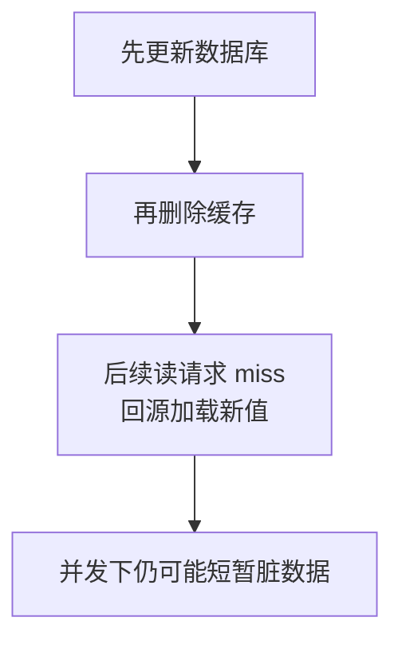

# 先更新库再清缓存：短暂不一致，但最终一致

## 面试题考什么

上一篇证明了「先清缓存再更新库」会造成永久性脏数据，这篇接着问：那正确的顺序能保证严格一致吗？答案是不能，但它能保证最终一致。面试官在这里想听的是你对「不一致窗口」的量化理解，以及为什么工程上愿意接受它。

## 先给结论

先更新库再清缓存，中间同样可能被其他查询插队，读出旧值，产生短暂的不一致；但这个不一致会在清缓存之后被扭转，后续查询一律拿到新值，所以它能保证最终一致。至于更严格的方案（加锁让两步变成原子操作），代价是性能，互联网应用一般不这么做。

## 是什么：根源在于两步之间没有保护

先清缓存再更新库出问题的根源在于：清缓存和更新库是两步操作，不具备原子性，又没有施加任何保护，两步之间的空档给了其他客户端指令可乘之机，指令交错之后就出现了不一致。

顺着这个思路，有人会想：给这两步加个锁不就行了？加锁保证原子性，当然能保证一致性。但加锁对性能影响比较大，如果对一致性的要求没那么严格，能不加就不加。加锁带来更高的一致性，代价是性能，这是一笔要算的账。

## 为什么：换个顺序就能兜住

不加锁的方案非常简单，就是把两步顺序颠倒一下：先更新库，再清缓存。

同样假设有指令插队，看看还会不会不一致。这回 B 客户端先更新库、后清缓存，中间插进来一次 A 客户端的查询：

1. B 先把新值 x=2 更新到数据库。
2. A 插进来查询。对 A 来说，缓存还没被清空，它优先在缓存里找，从缓存中拿到的仍然是旧值 x=1。这里确实发生了不一致，A 查到了过期数据。
3. B 接着把缓存清掉，x=1 这个旧数据被清掉了。
4. 之后其他客户端再查询，缓存里没有了，必须查数据库，这回就能得到最新的 x=2，并把它放入缓存。
5. 后续所有查询都能得到 x=2。

结论很清楚：先更新库再清缓存，中间空档里来的查询确实会查到不一致的旧值，但它最终能保证一致性。只要清缓存这一步执行完，不一致就被扭转，缓存和数据库重新达成一致。

## 深入细节：这个方案追求的是什么

这个方案并不追求严格的、时时刻刻的缓存与数据库一致。它保证的只是最终一致：中间会出现短暂的不一致，之后会收敛。

对于一致性要求不是那么严格的互联网应用，这种短暂不一致通常是可以接受的。这也是为什么行业里的主流建议是先更新库再清缓存，而不是先清缓存再更新库：前者最坏情况是短暂读到旧值，后者最坏情况是永久读到旧值，两者代价差了一个量级。

如果业务确实无法接受短暂不一致，再考虑加锁、延时双删、订阅 binlog 补偿这类更强但更重的手段。顺序问题是最便宜的那道防线，先把顺序做对再谈加强。

## 面试怎么答

按「根源、方案、代价、结论」答：

1. **根源**：清缓存与更新库是两步、非原子、无保护，中间空档会被其他指令插队。
2. **方案**：先更新库再清缓存。插队的查询会读到旧值，产生短暂不一致；清缓存之后，后续查询回源拿到新值并回填，最终一致。
3. **代价**：追求严格一致需要加锁，把两步变成原子操作，但性能影响大，一般不这么做。
4. **取舍**：顺序调整是代价最小的手段，保证最终一致；更强的一致性靠延时双删、binlog 订阅补偿等，按业务要求选。

追问一般是「删缓存失败怎么办」：这时缓存里会残留旧值，需要重试机制兜底（比如把失败的 key 放进消息队列重试删除），这也是工程上常见的补强点。

## 常见误区

认为先更新库再清缓存就彻底没有不一致了。它只是把「永久脏数据」降级成了「短暂旧值」，中间窗口里依然可能读到过期数据。把这两种方案的区别说清楚，比背结论更能体现理解深度。
