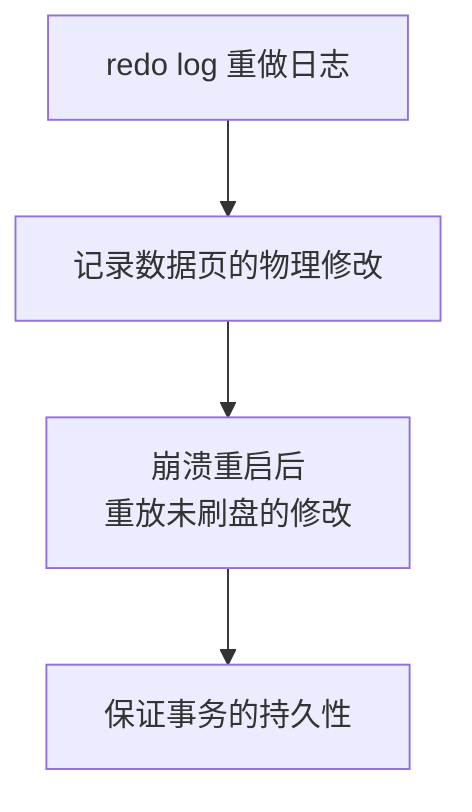

# redo log：持久性靠它，崩溃恢复也靠它

## 面试题考什么

undo log 之后必问 redo log，两者是 InnoDB 的一对孪生日志。面试官想知道：它解决 ACID 里的哪一个特性、为什么事务提交时只写 redo log 就算成功、它的刷盘策略有哪几种取值、分别丢多少数据。把这四点答全，这道题就过关了。

## 先给结论

redo log 的作用是实现事务四特性 ACID 中的持久性，通俗讲就是保证提交的数据不丢失。做法是记录事务提交时的增删改变更，服务器意外宕机后重启，从 redo log 里找到这些变更信息做回放，把已提交过的变更重新执行一遍，就能恢复到宕机前的状态；未提交的变更则被抛弃。事务提交时，只要变更成功写入 redo log，事务就视为成功，数据页（表和索引）上的变更可以放到后面慢慢做。同步策略由 innodb_flush_log_at_trx_commit 控制，取值 0、1、2，默认是 1，推荐保持默认。

## 是什么：为什么不直接写数据页

一次变更有两个地方要记录：一是 redo log 要记录变更，二是真正的变更还要同步到数据库的表、索引上去。那究竟是两处都成功才算成功，还是只要 redo log 写成功就算成功？

答案是后者。事务提交时首先把变更写到 redo log 日志，只要成功写入，事务就可以视为成功；数据页上的变更可以放在后面慢慢做。理由有两个：

1. **数据页上的变更丢了也没事**。即使宕机导致表和索引上的数据丢失，由于 redo log 里已经记了一份，重启后可以从 redo log 恢复。
2. **随机写太慢**。数据页（表、索引）在磁盘上的存储位置是随机的：这张表里改点数据、那个索引里改点数据，位置随机导致写入速度慢。而 redo log 不关心这些，它只记录变更信息，可以顺序写入，顺序写的速度非常快。

这一套正是 WAL（Write-Ahead Logging）的思路：先写日志，再慢慢落盘。

## 为什么：两部分组成，以及什么时候才算真安全

redo log 由两部分组成：内存中的 redo log buffer，磁盘上的 redo log file。

redo log file 由一组文件组成，而且文件有大小上限。写满之后会循环覆盖掉较旧的日志文件，这意味着不能无限依赖 redo log：比较旧的变更日志会被覆盖，如果需要恢复到更早的数据，就要用到 binlog（MySQL 中另一种日志，这里不展开）。

分成内存和磁盘两部分就意味着：变更数据光放在 buffer 里还不算真正安全，只有写入到磁盘上的文件才真正实现持久。那什么时候从 buffer 同步到文件？由 innodb_flush_log_at_trx_commit 这个参数控制，它有三个取值：

- **取值为 0**：每隔一秒，把内存 buffer 中的日志 write 并 flush 到磁盘文件。每隔一秒同步意味着最多会丢一秒的数据，如果内存还没同步到磁盘时宕机，这一秒的数据就丢了。
- **取值为 1**：每次事务提交时，把内存中的日志 write 并 flush 到磁盘文件。这是最理想的，事务一提交立刻同步，当然性能上会受一定影响，但它安全。
- **取值为 2**：每次事务提交时只把日志 write 到操作系统的缓存中（并没有 flush），操作系统每隔一秒再把缓存同步到磁盘文件。这种情况下如果 MySQL 挂了、操作系统没挂，数据不会丢；但操作系统崩溃仍有丢失风险。

## 深入细节：取值怎么选

课程的建议很明确：推荐取值 1，它其实也是默认值，所以如果没有特殊理由，不要去修改这个值。

三个取值本质上是安全性与性能的权衡：0 性能最好但可能丢一秒数据；1 最安全但每次提交都有一次刷盘开销；2 折中，把风险从 MySQL 进程转移到了操作系统。对绝大多数业务，默认 1 的开销是可以接受的，数据安全性优先。

## 面试怎么答

按「作用、判定、组成、策略」四层答：

1. **作用**：实现持久性，保证已提交数据不丢失；宕机重启后回放已提交的变更，未提交的抛弃。
2. **判定**：事务提交时先写 redo log，写成功即事务成功，数据页变更异步落盘（WAL）。
3. **组成**：内存 redo log buffer + 磁盘 redo log file；文件有大小上限、循环覆盖，更早的恢复要靠 binlog。
4. **策略**：innodb_flush_log_at_trx_commit，0 每秒刷（最多丢 1 秒）、1 每次提交刷（最安全、默认）、2 每次提交只写 OS 缓存、每秒刷；推荐保持默认 1。

常考的对比题是 redo log 与 undo log：redo log 保证持久性（崩溃恢复，顺序写），undo log 保证原子性（回滚）并支撑 MVCC 快照读；两者都是 InnoDB 独有。追问还可能是 redo log 与 binlog 的区别：前者是引擎层、循环写、物理日志，后者是服务层、追加写、逻辑日志，可用于主从复制和数据恢复。

## 常见误区

认为事务提交时数据已经写进了表文件。实际上提交那一刻只保证了变更进了 redo log，真实的数据页可能是「脏页」留在内存里稍后才落盘。这也是为什么宕机恢复必须依赖 redo log：真正的数据可能还没写进去。
