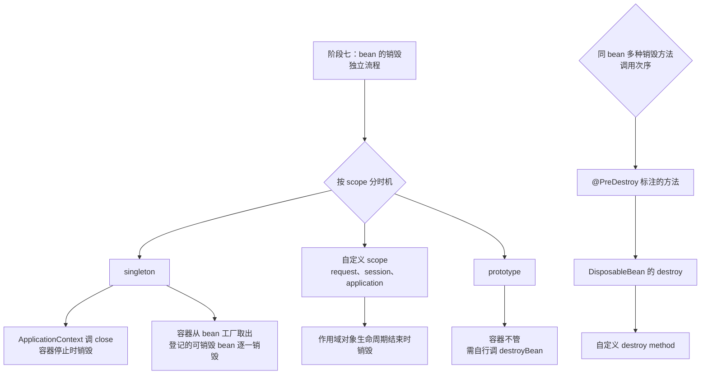

# 阶段七：bean 的销毁，以及整个生命周期回顾

## 面试题考什么

「说说 Spring Bean 的生命周期」是 Spring 面试里出场率最高的一道题。前面几个阶段已经拆开讲过，这一篇补上最后一个阶段（销毁），并把七个阶段串成一份可背诵的清单，同时把不同 scope 的销毁时机和销毁方法的调用次序讲清楚。

## 先给结论

阶段七是 bean 的销毁，它是一个独立流程。销毁时机按 scope 分：singleton 在 ApplicationContext 调用 close 时销毁；自定义 scope（request、session、application 等）在作用域对象生命周期结束时销毁；prototype 容器不管，需要自己拿到 bean factory 调 destroyBean 手动销毁。同一个 bean 里定义了多种销毁方法时，调用次序是 @PreDestroy 注解标注的方法 → DisposableBean 接口的 destroy → 自定义 destroy method。

## 是什么：三种 scope 的销毁时机

**singleton**：销毁时机是调用 application context 的 close 方法、整个 Spring 容器停止的时候。前面讲过，每个 bean 创建时都会检查它是不是可销毁 bean，是的话就登记到 bean factory 里；调用 close 时，容器到 bean factory 里找到这些可销毁 bean 的名字，遍历逐一销毁。

**自定义 scope**（request、session、application 等）：销毁时机是作用域对象生命周期结束的时候。比如 request 域，在 request 域对象生命周期结束之前，会调用这些 request scope bean 的销毁方法。

**prototype**：它其实也是可以销毁的，只不过需要我们自己手动调用方法来执行销毁。做法是先拿到 bean factory，调用它的 destroyBean 方法，把 prototype bean 作为参数传进去，它就会调用该 bean 的销毁方法完成销毁。

## 为什么：销毁方法也有优先级

同一个 bean 里如果定义了不同形式的销毁方法，调用有先后：

1. **优先执行后处理器的销毁**，也就是由后处理器去解析那些额外的扩展注解，说白了就是 @PreDestroy 注解标注的方法。
2. **其次调用实现了 DisposableBean 接口的方法**完成销毁。
3. **最后执行自定义 destroy method 的方法**进行销毁。

三者同时存在时，就按这个次序依次完成。这个次序和初始化阶段是对应的：初始化是 Aware → @PostConstruct → InitializingBean → init method，销毁则是 @PreDestroy → DisposableBean → destroy method，注解方式都排在接口方式之前。

## 深入细节：七个阶段串成一份清单

把整个生命周期从头到尾拎一遍，红色标注的重点阶段尤其要记住：

- **阶段一：处理名称，检查缓存**。处理别名、一些特殊 bean 的名字，然后看缓存里有没有，有就直接返回，没有才执行后续流程。
- **阶段二：检查父工厂**。当前 bean 的名字在本工厂里没有时，检查父工厂的名字，父工厂上有就优先返回父工厂的 bean。
- **阶段三：检查 DependsOn**。如果 bean 指定了 depends-on，会优先创建它依赖的那些 bean，依赖都创建好了才回过头来创建当前 bean。
- **阶段四：按不同 scope 创建 bean**，分为 singleton、prototype 以及其他域。
- **阶段五（重点）：创建 bean**，又分四个小步骤：
  1. **创建 bean 实例**：先看构造方法上有没有 @Autowired，有就优先采用被 @Autowired 标注的构造方法；没有的话选择唯一的带参构造；如果都没提供，就用默认构造。
  2. **依赖注入**：AutowiredAnnotationBeanPostProcessor 识别 @Autowired 和 @Value；CommonAnnotationBeanPostProcessor 识别 @Resource；还可以设置按名字匹配或按类型匹配，或者精确指定所引用的其他 bean 或值。优先级是精确指定最高，其次按名字和按类型匹配，注解方式最低。
  3. **初始化**：处理 Aware 接口、调用初始化方法（次序为 Aware → @PostConstruct → InitializingBean → 自定义 init method），以及创建 AOP 代理对象。
  4. **登记可销毁 bean**：标了 @PreDestroy 的、实现了 DisposableBean 接口的、自己指定 destroy method 的，都会被登记。
- **阶段六：类型转换**。创建出来的 bean 类型与调用方需要的类型不一致时，在这一步做转换。
- **阶段七：销毁 bean**，也就是本篇讲的内容。

## 面试怎么答

被问到 Spring bean 生命周期，直接按七个阶段背下来，重点展开阶段五：

1. 处理名称、检查缓存。
2. 检查父工厂。
3. 检查 depends-on。
4. 按 scope 创建（singleton / prototype / 其它域）。
5. 创建 bean：创建实例（@Autowired 构造 → 唯一带参构造 → 默认构造）、依赖注入（@Autowired、@Value、@Resource，以及按名字/按类型/精确指定的优先级）、初始化（Aware → @PostConstruct → InitializingBean → init method，外加创建代理）、登记可销毁 bean。
6. 类型转换。
7. 销毁：singleton 随容器 close 销毁，自定义 scope 随域生命周期结束销毁，prototype 需手动 destroyBean；销毁次序 @PreDestroy → DisposableBean → destroy method。

追问一般是「prototype bean 容器为什么不销毁」：容器不持有 prototype 实例的引用，创建完就交给调用方，自然无从销毁，这也是它和 singleton 最大的管理差异。

## 常见误区

只背「创建、注入、初始化、销毁」四个动作，漏掉类型转换和可销毁 bean 的登记。完整的七个阶段里，阶段六类型转换和阶段五的第 4 小步（登记可销毁 bean）最容易被忽略，但恰恰是这两点能拉开回答的差距。
