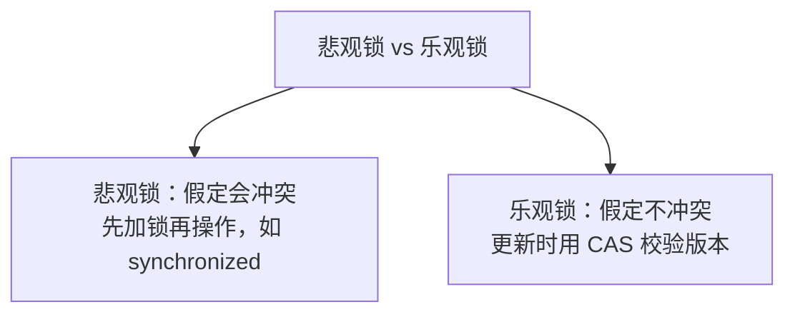

# 悲观锁与乐观锁：一个让你停下等，一个让你不停重试

## 面试题考什么

Java 并发里「悲观锁和乐观锁的区别」几乎是必答题。多数人能答出 synchronized 和 CAS，但说不清两者的本质差异在哪一层：关键不在加不加锁，而在失败的线程怎么办，一个阻塞等待、一个循环重试，由此带来上下文切换、适用场景、硬件依赖的一连串差异。

## 先给结论

悲观锁的代表是 synchronized 和 Lock，核心思想是线程只有占有了锁才能操作共享变量，获取锁失败的线程都得停下来等待，从运行到阻塞、再从阻塞到唤醒，涉及线程上下文切换；为了减少阻塞，它们在抢锁时都会先做几次重试。乐观锁的代表是 AtomicInteger，底层用 CAS 保证原子性，核心思想是不加锁，修改失败的线程不需要停止，而是在循环内不断重试直至成功，因此不涉及线程上下文切换；代价是需要多核 CPU 支持，且线程数不应超过 CPU 核数。

## 是什么：悲观锁

悲观锁的特点是：线程只有占有了锁才能去操作共享变量，占锁失败就没有资格进入同步代码块；每次只有一个线程能占锁成功，其他失败的线程都得停下来等待。

什么时候它们才有机会再获取锁？当前面的持锁线程把锁释放后，会在等待的线程里挑一个唤醒，被唤醒的线程才有资格进入下一轮锁竞争。

这里就引出了性能问题：线程本来在运行状态，获取锁失败就要进入阻塞；下次再把它从阻塞唤醒去竞争锁。从运行到阻塞、从阻塞到唤醒，涉及一次线程上下文切换。

什么是线程上下文切换？线程从运行到阻塞时，要把当前运行的状态记录下来：执行到第几行代码了、当前有哪些局部变量，都得记下来；下次从阻塞状态唤醒时，还要把这些信息恢复，让它接着上次中断的地方继续向下运行。这整个过程就是一次线程上下文切换。如果频繁发生，就要不断地记录和恢复，会影响性能。

为了减少上下文切换、也就是减少阻塞的机会，synchronized 和 Lock 都做了优化：它们发现锁已被其他线程占用时，当前线程不会立刻进行一次上下文切换进入阻塞，而是会做几次重试操作（挣扎几次）。如果重试期间锁被释放开了，就不用进入阻塞，从而省掉一次上下文切换。

## 为什么：乐观锁的另一条路

乐观锁的代表是 AtomicInteger（原子整数类），底层用 CAS 保证原子性。

乐观锁的核心思想是根本不需要加锁。同样每次只有一个线程能成功修改共享变量，但失败的线程怎么办？这是最大的区别：悲观锁里获取锁失败的线程都得停下来等，乐观锁里修改失败的线程不需要停，它们会在一个循环内不断运行、不断重试，直至成功。

这种「不怕失败、再来一次」的思路，正是「乐观」一词的由来：这次修改失败了没关系，再做一次循环，这次成功了就把共享变量改成了。

由此带来两个推论：

1. **不涉及线程上下文切换**。由于线程一直运行、不需要阻塞，自然也没有上下文切换带来的性能损失。
2. **需要多核 CPU 支持**。失败的线程不需要停，前提是得有 CPU 来执行它线程内的代码。如果 CPU 个数太少，线程虽然不会进入阻塞状态，但没有 CPU 执行它，同样会发生上下文切换，只能到一边歇着去。所以乐观锁需要多核 CPU，并且线程数不应超过 CPU 核数，必须有独立的 CPU 来执行这个不断重试的循环。

## 深入细节：怎么选

两种锁的差异决定了适用场景：

- **悲观锁**适合临界区执行时间长、竞争激烈的场景。让线程阻塞等待，虽然要付上下文切换的代价，但不会空转烧 CPU。
- **乐观锁**适合临界区执行极短、竞争不激烈的场景。重试一次的成本远低于一次上下文切换，且不涉及阻塞；但如果竞争激烈，大量线程同时自旋重试，会把 CPU 白白消耗在无效循环上。

这也是为什么 synchronized 在 JDK 1.6 之后引入了偏向锁、轻量级锁（自旋）等优化：它的思路和乐观锁一致，先自旋重试几次，实在拿不到再升级为重量级锁去阻塞，把两种策略的优点结合起来。

## 面试怎么答

按「代表、核心思想、失败线程怎么处置、代价与前提」四层答：

1. **悲观锁**：synchronized、Lock；只有占锁才能操作共享变量，失败线程阻塞等待；运行与阻塞之间来回切换涉及上下文切换，影响性能；抢锁时会先重试几次以减少阻塞。
2. **乐观锁**：AtomicInteger、CAS；不加锁，失败线程不阻塞、循环重试直至成功；不涉及上下文切换。
3. **前提**：乐观锁需要多核 CPU 支持，线程数不应超过 CPU 核数，否则自旋线程拿不到 CPU，一样会切换出去。
4. **选型**：竞争少、临界区短用乐观锁；竞争激烈、临界区长用悲观锁。

追问一般会落到 CAS 本身：它会带来 ABA 问题（可用版本号或 AtomicStampedReference 解决），以及自旋时间过长时的 CPU 开销问题。

## 常见误区

认为乐观锁一定比悲观锁快。它的优势建立在「竞争不激烈 + 多核 CPU」这两个前提上；一旦线程数超过核数或竞争白热化，自旋重试的开销会迅速超过一次上下文切换，反而不如悲观锁。
