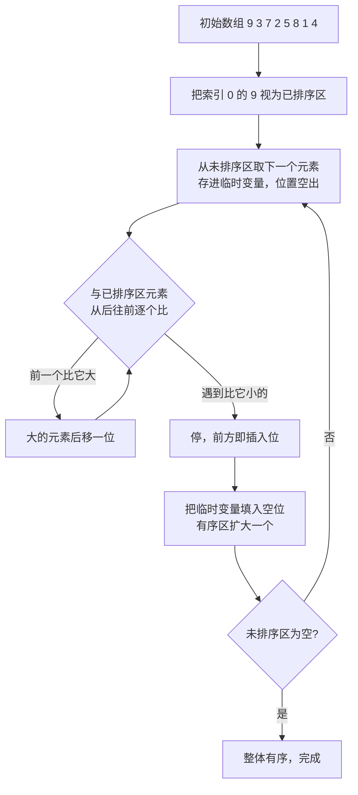

# 插入排序演示：把每个元素插到它该在的位置

## 面试题考什么

冒泡、选择之后，插入排序是第三个必会的 O(n²) 排序。它和选择排序一样把数组分成两部分，但做法完全不同。面试官常问：它和选择排序有什么相同和不同？为什么说它稳定？为什么有序数组上它特别快？

## 先给结论

插入排序和选择排序的相同点是都把数组划分为已排序区和未排序区；不同点在于插入排序一开始把索引 0 视为已排序部分，从索引 1 开始逐个把元素插入到前面有序区的合适位置，做法是把当前元素的位置空出来，比它大的元素依次后移，再把它放进去。它有两个明显优点：是稳定排序算法（选择排序不稳定），大部分情况下性能略高于选择排序。对已排序数组，它的时间复杂度是 O(n)，和冒泡排序的特征一样。



## 是什么：思路与分区

插入排序先把索引 0 位置的元素视为已经排序好的部分，从索引 1 开始，剩余的是未排序部分。思路是不断扩大有序区、缩减无序区。

用初始数组 `[9, 3, 7, 2, 5, 8, 1, 4]` 走一遍。

**第一轮插入**：有序区只有一个元素 9，要扩大为两个。先把元素 3 所在的位置空出来，空出来的目的是看 3 放在哪个位置能保证前面这些元素仍然有序。显然应该把 9 往后移动一下，3 放在原来 9 的位置，这样索引 0 到 1 这个区间内所有元素仍然有序，一轮插入完成。

**第二轮插入**：有序区继续扩大，把 7 的位置空出来，然后让 7 与前面的元素比较，看插到哪里能保证索引 0 到 2 仍有序。7 比 9 小，9 继续往后移；7 比 3 大，3 不用动，所以 7 就插入到中间这个位置。

**第三轮插入**：把 2 的位置空出来。2 要保证索引 0 到 3 有序，这回麻烦一些：9 比 2 大往后移，7 比 2 大也往后移，3 也比 2 大同样往后移，最后 2 放在最前面。

剩下的按同样方式走完：继续做 5 的插入、8 的插入、1 的插入，最后是 4 的插入，整个插入排序的流程就走完了。

## 为什么：它比选择排序好在什么地方

第一，**它是稳定排序算法**。选择排序是不稳定的，而插入排序在移动元素时只把比当前元素大的往后挪，相等的元素不会跨过去，因此相等元素的相对次序得以保持。

第二，**性能在大部分情况下略高于选择排序**。选择排序每一轮都要把剩余部分整个扫一遍才能确定最小值；插入排序在有序区内进行比较时，一旦发现当前元素已经比前面的元素大，就可以立刻停止这一轮的比较，不必扫完整个有序区。

## 深入细节：有序数组上是 O(n)

插入排序和冒泡排序有一个共同点：对已排序的数组，排序效率特别高。

拿已经排好序的数组来看。第一次插入，扩大范围时把 2 提出来，发现它比前面的 1 大，不用动，只比较了一次。接下来 3 与 2 比，发现比 2 大，前面的都不用比了，3 仍在原来的位置，也只比较了一次。按这个规律，4 只需要跟前面的 3 比一下，发现比 3 大，由于前面都是有序的，不用再跟 2、跟 1 比，所以它还是在原来的位置。

每一轮都只比较一次，整个插入排序的时间复杂度就是 O(n)，已经非常高效。这一点和冒泡排序的特征一致：它们对有序数组的排序时间复杂度都是 O(n)。

插入排序的代码实现如下：

```java
public static void insert(int[] a) {
    // i 代表待插入元素的索引，从 1 开始
    for (int i = 1; i < a.length; i++) {
        int t = a[i];               // 待插入的元素值，先存进临时变量
        int j = i;                  // j 指向已排序区的末尾
        while (j >= 1) {
            // 与前面已排序区的元素逐个比较
            if (t < a[j - 1]) {       // 前一个比它大，就后移让位
                a[j] = a[j - 1];
                j--;
            } else {                 // 遇到比它小的，j 就是插入位置
                break;
            }
        }
        a[j] = t;                   // 填入空位，一轮插入完成
    }
}
```

## 面试怎么答

按「分区、做法、优点、复杂度」四步答：

1. **分区**：把数组分为已排序区和未排序区，索引 0 视为已排序，从索引 1 开始处理。
2. **做法**：把当前元素的位置空出来，与有序区从后往前比较，比它大的元素依次后移，找到位置后放入。
3. **优点**：稳定排序；大部分情况下略快于选择排序，因为有序区内比较可以提前结束。
4. **复杂度**：最好情况（已有序）O(n)，因为每轮只比较一次；最坏和平均 O(n²)；空间复杂度 O(1)，原地排序。

追问一般是「为什么插入排序稳定而选择排序不稳定」：插入排序只移动比当前元素大的元素，相等元素不会被跨过；选择排序是把最小值直接交换到前面，交换动作可能把前面的元素甩到后面，从而打乱相等元素的相对次序。

## 常见误区

把插入排序的「后移」理解成不断交换相邻元素。演示里看到的是「空出位置 + 元素后移 + 最后放入」，每一步都是赋值而不是两两交换，这也是它在元素移动次数上通常优于冒泡的原因之一。

## 课件配套可视化 Demo

> 本算法的交互式可视化页面已随本系列一并打包：[demos/day01_insertion_sort.html](demos/day01_insertion_sort.html)（纯 Canvas 实现，无需任何外部依赖，直接用浏览器打开即可）。

页面用柱状图展示已排序区与未排序区的划分，以及未排序元素如何向左比较并插入到正确位置。本系列 128–142 插入排序博客（实现、总结）可用同一页面对照。
