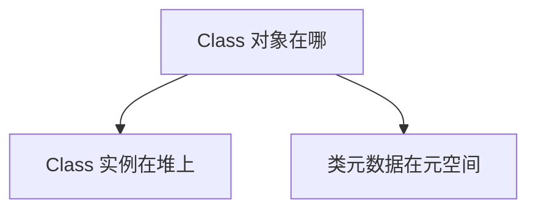

# 用 HSDB 证明：类对象在堆里，不在方法区

## 面试题考什么

「类对象存在哪里」是一道能拉开差距的题。多数人凭印象说方法区，因为类的字节码确实在方法区；但类对象（Student.class）在现在的 JVM 实现里是放在堆里的。会说结论只值一半分，能说出怎么验证才值满分。

## 先给结论

用 HSDB 的 universe 命令确认堆空间的地址范围，再用 inspect 命令找到 Student.class 这个类对象、确认它的地址落在这个范围内，就能证明类对象属于堆空间。进一步看，它刚创建时诞生在伊甸园区，经历几次垃圾回收仍然存活后会被转移到老年代。同时还能顺带验证一个结论：非 final 的静态变量此时只有默认值（0），而 final 静态变量已经有值，说明它在链接阶段就赋好值了。

## 是什么：验证思路

思路其实很简单：先想办法确定堆空间的内存范围，再想办法找到 Student.class 这个类对象，然后看它是不是落在这个范围之内。如果是，就证明类对象所占用的内存空间属于堆空间。

思路简单，实现起来却不那么简单。网上的资料大多基于 JDK 8 的 HSDB 工具来验证，而高版本的 HSDB 工具功能上反而有所缺失，有些菜单里找不到对应的功能，所以下面的方法是自己摸索出来的：主要靠 HSDB 的控制台命令。

## 为什么：三步走

**第一步，确认堆的地址范围。** 打开 HSDB 的控制台，先敲 help 查看可用命令，其中 universe 这个命令有用，它可以查看当前堆内存的地址。从输出可以看到当前是 G1 垃圾回收器的堆空间，并且给出两个地址。用后面的地址减去前面的地址（16 进制），换算成 10 进制正好是 16 兆，因为演示时故意把最大堆空间设成了 16 兆。堆小一点，查找起来速度快。

接下来只要验证 Student.class 对象的内存地址在这个范围之内就行。

**第二步，看堆的分区详情。** 再看一下 g1regiondetails 命令，它能看到 G1 堆内存中各个区间的详情：堆内存被划分成大小相等的区域，有 old（老年代区域）、free（暂未使用的区域）、survivor（幸存区域），还有 eden（伊甸园区域）。等找到 Student.class 之后，可以再看看它具体落在哪个区域。

**第三步，找到类对象并确认它。** 通过某种方法找到 Student.class 之后，用 inspect 指令可以看到这个内存地址对应对象的详情：它的类型是 java.lang.Class，确实是一个 class 对象。

怎么证明这个 class 对象就是 Student.class 而不是别的类的？看它后面关联的静态成员变量就知道了。创建 Student 类时刻意加了几个静态变量，分别是 a、b、c，这些静态变量存储在类对象的尾部，所以从详情里能看到类对象关联了 a、b、c 这几个变量。其中 a、b 的值是 0，说明它们还没有初始化，只是分配了空间、没有赋值（代码里赋的是 16 进制的 0x77 和 0x88）；而 final 修饰的静态变量是有值的，显示是 0x99，换算成 10 进制就是 153，和代码里写的值一致。这就确认了它确实是 Student 的类对象。

## 深入细节：它在堆的哪个区域

再看地址。类对象的地址是 8 位，前三位都是 FFF；而堆的起始地址也是 8 位，结束地址是 9 位。这个类对象的地址落在堆的这个区间之内，具体属于 eden（伊甸园）区。

也就是说，类对象刚创建时也是创建在伊甸园区的，和普通的 Java 对象一样。将来如果它经历了几次垃圾回收仍然存活，就会被转移到老年代去。

这同时也验证了前面讲过的另一个结论：类的元数据在方法区，类对象在堆内存；以及非 final 静态变量在准备阶段只有默认值、final 静态变量在链接阶段就赋好了值。

## 面试怎么答

按「结论 + 验证步骤」答：

1. **结论**：类的字节码（元数据）在方法区，类对象 Student.class 在堆里；刚创建时位于伊甸园区，多次 GC 存活后进入老年代。
2. **验证一**：HSDB 的 universe 命令查看堆地址范围（演示中堆被设成 16 兆，便于查找）。
3. **验证二**：inspect 命令查看对象详情，类型为 java.lang.Class；通过类对象尾部关联的静态变量 a、b、c 确认它属于 Student 类。
4. **附带验证**：非 final 静态变量 a、b 此时是 0（只分配空间未赋值），final 静态变量已是 0x99（十进制 153），印证准备阶段与初始化阶段的差异。

追问一般是「为什么类对象不放在方法区」：方法区存的是类的元数据，其数据结构是 C++ 表示的，Java 代码无法直接访问；类对象是给 Java 代码用的访问入口（反射就是基于它），放在堆里可以统一由垃圾回收管理。

## 常见误区

把「类的字节码」和「类对象」当成同一个东西、认为都在方法区。两者是分开存放的：字节码（元数据）在方法区，类对象在堆。这也能解释为什么类的元数据要靠类卸载来回收、而类对象可以像普通对象一样被 GC 管理。
