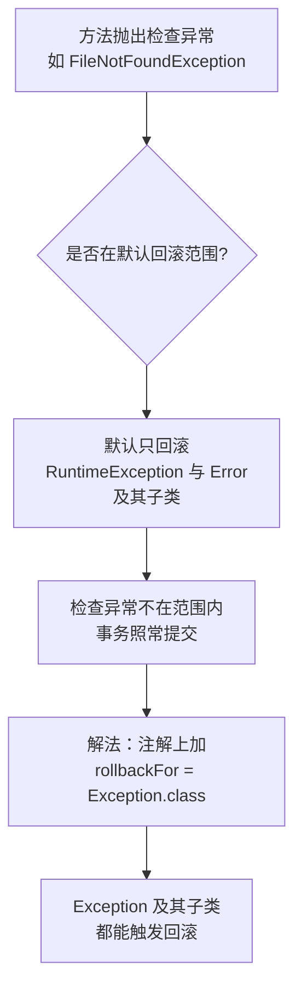
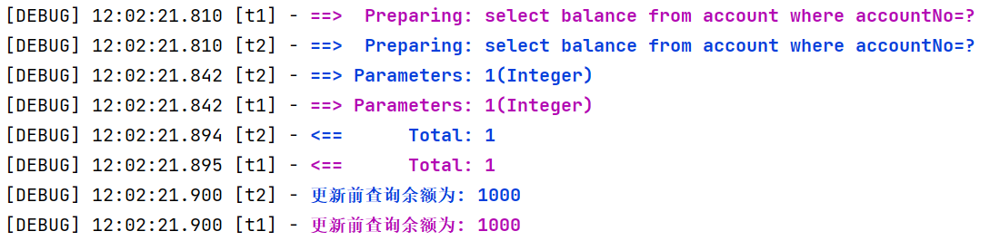
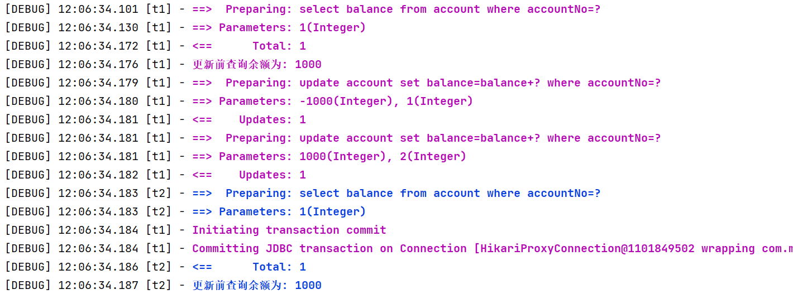
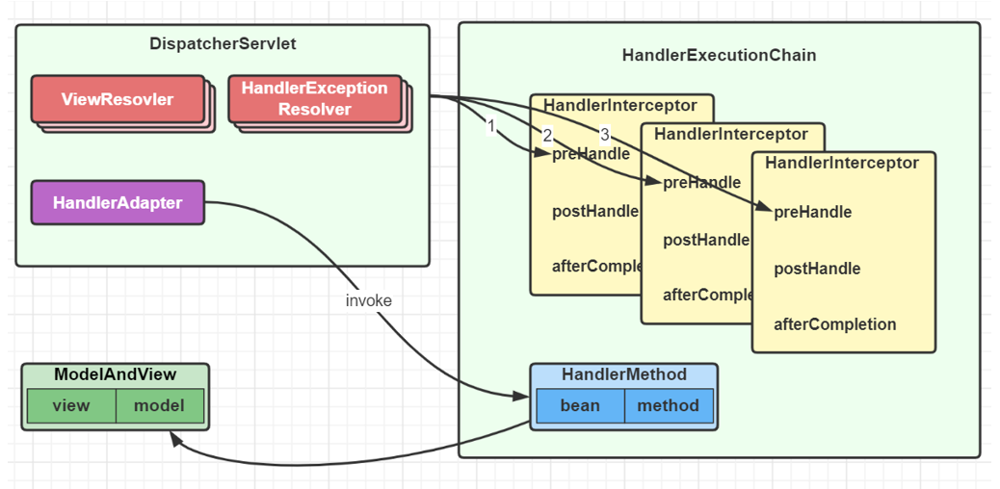

# Spring 事务失效场景之一：抛出检查异常不回滚

## 面试题考什么

「Spring 事务失效的几种场景及原因」是事务题里最常见的一道，课程一共总结了八种场景，这是第一种，也是最容易在实际项目里踩到的一种：方法抛了异常，事务却提交了。面试官要你答出原因（默认只回滚 RuntimeException 和 Error）和解法（rollbackFor）。

## 先给结论

@Transactional 默认只对 RuntimeException 和 Error 本身及其子类进行回滚，抛出检查异常（比如 FileNotFoundException）时不会回滚，事务照常提交。解决办法是在注解上加 rollbackFor，指定遇到什么异常要回滚，一般建议直接配 `rollbackFor = Exception.class`，让 Exception 及其子类都能触发回滚。



## 是什么：实验环境

先准备一个最简单的 Spring 容器，提供必要的 bean 后处理器和 bean 工厂后处理器，然后用配置类的方式做配置：

```java
@Configuration
@PropertySource("classpath:jdbc.properties")
@EnableTransactionManagement
@ComponentScan("day04.tx.app.service")
@MapperScan("day04.tx.app.mapper")
public class AppConfig {
    @ConfigurationProperties("jdbc")
    @Bean
    public DataSource dataSource() { return new HikariDataSource(); }
    
    @Bean
    public DataSourceInitializer dataSourceInitializer(DataSource dataSource, DatabasePopulator populator) { ... }
    
    @Bean
    public DatabasePopulator databasePopulator() { ... }
    
    @Bean
    public SqlSessionFactory sqlSessionFactory(DataSource dataSource) { ... }
    
    @Bean
    public PlatformTransactionManager transactionManager(DataSource dataSource) {
        return new DataSourceTransactionManager(dataSource);
    }
}
```

配置类里做了几件关键的事：解析资源文件读取数据库连接信息；启用声明式事务管理，也启用了 AOP；做包扫描，扫描 service 包下的业务类；因为用到 MyBatis，还用 MapperScanner 去扫描相关的 Mapper 接口。

下面配置的几个 bean 各有用途：数据源用 Hikari 连接池；数据源初始化器主要用于测试，它会执行一个 SQL 脚本，每次执行方法都会跑这个脚本，把旧表删掉、创建新表、插入两条账户测试数据，保证每次数据都从一致的初始状态开始；因为要用 MyBatis，还配置了 SqlSessionFactory；最后为了处理声明式事务，必须配置 DataSourceTransactionManager，它是配合 MyBatis 使用的事务管理器。

业务类是 Service1，代表第一种事务失效情况：

```java
@Service
public class Service1 {
    @Autowired
    private AccountMapper accountMapper;
    
    @Transactional
    public void transfer(int from, int to, int amount) throws FileNotFoundException {
        int fromBalance = accountMapper.findBalanceBy(from);
        if (fromBalance - amount >= 0) {
            accountMapper.update(from, balance - 1 * amount);
            accountMapper.update(to, amount);
        }
    }
}
```

transfer 方法从源账户向目标账户转钱。先查询源账户余额，余额充足就源账户减钱、目标账户加钱，一共三条 SQL。因为有多条 SQL、要保证原子性，所以加了 @Transactional 做声明式事务控制。

先跑一遍确认配置能走通：日志里打印了创建了新的事务、获取了数据库连接并把连接切换为手动提交，接着执行三条 SQL，最后提交事务并释放 JDBC 连接（归还给 Hikari 连接池）。配置没有问题。

## 为什么：检查异常不触发回滚

接下来在业务方法中间制造一个异常：构造一个 FileInputStream 去读一个不存在的文件，就会抛出 FileNotFoundException。

注意这个异常属于**检查异常**。什么是检查异常？就是语法上强制要求处理的异常：要么在方法声明处加 throws 说明要抛出它，要么自己用 try catch 把异常捉起来。反之，语法上没有强制要求的，不需要加 throws 也不需要 try catch 的，叫未检查异常。

运行之后，日志显示事务确实开始了、连接切换成了手动提交，接着执行了两条 SQL（第三条还没来得及执行就出异常了）。既然本来是想让三条 SQL 作为一个整体执行，现在只执行了两条，不完整，理应回滚。但日志显示的不是回滚，而是提交：

```text
- Initiating transaction commit
- Committing JDBC transaction on Connection [HikariProxyConnection...]
```

查数据库也能印证：两个账户初始余额都是 1000，如果回滚了应该恢复成两个 1000，但结果是源账户减了 500、目标账户那 500 没加上，总金额从 2000 变成了 1500，数据不一致。这就是抛出检查异常导致的事务失效。

原因在于：Spring 默认情况下只对 RuntimeException 和 Error 这两个异常本身以及它们的子类进行回滚操作；抛出检查异常时，它并不会回滚。

## 深入细节：加 rollbackFor 解决

改正方法很简单，加一个 rollbackFor 配置，意思是遇到什么样的异常要进行回滚：

```java
@Service
public class Service1 {
    @Autowired
    private AccountMapper accountMapper;
    
    @Transactional(rollbackFor = Exception.class)
    public void transfer(int from, int to, int amount) throws FileNotFoundException {
        int fromBalance = accountMapper.findBalanceBy(from);
        if (fromBalance - amount >= 0) {
            accountMapper.update(from, balance - 1 * amount);
            new FileInputStream("aaa");
            accountMapper.update(to, amount);
        }
    }
}
```

写成 `rollbackFor = FileNotFoundException.class` 表示只有遇到这个异常才回滚；为了把常见异常都涵盖进去，一般建议直接配 `rollbackFor = Exception.class`，这样只要是 Exception 及其子类都会触发回滚。

加上之后再跑一次，异常还是那个异常，两条 SQL 执行了、第三条没执行，但日志变成了回滚：

```text
Exception in thread "main" java.io.FileNotFoundException: aaa
- Initiating transaction rollback
- Rolling back JDBC transaction on Connection [HikariProxyConnection...]
```

## 面试怎么答

被问到事务失效场景，把这一种作为第一条答：

1. **现象**：方法抛了异常，但事务提交了，数据不一致。
2. **原因**：@Transactional 默认只回滚 RuntimeException 和 Error 及其子类，检查异常不回滚。
3. **解法**：加 rollbackFor，建议直接配 `rollbackFor = Exception.class`。

追问通常有两个方向。一是「为什么默认这样设计」：这是沿袭 EJB 的惯例，认为检查异常是「可预期的业务异常」，调用方已经强制处理过，不代表需要回滚。二是「还有哪些常见失效场景」：非 public 方法、同一个类内部方法自调用（没走代理）、异常被 try catch 吞掉、数据库引擎不支持事务、传播行为配置错误等，这些是另外几种场景的内容。

## 常见误区

以为只要加了 @Transactional、方法里抛了异常就一定会回滚。默认规则只覆盖运行时异常和 Error，检查异常必须显式配置 rollbackFor；把异常 catch 掉不往外抛，同样不会回滚。

## 课件配图
> 以下配图取自阶段七课件对应讲义，与上文讲解一一对应，可作为图文对照辅助理解。
**Spring 事务失效**（课件讲义图示）


**讲义配图**（课件讲义图示）

