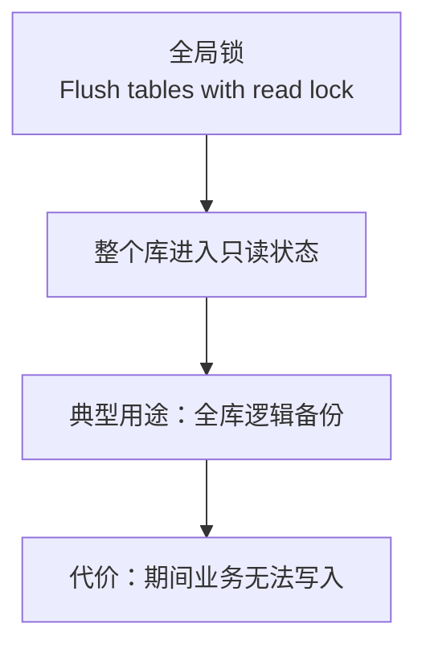

# 全局锁

## 开场

面试官问「你对 MySQL 的锁了解吗」，其实是在考你两件事：第一，你能不能把锁按粒度分成全局锁、表级锁、行级锁三层讲清楚；第二，你能不能说出每一层锁的真实使用场景。全局锁这一层最容易答空，因为它平时用得少，但它有一个非常经典的落地场景：全量备份。

## 先给结论

全局锁是粒度最粗的一层锁，用 `FLUSH TABLES WITH READ LOCK` 加锁，会把整个实例里所有库的所有表都加上读锁，期间阻塞所有 DML（增删改）和 DDL（改表结构），但查询不受影响。它的典型用途是全量备份时保证多张表之间的数据一致性。因为它代价太大（业务基本停写），所以 InnoDB 表更推荐用 `mysqldump --single-transaction` 走快照读来备份，只有非事务引擎的表才必须依赖全局锁。



## 是什么：MySQL 的三层锁粒度

从加锁范围由大到小，MySQL 的锁可以分成三类：

- 全局锁：针对所有库的所有表，加锁范围最广。
- 表级锁：以表为单位锁定。
- 行级锁：粒度最细，锁的是数据行，以及行与行之间的间隙。

全局锁的语法就一行：

```sql
FLUSH TABLES WITH READ LOCK;
```

执行后所有表被加上全局读锁，其他客户端照样能查，但增删改和改表结构都会被阻塞。备份做完后用下面这条语句解锁：

```sql
UNLOCK TABLES;
```

## 为什么：备份时不加锁会出什么问题

假设系统里有两张表：账户表和课程表。账户表余额 200，课程表还没有课程。现在两个客户端同时来了。

客户端一要做备份，它先备份账户表，记下余额 200，还没来得及备份课程表。这时客户端二执行了一个购买业务：买了一门 99 元的课程，账户表余额从 200 减到 101，课程表的课程数从 0 变成 1。客户端二这几步操作本身完全正确，也提交成功了。

问题出在客户端一身上。它接着备份课程表，读到课程数是 1。于是最终备份出来的数据是：余额 200，课程数 1。相当于一分钱没花，白赚了一门课。

正确的数据只有两种组合：要么余额 200、课程 0，要么余额 101、课程 1。一旦拿这份错乱的备份去做恢复，业务逻辑就错了，用户的账和课对不上。

全局锁就是为了解决这件事：备份期间禁止任何写入，那么账户表和课程表被读到的必然是同一时刻的状态，不会有中间态。

## 深入细节：一次完整的加锁备份

演示环境里有两个客户端。客户端一先加全局读锁：

```sql
FLUSH TABLES WITH READ LOCK;
```

返回 `Query OK, 8 rows affected`，锁就加上了。此时客户端一可以继续读：

```sql
SHOW TABLES;
SELECT * FROM t;
```

客户端二尝试写入：

```sql
INSERT INTO t VALUES(14,'bbb',18);
```

这条语句会被阻塞住，界面上一直卡着不动，直到超时或被中断，返回 `ERROR 1317 (70108): Query execution was interrupted`。这就直观地证明了全局读锁对 DML 的阻塞效果。

客户端一这时可以安全地执行备份，用 MySQL 自带的 `mysqldump` 工具：

```bash
mysqldump -u root -p test > 1.sql
```

`-u` 后面跟用户名，`-p` 表示接下来要输入密码，再后面是要备份的库名，最后用重定向把结果写进 `1.sql`。因为备份是读操作，和全局读锁兼容，不会互斥。

备份完成后，客户端一解锁：

```sql
UNLOCK TABLES;
```

这时客户端二再执行那条插入，就返回 `Query OK, 1 row affected`，写入恢复正常。

## 另一种方案：用快照读备份

加全局锁的代价是整个实例在备份期间不能写，业务基本处于停摆状态。所以 InnoDB 表的备份更推荐给 `mysqldump` 加一个参数：

```bash
mysqldump --single-transaction -u root -p test > 1.sql
```

这个参数的作用是让备份在一个事务里进行，底层用的就是快照读。事务一启动就会建立数据快照，后续所有表的备份都以快照时刻的数据为基准。

沿用前面的例子：如果客户端一先开事务，快照里就是余额 200、课程 0，之后客户端二怎么改都不影响备份结果；如果客户端一开得晚，客户端二的事务已经提交，那快照就建立在提交之后，备份出来的是余额 101、课程 1。两种结果各自内部都是自洽的，不会出现「余额 200 配课程 1」这种拼接出来的错乱数据。

需要注意它的局限性：`--single-transaction` 依赖事务，所以只支持 InnoDB 引擎的表。如果库里还混着 MyISAM 这类非事务引擎的表，快照读就罩不住它们，这时还是得回到全局锁。

## 面试怎么答

「MySQL 的锁按粒度怎么分？全局锁有什么用？」可以这么答：

> 锁分三层，全局锁、表级锁、行级锁。全局锁用 `FLUSH TABLES WITH READ LOCK` 加，锁住所有库的所有表，阻塞所有 DML 和 DDL，只放行查询，用 `UNLOCK TABLES` 释放。它的用途是全量备份时保证多表之间的数据一致性，典型的不加锁场景是：先备份账户表拿到余额 200，这时另一个事务买了 99 元的课把余额改成 101、课程数改成 1，再备份课程表拿到 1，最后备份出「余额 200、课程 1」这种错乱数据。不过全局锁太重，业务会停写，所以 InnoDB 表一般用 `mysqldump --single-transaction` 走快照读备份，这个方案只支持事务引擎，MyISAM 表不行。

追问：「加了全局读锁之后，备份为什么还能正常执行？」

> 因为备份走的是读操作，读锁和读锁之间是共享的、不互斥。全局读锁排斥的是写操作（DML、DDL），不是读操作。

追问：「`--single-transaction` 为什么能保证一致性？」

> 它在可重复读隔离级别下开启一个事务，事务内的普通读是快照读，整个备份过程看到的是事务开始那一刻的一致性视图，其他事务后续的提交对它不可见，所以多张表读出来的是同一时点的数据。

## 常见误区

- 以为全局锁会阻塞查询。不会，读锁只排斥写，查询照常执行。
- 以为备份工具一定要配全局锁。InnoDB 表优先用 `--single-transaction`，全局锁是兜底手段。
- 以为 `--single-transaction` 万能。库里一旦有 MyISAM 这类非事务引擎的表，它就保证不了这些表的一致性。
- 把全局锁当成日常并发控制手段。它是运维级的重操作，只在备份这类场景短时使用，不能拿来替代行锁或事务隔离。
