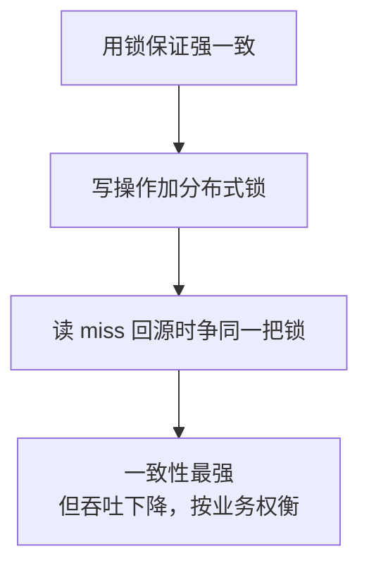

# 缓存一致性：锁方案

## 开场

缓存与数据库的一致性，常见的方案有三种：先清缓存再更新库、先更新库再清缓存、以及用锁来做强一致。前两种都是最终一致，会在极短的时间窗内出现不一致；第三种是面试官追问「有没有强一致的方案」时你要能拿出来的答案。

## 先给结论

用锁解决缓存一致性，属于强一致方案。思路很简单：不管是查询还是更新，进入业务逻辑之前都必须先抢到同一把锁，抢到锁才有权去执行后面的多步操作（查库、写缓存、更新库、清缓存），抢不到就直接返回。这样一来，查询的两步和更新两步永远不会交错执行，缓存与数据库始终一致。代价是性能：所有相关请求被串行化了，所以除非业务对一致性要求极其严格，实际开发中不会用。



## 是什么：锁加在哪里

以 Redis 实现的分布式锁为例，加锁和解锁就是两个命令：

```bash
setnx lock.foo
del lock.foo
```

`setnx` 的含义是「set if not exists」，只有这个 key 不存在时才能设置成功，也就是抢锁；成功拿到锁的线程进去执行业务，执行完用 `del` 删掉这个 key，也就是释放锁。

这里的锁是针对同一份数据（同一个缓存 key）的，不是全局一把大锁。为了把问题讲清楚，下面的分析做了简化：不考虑分布式环境下的锁续期、过期时间、误删别人锁这些工程细节，只看「加锁、执行多步操作、解锁」这条主线。

## 为什么：不用锁为什么会不一致

回顾一下不加锁的写法。查询流程是「缓存没有 → 查数据库 → 结果放入缓存」，更新流程是「更新数据库 → 清空缓存」。这两串动作都是多步的，而多步操作在没有保护的情况下是可以交错的。

典型的问题场景是这样：查询线程 A 缓存没命中，去查库拿到旧值 1，正准备写缓存；这中间更新线程 B 插进来，把库改成 2 并清了缓存；然后 A 才把自己手里的旧值 1 写进缓存。结果是库里是 2，缓存里是 1，而且这个旧值会一直留在缓存里直到过期，属于长时间的不一致。

锁要解决的正是这个「交错」问题。

## 深入细节：两种执行顺序都不会出问题

**第一种情况：查询先拿到锁。**

线程 A 要查询，先执行 `setnx` 抢锁，成功后读缓存，发现没有，于是准备查库。这时线程 B 想插队做更新，它也得先 `setnx`，但锁已经被 A 持有，B 加锁失败，只能返回。

A 不受干扰地查库拿到旧值 1，把结果写入缓存，然后 `del` 释放锁。虽然此刻缓存里是旧值，但中间没有任何人插进来改过数据，所以这个旧值和库里的值是一致的。

锁释放后，B 重试 `setnx`，这次拿到了锁，把新值 2 更新进库，再清空缓存，最后解锁。整个过程里查询的两步和更新的两步没有发生任何交错，最终一致。

**第二种情况：更新先拿到锁。**

线程 B 先执行 `setnx` 拿到锁，线程 A 再来抢锁就失败，只能暂时返回。B 安全地做自己的事：更新库，再清缓存，然后 `del` 释放锁。

这里有个关键点值得注意：一旦加了锁，「先更新库还是先清缓存」这个顺序已经不重要了。因为整个临界区内不会有别的线程读写这份数据，先做哪一步都不会产生中间态被别人读到，所以两种顺序都能得到正确结果。

B 解锁后，A 才能执行：抢锁成功，查库拿到最新的 2，写入缓存，释放锁。此时缓存里是 2，库里也是 2。

可以看到，只要把所有对同一份数据的操作都串行化，无论谁先谁后，缓存和数据库的数据始终是一致的。

## 面试怎么答

「缓存和数据库的一致性怎么保证？有没有强一致的方案？」

> 常见做法是 cache aside：读的时候先读缓存，没有再读库并回写；更新的时候先更新库再删缓存。这是最终一致，在极端交错下会有短暂甚至较长时间的不一致，一般用 TTL 兜底、延时双删来缓解。如果要求强一致，可以用锁：查询和更新执行前都必须先抢同一把锁，抢不到就直接返回，拿到锁才去执行查库、写缓存、更新库、清缓存这些多步操作，执行完释放锁。这样两套多步操作不会交错，数据始终一致。代价是性能，相关请求被串行化，所以只有对一致性要求特别严格的场景才会用。

追问：「用了锁之后，更新时先更新库还是先删缓存，还重要吗？」

> 不重要了。加锁之后，更新库和删除缓存这两步处在同一个临界区内，中间不会有别的线程进来读这份数据，也就不会产生被别人观察到的中间态，所以先做哪个都能得到正确结果。这个顺序问题本质上是无锁方案下才需要权衡的。

追问：「这个方案有什么工程上的坑？」

> 简化模型之外还有一堆细节要处理：锁必须有过期时间，否则持锁线程宕机就会死锁；过期时间又可能不够业务执行，需要续期；释放锁时要校验是不是自己加的锁，避免误删别人的；加锁失败后的策略是快速失败、自旋重试还是阻塞等待，要根据场景定；另外锁的粒度要按数据维度（比如一个缓存 key 一把锁）来设计，用一把全局锁会把整个系统的吞吐拖垮。

## 常见误区

- 以为用了锁就还能保持高并发。锁的本质是把并发串行化，强一致是用吞吐换来的。
- 以为加锁后顺序问题依然存在。顺序问题是无锁场景下多步操作交错导致的，加锁后临界区内不存在交错。
- 以为加锁失败就该一直重试。工程上通常快速失败或有限次重试，否则会把压力堆在锁竞争上。
- 忽略锁自身的可靠性。生产环境用 Redis 做分布式锁，要处理过期、续期、归属校验这些问题，不能只写 `setnx` 和 `del`。
