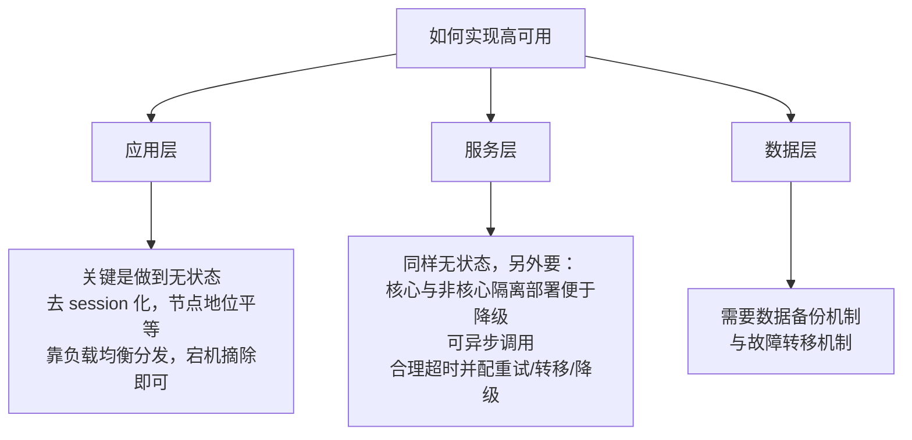

# 如何实现高可用

## 开场

「你们的系统是怎么做高可用的？」这类问题没有标准答案，考的是你有没有成体系的设计思路，而不是背几个组件名。一个清晰、好记、能展开的回答框架是：按层次拆成应用层、服务层、数据层，每一层各自回答「这一层凭什么不怕挂」。

## 先给结论

- 应用层高可用：核心是无状态，节点之间地位平等，配合负载均衡把请求打到任意节点，节点宕机后从服务列表摘掉即可。
- 服务层高可用：同样要无状态，此外还要做服务拆分与隔离部署、把非实时调用异步化、合理设置超时并配套重试、转移、降级策略。
- 数据层高可用：必须持久化且不能丢，靠数据备份与故障转移、副本与分片来保障，多副本之间用 Paxos、Raft 这类一致性算法保证数据一致。
- 缓存层是否需要高可用有争议，但更稳妥的做法是给它也做主备，因为缓存一旦整体失效，数据库会直接被流量打穿。

顺带一提，想系统梳理这块内容，可以读李智慧写的《大型网站技术架构：核心原理与案例分析》，高可用这一章的条理相当清楚。

## 是什么：高可用到底在解决什么

高可用说的是：系统的某些组件出问题的时候，整体上还能继续对外提供服务。所以设计的主线只有两条，一是让单个节点变得可有可无（无状态 + 冗余），二是让故障发生时能被快速发现和隔离（故障转移 + 降级）。下面三层各自的手段，都是这两条主线的具体化。

## 为什么：应用层为什么要无状态

应用层高可用的关键是无状态，也就是集群里所有节点地位平等，谁都不存只有自己才有的信息。

反面例子是 session。假设服务器 A 上存了某个用户的登录信息，服务器 B 上没有。那用户下次请求被负载均衡打到 B，就读不到登录态；更糟的是 A 一宕机，这份 session 信息就没了，其他服务器上都找不到。一旦引入状态，问题立刻变得复杂：session 要不要复制到所有节点？要不要做 session 绑定让同一个用户的请求固定打到同一台机器？这些都会显著增加复杂度和故障面。

所以无状态的要求是：不要在本层存储用户相关的任何特殊信息，这些状态每次都由客户端的请求带过来（比如放在 token 里，或者统一放到外部的缓存、存储服务里）。

无状态的好处很直接：

- 配合负载均衡，请求可以发到任意一台节点上处理，因为每台机器的处理方式都一样，不需要任何特殊调整。
- 扩展性极好，加机器就是加节点。
- 某个节点宕机，把它从服务列表里移除即可，业务不受影响，因为其他节点都能干同样的活。

## 深入细节：服务层除了无状态还要做什么

服务层同样要做到无状态，除此之外还有三点要考虑。

**第一，服务要拆分，核心服务和非核心服务要隔离部署。** 隔离之后才能分级管理，才能方便地对非核心业务做降级。业务高峰期来了，把资源让给核心服务保证它能正常运行，非核心服务适当降级甚至关停，整体可用性就保住了。如果不分主次、所有服务挤在同一批机器上，压力一大就是大家一起崩。

**第二，对即时性要求不高的调用，改成异步。** 引入消息中间件，把同步调用变成异步消息，调用方不用一直等着被调方返回，被调方短暂抖动也不会直接把调用方拖死，整个服务层的可用性就提高了。

**第三，合理设置超时时间，并配套超时之后的处理策略。** 不管是应用层调服务层，还是服务层内部互相调用，都要考虑超时。超时之后怎么办，一般有三种策略：重试、转移（换一个节点再调）、降级（返回兜底结果或直接跳过）。

这里要特别提醒一点：选了重试，就必须考虑接口的幂等性。不能因为重试了几次，同一条记录就重复插入了好几条。这往往是面试官接着往下追问的地方。

## 数据层：必须持久化，靠备份和故障转移兜底

应用层和服务器层的共同点都是无状态，但数据层做不到无状态，数据必须持久化保存下来，而且要保证一致、不能丢失。所以数据层高可用要考虑的是另外几件事：

- 数据备份机制：全量备份加增量备份，备份要能真正恢复。
- 故障转移机制：主节点挂了，备节点要能顶上来。
- 数据一致性：多副本之间的一致怎么保证。

具体的实现思路很多。MySQL 可以做主备，其他数据存储也都有类似的机制：做数据副本、做分片，都是提高数据层可用性的常见手段。至于多份副本之间的数据一致性，可以用 Paxos、Raft 这类一致性算法来保证。

## 缓存层要不要高可用：两种观点

和数据层相关的还有缓存服务。缓存服务本身要不要做高可用，有两种不同看法。

第一种观点认为缓存非常重要，必须对缓存服务做高可用。理由是缓存是对数据库的保护层，如果缓存整体不可用，所有请求都会直接压到数据库上，数据库很可能当场被打垮。所以缓存也要做主备，master 挂掉之后 slave 顶上去，始终对后端数据库起到保护作用。

第二种观点认为缓存不是数据存储服务，不能把它当数据库用，这一点本身没错。缓存宕机应该通过其他方式解决，比如扩大缓存规模：集群规模大了之后，单个缓存节点宕机只会影响局部的保护能力，不会动摇整体业务的稳定性。

两种观点各有道理，但工程实践中更推荐第一种。缓存虽然不是数据库，但它挡在数据库前面，它的可用性直接影响数据库的存亡，因此给它配主备、配故障转移是必要的。

## 面试怎么答

「如何设计一个高可用的系统？」可以按三层来答：

> 我会分三层看。应用层的核心是无状态，集群内节点地位平等，不存 session 这类本地状态，状态由请求携带或者下沉到外部存储，这样配合负载均衡可以把请求打到任意节点，节点宕机直接从服务列表摘除即可。服务层同样要无状态，另外要做三件事：核心服务和非核心服务拆分并隔离部署，方便高峰期对非核心服务降级；对实时性要求不高的调用引入消息中间件改成异步；所有跨服务调用都要设置合理的超时，并配套重试、转移、降级策略，其中重试必须保证接口幂等。数据层不能无状态，必须有数据备份和故障转移机制，通过副本、分片提高可用性，多副本之间用 Raft 这类一致性算法保证数据一致。另外缓存层我也建议做主备，因为缓存整体失效会把流量全部压到数据库上。

追问：「为什么要强调无状态？」

> 因为状态是单点。一旦某些数据只存在于某个节点上，这个节点就变得不可替代，它宕机就意味着这部分能力不可用，而且还要额外解决状态复制、请求绑定这些问题。去掉状态之后节点可以随意替换和扩缩，故障恢复也变成简单的摘除操作。

追问：「超时之后重试有什么要注意的？」

> 最重要的是幂等。重试意味着同一个请求可能被处理多次，如果接口不幂等，就会出现重复下单、重复插入这类问题。所以要通过唯一请求号、数据库唯一约束或者状态机校验来保证重复执行的结果和一次执行一致。另外重试要有次数上限和退避策略，否则会放大下游的压力。

## 常见误区

- 以为高可用就是多部署几台机器。没有无状态设计，多部署的机器之间地位不平等，扩多少台都没用。
- 以为服务拆分只是为了解耦。在高可用语境下，拆分的核心目的是隔离和分级管理，让非核心服务可以被降级。
- 只设超时不设策略。超时时间只是触发器，真正决定可用性的是超时之后重试、转移还是降级。
- 忽略重试带来的幂等问题，这是降级、重试类方案里最常见的线上事故来源。
- 把缓存当成纯加速组件，不做任何高可用设计，结果缓存一挂数据库就被打穿。
