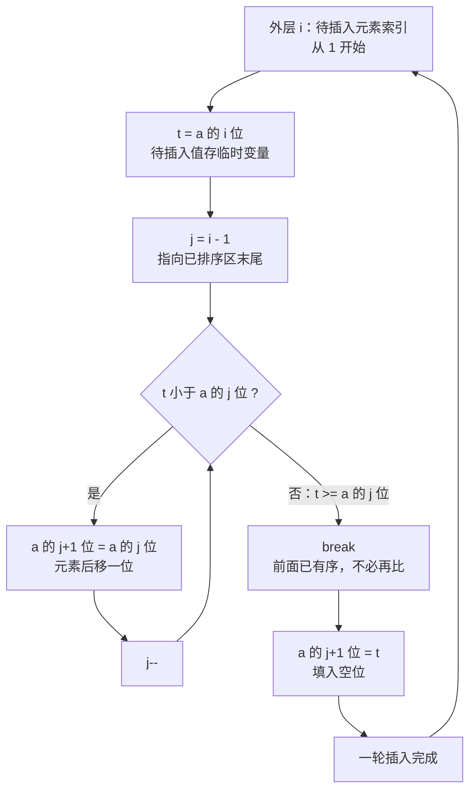

# 插入排序的实现

## 开场

插入排序的思路上一篇已经讲过了：把数组分成已排序区和未排序区，每次从未排序区拿一个元素，插入到前面已排序区的合适位置。面试官让你手撕的时候，真正的考点在内层循环：待插入的值为什么要先存进临时变量，元素是怎么「后移」的，以及那个 `break` 到底优化掉了什么。

## 先给结论

插入排序用两个索引配合一个临时变量完成：

- `i` 代表待插入元素的索引，从 1 开始，一直到数组长度；
- `t` 是临时变量，保存待插入元素的值；
- `j` 代表已排序区域的元素索引，初值是 `i - 1`，比较过程中不断 `j--`。

内层循环做两件事：`t < a[j]` 就把 `a[j]` 后移一位（`a[j + 1] = a[j]`）；一旦 `t >= a[j]` 就 `break`，因为前面已经有序，没必要再比。循环结束后把 `t` 填进 `j + 1` 这个空位，一轮插入就完成了。



## 是什么：完整代码

```java
public class InsertSort {
    public static void main(String[] args) {
        int[] a = {9, 3, 7, 2, 5, 8, 1, 4};
        insert(a);
        System.out.println(Arrays.toString(a));
    }

    private static void insert(int[] a) {
        // i 代表待插入元素的索引
        for (int i = 1; i < a.length; i++) {
            int t = a[i]; // 代表待插入的元素值
            int j = i - 1; // 代表已排序区域的元素索引
            while (j >= 0) {
                if (t < a[j]) {
                    a[j + 1] = a[j]; // 移动元素
                } else {
                    break; // 退出循环，减少比较次数
                }
                j--;
            }
            a[j + 1] = t; // 插入元素
        }
        System.out.println(Arrays.toString(a));
    }
}
```

## 为什么：三个变量各自解决什么问题

**外层循环为什么从 1 开始。** 插入排序是把下标 1 之后的所有未排序元素，一个一个拿出来插到前面的已排序区。第 0 个元素自己一个人天然就是有序的，所以待插入元素从 1 开始，一直循环到数组长度，`i` 就对应「待插入元素的索引」。

**为什么需要临时变量 `t`。** 假设现在待插入的值是 3，而它前面有个更大的元素 9，9 要往后挪一位才能给 3 腾出位置。一旦 9 挪过来，3 原来的位置就被覆盖了，3 这个值就丢了。所以必须先把待插入的值记进一个临时变量 `t`，原来的位置才能空出来去存放更大的元素。

**为什么需要 `j`。** 待插入的值要跟前面已排序区的元素逐个比较。比如要插入 7，它得跟前面的 3、9 依次比较，所以需要一个变量表示已排序区的索引。它的初值正好是 `i - 1`，也就是待插入元素的前一个位置，之后每比较一次就 `j--` 往前走一格。

## 深入细节：内层循环的两条分支

内层循环的条件是 `j >= 0`，也就是只要还没走到数组头，就继续比较。比较的是 `t` 和 `a[j]`，也就是待插入值和已排序区当前元素。

**分支一：`t < a[j]`，把 `a[j]` 后移一位。** 比如待插入的 7 小于 9，那么 9 显然应该往后排，去占据刚才空出来的那个位置，7 才能插到 9 原来的位置上。后移一位的写法就是 `a[j + 1] = a[j]`：把 `j` 位置的值搬到 `j + 1`。

搬完之后 `j--`，继续往前比。回到例子里，`j` 减到下标 0，拿 3 跟 7 比较，这次 7 大于 3，条件不成立。

**分支二：`t >= a[j]`，直接 `break`。** 这一步是插入排序里一个比较重要的优化。因为可以假定前面这个区域已经是排好序的结果，既然 7 比 3 大，那 3 前面的元素只可能更小，不可能再出现比 7 大的元素。所以一旦遇到待插入元素大于等于 `a[j]`，就说明位置已经找到了，直接退出循环，省掉后面所有毫无必要的比较。

**循环结束后的收尾。** 退出循环时 `j` 已经减过了，所以 `j + 1` 恰好就是空出来的那个位置。把 `t` 赋值给 `a[j + 1]`，就完成了这一轮的插入。注意别漏这最后一步，否则前面搬了半天，待插入的值还没放回去。

## 每轮发生了什么

用 `{9, 3, 7, 2, 5, 8, 1, 4}` 跑一遍，把每轮插入后的数组状态打印出来，可以看到有序区在不断扩大：

- 第 1 轮：`3 9 7 2 5 8 1 4`，把 3 插到 9 前面；
- 第 2 轮：`3 7 9 2 5 8 1 4`，把 7 插到 3 和 9 中间；
- 第 3 轮：`2 3 7 9 5 8 1 4`，把 2 插到最前面；
- 第 4 轮：`2 3 5 7 9 8 1 4`，把 5 插到 3 和 7 中间；
- 后续几轮依次把 8、1、4 插入，最终得到 `1 2 3 4 5 7 8 9`。

配合排序动画看会更直观：每一轮里，比待插入值大的元素整体右移一格，待插入值落到空出来的坑里，有序区就向前扩张一格。

## 面试怎么答

「手写一下插入排序，并说明每个变量的含义。」

> `i` 是待插入元素的索引，从 1 开始；`t` 是临时变量，先存住待插入的值，因为前面更大的元素往右挪时会把原位覆盖掉；`j` 是已排序区的索引，初值为 `i - 1`。内层 `while (j >= 0)` 里比较 `t` 和 `a[j]`：如果 `t < a[j]`，说明 `a[j]` 应该往后让位，执行 `a[j + 1] = a[j]` 后移一位，然后 `j--` 继续往前比；如果 `t >= a[j]`，说明位置找到了，直接 `break`，因为前面已经有序，不用再比。循环结束后 `a[j + 1] = t`，把待插入值放进空位。

追问：「那个 `break` 能不能去掉？」

> 能去掉，用 `while (j >= 0 && t < a[j])` 也能得到正确结果。但保留 `break` 的好处是减少比较次数：已排序区是有序的，一旦遇到一个不大于 `t` 的元素，它前面的元素必然也都小于等于 `t`，继续比较纯属浪费。

追问：「时间复杂度和稳定性？」

> 平均和最坏都是 O(n²)，比较和移动的次数都随 n 的平方增长；最好情况（数组已经有序）每轮内层循环第一次比较就 `break`，是 O(n)。它是稳定排序，因为只有 `t < a[j]` 时才后移，等于的情况不移动，相等元素的相对顺序不会被打乱。

## 常见误区

- 忘了用临时变量存待插入值，直接拿 `a[i]` 参与比较，结果被前面的元素覆盖，值丢失。
- 循环结束后忘记 `a[j + 1] = t`，元素移了位但待插入值没回填。
- 用 `j` 而不是 `j + 1` 做回填位置。退出循环时 `j` 已经减过一次了，`j + 1` 才是空位。
- 把 `t < a[j]` 写成 `t <= a[j]`，相等时也后移，排序就变成不稳定的了。
- 认为插入排序一定比冒泡、选择慢。它虽然同为 O(n²)，但在近乎有序的数据上表现接近 O(n)，而且内层循环是简单的比较加赋值，常数很小，小规模数据上很实用。
