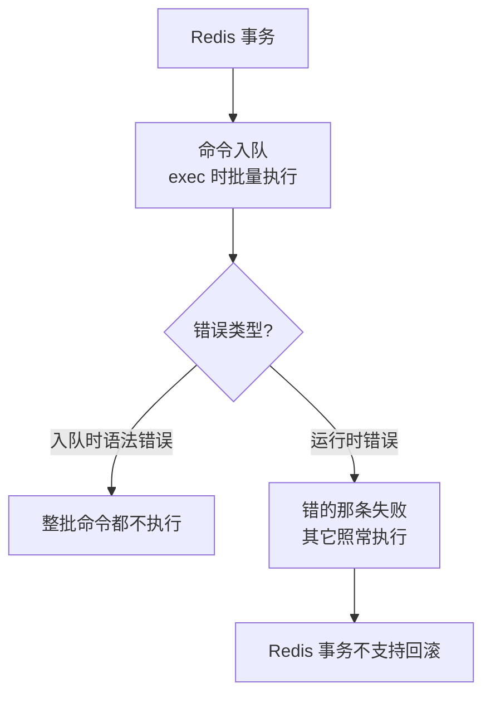

# Redis 事务为什么不支持回滚

面试题：Redis 的事务和 MySQL 的事务有什么区别？

Redis 用 multi 加 exec 实现事务，但它和数据库事务有一个根本差异：不支持回滚。命令入队时不检查对错，执行时某条失败，前面成功的命令不会被撤销。这篇用实验把这个特点讲透，并顺带理清 multi 加 exec 的另外两个特性。

## 先给结论

- Redis 单条命令是原子的，由底层的单线程机制保证，这一点没有问题。
- multi 加 exec 能批量执行命令，但不支持回滚：执行阶段某条命令失败，已成功的命令不会被撤销。
- 入队阶段不校验命令对错，类型错误的命令也能进队列，到 exec 才报错。
- 与 MySQL 事务「要么都成功、失败全撤销」不同，Redis 事务可能部分成功。
- 另外两个特性：事务里的读操作没有意义，因此也没法保证读加写的原子性。



## 深入细节：一个不复滚的实验

先初始化三个键：a 是 1000，b 是 1000，c 是个字符串。然后执行 multi，相当于开始事务。接下来往事务里放多条命令，注意这些命令并不是立刻执行，只是加入事务队列，最后执行 exec 时才运行队列里的所有命令。

放三条命令进去：第一条让 a 减 1，第二条让 b 加 1，第三条让 c 加 1。前两条入队都正常。第三条有问题：c 的值是字符串，不是数字，字符串不能自增，这条命令将来执行时必然出错。但入队时不会检查值是否正确，所以入队照样成功。

三条命令都在队列里了，执行 exec，看结果：第一条成功，a 变成 999；第二条成功，b 变成 1001；第三条因为 c 不是数字，自增时报错。

现在对比 MySQL 事务：多条命令要么都成功，有一条失败，所有命令都应该被撤销。Redis 这里最后一条失败了，前两条被撤销了吗？没有。get a 是 999，get b 是 1001，前两条的结果原样保留。这就是 Redis 事务的实现特点：不支持回滚，多条写操作可能部分成功、部分失败。

示例命令长这样：

```redis
set a 1000, set b 1000 set c a
multi, decr a, incr b, incr c, exec
```

## 深入细节：读操作没有意义

multi 加 exec 的第二个特性：事务里执行读操作没有任何意义。Redis 事务没有临时变量的概念，get 的结果没法被同一事务里的写命令使用，也不能写 a 加 b 让 Redis 当表达式算，它只会当成字符串。比如先 get a 得到 999、get b 得到 1001，再 set c 存两者的和，实际存进去的是字面字符串。

```redis
set a 1000, set b 1000
get a, get b (分别为 1000), 现在转账 500
multi, set a 500, set b 1500, exec
```

既然事务里的读没有意义，第三个特性顺理成章：multi 加 exec 无法保证读加写的原子性。事务里只能放写操作，多个写操作之间可以保证原子；一旦涉及读，读必须放到事务外由应用程序完成，读写就不在一个事务里，一个事务控制不了它们。典型后果是丢失更新：如果在读和写事务之间，别的客户端修改了数据，你拿着旧值算出的结果写回，就把别人的更新覆盖掉了。

## 面试怎么答

1. **先答定位**：Redis 单条命令原子（单线程保证），multi 加 exec 是批量执行写命令的机制，不是数据库意义上的事务。
2. **再答不回滚**：入队不校验、执行失败不撤销，用 decr/incr 字符串键的实验说明。
3. **补两个特性**：事务内读无意义，因此读写原子性保证不了，会丢更新。
4. **点出根源**：Redis 事务的设计目标是「批量执行不被打断」，不是「失败可撤销」，这和它对性能和简单性的取舍有关。

常见追问：

- **问**：Redis 事务执行过程中会插入其他客户端的命令吗？
  **答**：不会。exec 时队列里的命令连续执行，这是它唯一能保证的原子性边界。
- **问**：那 Redis 怎么保证读写原子性？
  **答**：两条路：watch 加事务做乐观锁控制，或者用 Lua 脚本把读写打包成一段脚本整体执行。

## 常见误区

- **误区一**：把 Redis 事务当 MySQL 事务用，以为失败会回滚。不会，部分成功就部分成功。
- **误区二**：在事务里写 get 供后续命令使用。返回值只回到客户端，事务内消费不到。
- **误区三**：只记「不支持回滚」，答不出「读无意义、读写不原子」这两条连带结论。追问一句就空档。
