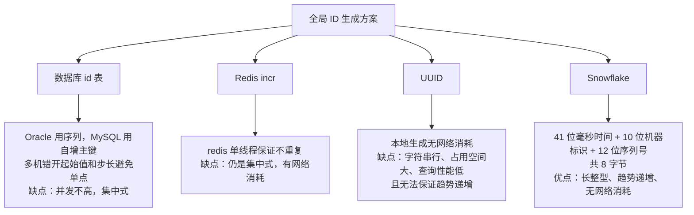

# 分布式通用设计：如何生成全局 ID

面试题：分布式系统中怎么生成全局唯一的 ID？

分库分表之后，单表自增主键就不够用了，全局 ID 生成是分布式设计的必备功课。常见方案四种：数据库 id 表、Redis incr、UUID、Snowflake。四种方案没有绝对的银弹，但面试标准答案的收敛方向很明确：优先 Snowflake。

## 先给结论

- 方案一：数据库。Oracle 用序列；MySQL 用自增主键，多台机器可以设不同起始值和步长避免单点。
- 方案二：Redis incr。单线程特性保证不重复，但仍是集中式方案，有网络消耗。
- 方案三：UUID。本地生成、无网络消耗，但含 MAC 地址有安全风险，且是字符串，占用空间大、查询性能低、不连续。
- 方案四：Snowflake 雪花算法。64 位长整型，41 位毫秒时间戳加 10 位机器标识加 12 位序列号，本地生成、趋势递增，是推荐方案。

## 深入细节：四种方案逐个看

**方案一：数据库 id 表。** 专门设计一张 ID 表来生成和存储 ID 值。用 Oracle 的话更省事，直接用序列生成。常用的 MySQL 可以用自增主键作为 ID。有同学会问：一台 MySQL 有单点故障怎么办？可以用两台 MySQL，设置不同的起始值和步长，比如一台生成 1、3、5、7 这样的 ID，另一台生成 2、4、6、8，这样即使一台挂了，另一台的 ID 生成不受影响，本质是控制 auto_increment 的起始值和步长。

这个方案的缺点：数据库本身并发不高，如果 ID 生成非常频繁，性能不够好；而且它是集中式解决方案，要先访问数据库拿到 ID 再返回给应用，中间有网络传输损耗。

**方案二：Redis。** 用 incr 命令生成 ID。Redis 的单线程特性可以保证 ID 不会重复。缺点和数据库类似，仍属于集中式方案，有网络消耗；但并发比数据库好一些，因为 Redis 是在内存里执行的。

**方案三：UUID。** UUID 是国际通用的算法，有多种实现。典型实现会在生成的 ID 里包含时间信息、MAC 地址信息和一些随机数。它最大的优点是本地解决方案：不用经过网络传输到一个中心服务器去问 ID 是多少，本地直接生成，没有网络消耗。

缺点也不少：典型实现包含 MAC 地址，别人拿到你的 ID 就能拿到你的 MAC 地址，有安全风险；更糟糕的是它是字符串形式，占用空间大、查询性能低，而且不连续，无法保证趋势递增。

**方案四：Snowflake 雪花算法。** 之前课程里应该讲过。Twitter 最早提出，通常实现是一个 64 位的长整型作为 ID，一共 64 个 bit：其中 41 位存储时间，精确到毫秒；10 位存储机器标识；12 位是顺序产生的序列号；还有 1 位没有使用。加起来 64 位，8 个字节。

它的优点：本地解决方案，不需要经过网络到中心服务器拿 ID，同时能保证生成的 ID 不重复；相对 UUID，它是长整型而不是字符串，避免了字符串的所有缺点，占用空间小、查询性能高，而且能保证趋势递增。理解了 Snowflake 的思想，还可以根据自己团队的实际情况对原算法做调整，网上有很多优化版本。

四种方案推荐使用雪花算法。

## 面试怎么答

1. **先分类**：集中式（数据库、Redis）和本地式（UUID、Snowflake），点出网络消耗是分水岭。
2. **逐个说优劣**：数据库和 Redis 强在连续 ID、弱在集中式瓶颈；UUID 强在本地无网络、弱在字符串和 MAC 泄露；Snowflake 两头都占。
3. **答出结构**：雪花算法 64 位怎么分，41 位毫秒时间戳、10 位机器标识、12 位序列号。
4. **给结论**：常规场景推荐 Snowflake，需要严格连续 ID 或号段管理的场景才考虑数据库方案。

常见追问：

- **问**：Snowflake 的时钟回拨怎么办？
  **答**：这是雪花算法的经典风险，服务器时间往回跳会导致同毫秒内序列号撞车。工程上的做法是检测到回拨时等待追平或借用机器位扩容，具体策略看实现。
- **问**：为什么 UUID 不适合做数据库主键？
  **答**：字符串占用空间大导致索引膨胀，无序插入还会造成页分裂，查询性能和写入性能双输。

## 常见误区

- **误区一**：只答「用 UUID」。不指出字符串无序和 MAC 安全问题，显得没踩过坑。
- **误区二**：忘记 Snowflake 的位分配。41 加 10 加 12 加 1 等于 64，这个结构要能脱口而出。
- **误区三**：以为数据库自增不能分布式。多库不同起始值加步长就是一种朴素可用的分布式方案，虽然并发上限低。
