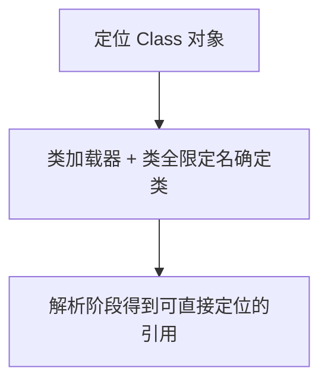

# 类加载实战：如何在内存里定位类对象的地址

前面验证了「类对象在堆里、诞生在伊甸园区」，当时类对象的地址是直接给出的。这篇补上方法论：怎么用 HSDB 的命令在堆内存里把一个类对象的地址找出来。整个过程就是一条思路：直接找类对象太难，就借一个只有一份的实例对象拐个弯。

## 先给结论

- 查找工具是 scan oops 命令，格式是 scan oops 加起始地址加结束地址加类型，在给定范围内按类型找对象。
- 直接找类对象行不通：每个类都有一个 Class 类型的类对象，JDK 自带的加上自定义的，整个堆空间约 1300 个，逐个 inspect 工作量巨大。
- 可行思路：把类对象挂到自己对象的成员变量上，先找只有一份的这个对象，再通过它的成员变量间接拿到类对象地址。
- 实例对象好找是因为数量可控，类对象难找是因为类型全是 java.lang.Class，无法按类型区分。

## 是什么：scan oops 与找实例

HSDB 里有个命令叫 scan oops，可以在一个范围内找到某个类型的对象。start 和 end 是起始和结束地址，决定扫描范围；type 是对象类型。

先拿它找 Student 实例练手。把最后一个伊甸园区的起始地址和结束地址填进去，类型写上全路径，也就是包名加子包名加类名，day03.loader.Student。执行后找到了：前面的值是地址，后面是类型。再用之前介绍过的 inspect 命令看一下这个地址的对象详情，能看到成员变量 d 和 e。静态变量属于类对象，成员变量属于实例对象，看到 d 和 e 说明找到的确实是 Student 实例。

Student 实例为什么好找？因为整个堆内存里只有一个 Student 对象，new 了一次，范围一缩，scan oops 一跑就出来了。

## 深入细节：类对象为什么难找，怎么绕

难的是类对象。堆里的类对象有多少？非常多。不光有 Student.class，JDK 自身还带了一大批类，每个类都有自己的 Class 类对象。按 java.lang.Class 类型去 scan oops，数量巨大；就算耐着性把地址一个个粘贴过去 inspect，一个个看是不是 Student.class，工作量也吃不消，这还只是搜了一个伊甸园区，如果类不在这个区，得在整个堆空间找，大约 1300 个类。

换个思路：类对象虽然多，但可以把它做成某个对象的成员变量，而这个对象的个数是可控的。给 TestLazy 加一个 Class 类型的成员变量，比如叫 studentClass，加载完之后把 Student.class 赋值给它。TestLazy 的对象只有一个，先找到它，它内部的这个成员变量就是我们要找的类对象，通过成员变量间接定位，问题就解决了。

实操流程：

1. 重新启动程序，在 System.in.read 处停下，这时内存里既有 TestLazy 对象，也有 Student.class。
2. 连上 HSDB，先看 G1 的 region details，确认内存区域划分，猜 TestLazy 在最后一个伊甸园区，就在这个范围搜。
3. scan oops，起始地址和结束地址复制过去，类型写 day03.loader.TestLazy。果然找到了，只有一个。
4. 复制这个地址，用 inspect 查看，对象内部信息一目了然，并且能看到 studentClass 这个成员变量，类型是 Class，后面跟着的就是它的地址。
5. 再拿这个地址 inspect 一次，Student 的类对象就定位到了。

这条「实例带类对象」的绕行路线，是 HSDB 里定位类对象的实用技巧。核心思想一句话：不好找的目标，挂到好找的目标身上。

## 面试怎么答

1. **先答工具**：HSDB 的 scan oops 按地址范围加类型查找对象，inspect 查看对象详情。
2. **再答难点**：类对象数量庞大（约 1300 个），类型都是 java.lang.Class，无法直接按类型筛出来。
3. **讲清思路**：把类对象设为某个唯一实例的成员变量，先 scan oops 找实例，再 inspect 顺成员变量拿到类对象地址。
4. **点出本质**：查找策略是「用数量可控的对象去锚定数量不可控的对象」。

常见追问：

- **问**：scan oops 的类型参数写什么？
  **答**：写全限定类名，比如 day03.loader.Student；找类对象时写 java.lang.Class。
- **问**：为什么要限定在最后一个伊甸园区搜？
  **答**：缩小扫描范围，加快速度。新创建的对象大概率在伊甸园区，猜错再换范围。

## 常见误区

- **误区一**：试图直接 scan java.lang.Class 逐个翻。结果量大到没法人工筛选，方法上就错了。
- **误区二**：把类对象和实例的地址混为一谈。实例对象 inspect 看到的是成员变量，类对象 inspect 看到的是静态变量。
- **误区三**：忽略地址会随 GC 变动。演示中程序不能停，地址才是稳定可复现的，重跑后要重新找。
