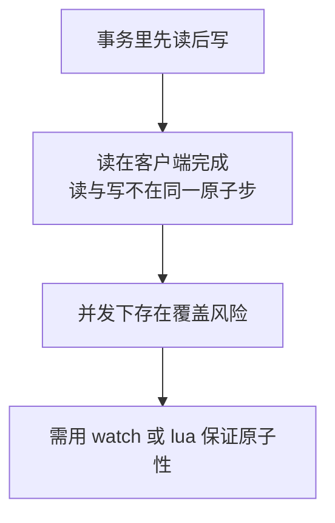

# Redis 事务第二特点：读操作没有意义，读写不原子

面试题：Redis 的 multi 加 exec 能保证多条命令的原子性吗？

上一篇讲了 multi 加 exec 不支持回滚，这篇讲它的第二个特点：事务里的读操作没有任何意义。而这条性质直接推导出最严重的后果：multi 加 exec 只能保证多个写操作的原子性，读加写不在一个事务里，根本管不住。

## 先给结论

- multi 加 exec 中的读操作没有意义：Redis 事务里没有临时变量的概念，get 的结果别的命令用不上。
- 由于读没有意义，multi 加 exec 只能包含写操作，多个写操作之间可以保证原子。
- 一旦涉及读，就没法保证读加写的原子性，因为读必须放在事务之外，由应用程序先完成。
- 典型后果：丢失更新。事务外读到旧值，计算后写回事务，期间别人的修改被覆盖。

## 是什么：事务里的 get 为什么没用

先看个例子。用 multi 开始一个事务，想把 a 和 b 加起来赋值给 c：先 get a 拿到 999，再 get b 拿到 1001，然后 set c 等于两者的和。行不行？不行。

在其他编程语言里，get a 和 get b 的结果可以赋给临时变量，再用临时变量去 set c。但 Redis 事务里不存在临时变量这个概念，get a 的结果 set c 根本用不上。也不能写一个 a 加 b 让 Redis 当表达式运算，它只会把 a 加 b 当成一个字符串。

跑一遍验证：几条命令都正常入队，exec 之后，get 命令确实执行了，a 返回 999、b 返回 1001，但是这两个返回结果没人能用上；最后那条 set c 也执行成功了，值却是字符串 a 加 b，Redis 并不会把 a 和 b当变量运算。这就是 multi 加 exec 中读没有意义的完整含义：命令会执行，返回值作废。

## 深入细节：丢失更新是怎么发生的

既然 multi 加 exec 里读没有意义，那读只能放到事务之外：应用程序自己先把 a 和 b 的值读出来，在应用层运算好，再把写操作放进事务。这样一来，读和写就不在一个事务里，一个事务控制不了它们。

看转账的例子。a 和 b 两个账户，初始都是 1000，现在 a 减 500、b 加 500。应用程序提前在事务外 get a、get b，算好结果：a 应该是 500，b 应该是 1500。然后开启事务，把两个写操作放进去：set a 500，set b 1500，执行 exec。本意是保证这两条 set 是原子的。

问题在于：如果在应用程序读值之后、exec 执行之前，有另一个客户端对 a 做了 incr a，a 变成 1001，会怎么样？exec 之后 get a 是 500、get b 是 1500，那个新增的 1 去哪了？被覆盖掉了。这就是丢失更新。

原因很直白：两个 get 操作是在事务之外执行的，事务之外的操作不能保证跟事务里的两条 set 是一个原子的整体。别人在间隙里的修改，对这个事务来说就是被遗漏了，你还拿着旧值算出的结果去写，自然把新数据覆盖掉。

那怎么保证 Redis 中多条命令的原子性呢？有解决办法，接下来会介绍两种，思路分别是用乐观锁和 Lua 脚本。

## 面试怎么答

1. **先答读无意义**：Redis 事务没有临时变量，get 的返回值无法被同事务的其他命令使用，所以事务里的读是废的。
2. **再答边界**：multi 加 exec 只能保证多个写操作的原子性，读必须放在事务外由应用完成。
3. **讲清后果**：读写割裂导致丢失更新，举转账 incr 被覆盖的例子。
4. **引出方案**：要么用乐观锁（watch）保证读写的值没被改，要么用 Lua 脚本把读写打包成一段脚本整体执行。

常见追问：

- **问**：为什么 Redis 事务不做临时变量？
  **答**：事务队列只是命令的集合，入队时不执行、不计算，exec 时才逐条执行，命令之间没有数据流的语义，a 加 b 只是字符串。
- **问**：multi 加 exec 能保证写操作的原子性吗？
  **答**：能。exec 时队列里的写命令被连续执行，中间不会插入其他客户端的命令，这是单线程模型给的保证。

## 常见误区

- **误区一**：以为 multi 加 exec 等于数据库事务。它既不能回滚，也不能把读纳入原子范围，只是写命令的批量执行。
- **误区二**：在事务里写 get 期待后文的命令能用上。返回值只能回到客户端，事务内的后续命令拿不到。
- **误区三**：只记「Redis 事务不原子」的结论，讲不出「读在事务外导致丢失更新」的链路。追问一句「怎么解决」就答不上来。
