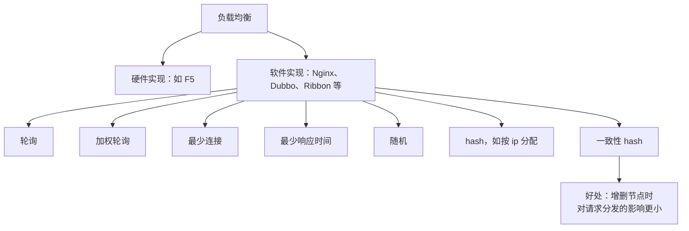

# 分布式通用设计：负载均衡策略

面试题：负载均衡有哪些常见策略？

负载均衡是分布式系统的标配组件，面试不只能说出「轮询」就完事。七种常见算法，每种解决什么问题、适用什么场景、在 Nginx 和 Dubbo 里怎么落地，这篇一次梳理清楚。

## 先给结论

- 负载均衡：用多台服务器共同分担计算任务，把网络请求和计算按某种算法均摊到各台服务器上，整体吞吐量上去。
- 实现方式分硬件（如 F5）和软件（如 Nginx、Dubbo、Ribbon）两类，日常接触最多的是软件。
- 常见算法七种：轮询、加权轮询、最少连接、最少响应时间、随机、Hash、一致性 Hash。
- Hash 类算法（含一致性 Hash）的关键价值是「相同特征的请求落到同一台服务器」，一致性 Hash 额外解决了增删节点时大面积重新分发的问题。

## 是什么：负载均衡在解决什么问题

单台服务器的处理能力有上限，请求一多就扛不住。负载均衡的思路是多台服务器共同分担计算任务，把网络请求和计算按照某种算法均摊到各个服务器上，每台承担一点，整体吞吐量就上去了。它可以用硬件实现，比如 F5，也可以用软件实现，比如 Nginx、Dubbo、Ribbon，这些软件都有自己的负载均衡能力。

## 深入细节：七种常见算法

**轮询。** 最好理解：四台服务器轮着来，第一个请求服务器一处理，第二个服务器二，第三个服务器三，第四个服务器四，第五个请求再回到服务器一。Nginx、Ribbon 都支持轮询。

**加权轮询。** 在轮询的基础上考虑权重。每台机器性能不一样，性能好的权重设高一些，性能差的设低一些。权重高的分到的请求机会更多，能分担更多任务。Nginx、Dubbo 都实现了。

**最少连接。** 更确切的叫法是「最少活跃连接」：哪台服务器的活跃连接数少，请求就分发给谁。道理是活跃连接多意味着处理速度慢、同时服务的客户端多；处理快的服务器活跃数下降得也快。所以应该尽量把任务发给活跃连接数少的服务器。Nginx、Dubbo 有类似实现。

**最少响应时间。** 更直接：统计每台服务器的响应时间，哪台响应快并且活跃连接数少，就把请求发给谁。Nginx、Ribbon 实现了这种策略。

**随机。** 随便发给谁，分布上最均匀。Nginx、Dubbo、Ribbon 默认采用的方式应该都是随机。

**Hash。** 先对某个信息求哈希值，这个信息可以是 ID，也可以是服务器自定义的值；算出哈希码后，用哈希码模集群中服务器的个数，决定分发给哪台。如果用 IP 的哈希值来分配，IP 相同的请求计算出的哈希码一样，最终会由同一台服务器处理。它有两个问题：一是哈希值选得不好会导致分布不均，有的服务器请求多有的少；二是新增或移除节点时机器总数变了，求模的结果全变，对请求分发影响比较大，扩展性差。

**一致性 Hash。** 针对 Hash 的改进。它不是把哈希值直接映射到某一台服务器，而是映射到一个范围、一个区间上。添加或删除节点时，对请求的分发影响比较少。Dubbo 实现了一致性 Hash 的负载均衡策略。

学算法不能只看不练。这些算法里很多并不复杂，建议自己选几种实现一遍，就能体会到里面的算法内涵，印象也会深很多。另外提一句：网上说 Nginx 有六种负载均衡策略，实际查下来不止六种，内置的就超过六种，而且还支持扩展；Dubbo 有四种，同样支持通过接口扩展出自己的实现。细节以官方文档为准。

## 面试怎么答

1. **先给定义**：多台服务器按算法均摊请求与计算，提升整体吞吐量。
2. **分类答算法**：静态类（轮询、加权轮询、随机）与动态类（最少连接、最少响应时间），再点出 Hash 和一致性 Hash 解决的是会话粘滞问题。
3. **对比收尾**：Hash 扩展性差，一致性 Hash 用区间映射缓解了增删节点的影响。

常见追问：

- **问**：一致性 Hash 为什么能减少节点变动的影响？
  **答**：它把哈希值映射到环上的区间，节点只负责自己区间内的请求，增删节点只影响相邻区间的重新分配，不会像取模那样让全部分发结果洗牌。
- **问**：加权轮询的权重按什么设？
  **答**：按机器处理能力设，性能好的权重高、分到的请求多，目的是把负载和容量匹配起来。

## 常见误区

- **误区一**：把负载均衡等同于轮询。轮询只是最简单的一种，动态算法和 Hash 类算法覆盖的是不同场景。
- **误区二**：以为 Hash 分配很均匀。不调优的哈希很容易偏斜，一致性 Hash 也不能完全避免偏斜，只是控制了节点变动时的影响面。
- **误区三**：面试里只报算法名字，不讲每种算法适合什么场景。能结合「会话保持」「节点扩缩」说场景才是满分答法。
