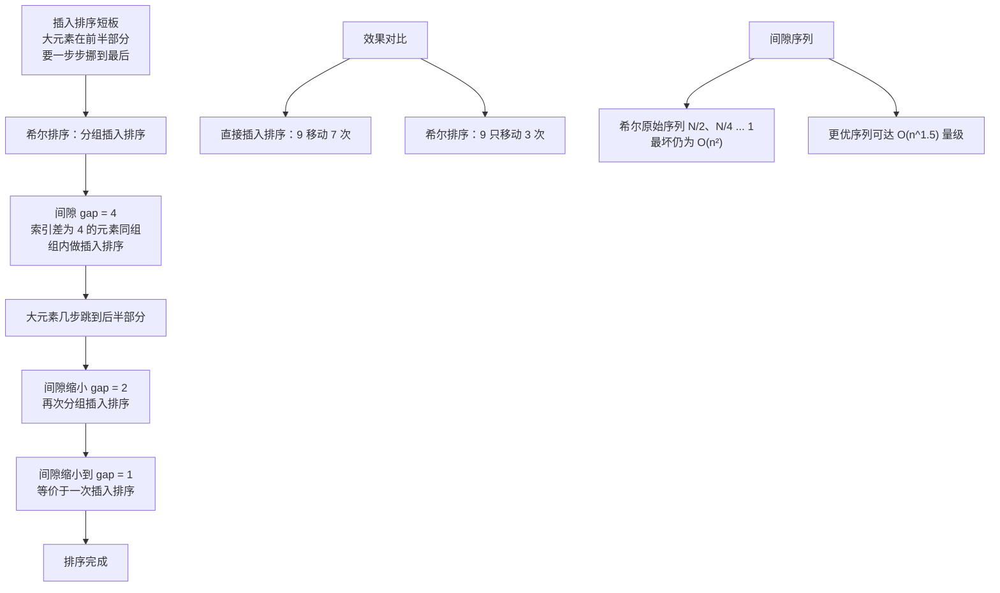

# 希尔排序：插入排序的改进，让大元素少走弯路

面试题：了解希尔排序吗？它解决的是什么问题？

插入排序有一个明显短板：较大的元素如果位于数组前半部分，要经历很多次移动才能到达最终位置。希尔排序就是针对这个缺点的改进版，核心思路是分组插入，让大元素几步跳到后半部分。这篇把思路、演示过程和间隙序列的选择一次讲清。

## 先给结论

- 插入排序的短板：大元素在前半部分时要一步步挪到最后。八个元素里 9 在索引 0，最终位置在索引 7，要移动 7 次。
- 希尔排序的核心：把间隙相同的元素划为一组，组内做插入排序；间隙从大到小不断缩小，直到 1，排序完成。
- 效果：大元素很快被移到数组后半部分，减少移动次数。同一个例子里，9 在整套希尔排序过程中只移动 3 次。
- 间隙序列的选择很讲究：希尔本人最初的序列是 N/2、N/4 直到 1，最坏时间复杂度仍是 O(n²)；换更合适的序列可以到 O(n^1.5) 等。
- 代码不要求掌握，思路必须掌握。



## 是什么：插入排序为什么需要改进

盯着插入排序里的 9 看：它是最大的元素，最终位置在索引 7。从索引 0 出发，一次、两次、三次、四次、五次、六次、七次，要移动 7 次才能到位。如果数组前半部分堆了一大批这样的大元素，它们的移动次数会非常多，拖慢整体效率。

有没有办法减少移动次数？有人提出了插入排序的改进算法：希尔排序。

## 深入细节：跟着动画走一遍

**间隙为 4 的第一轮。** 假设间隙序列是 4、2、1。第一次间隙为 4，把索引差为 4 的元素视为一组：9 和 5 一组，3 和 8 一组，7 和 1 一组，2 和 4 一组。每组内部做插入排序，每组只有两个元素，非常快。9 和 5 这组，5 拿过来、9 往后移，完成一次交换；3 和 8 不用动；7 和 1 这组，1 前移；2 和 4 不用动。一轮下来，较大的元素都很快被移到数组后半部分，9 不用再一步一步挪了。

**间隙为 2 的第二轮。** 间隙缩小为 2。这时 5、1、9、7 四个元素（索引 0、2、4、6）间隙都是 2，划为一组；3、2、8、4（索引 1、3、5、7）是另一组。两组交替着进行插入排序：先 5 和 1 排，再 3 和 2 排，接着 5、1、9 排，3、2、8 排，最后 5、1、9、7 整体排一次，3、2、8、4 整体排一次。整个过程仍然是插入排序，只是每一步处理的是组内元素，目的依然是尽快把较大元素往后送。

**间隙为 1 的最后一轮。** 间隙为 1 时所有元素都是一组，这一轮就是普通的插入排序。经过前两轮预整理，大元素基本就位，最后一轮只是收尾。

数一下 9 的移动：整个三轮希尔排序过程中它只移动了 3 次，而纯插入排序要 7 次。这就是希尔排序的价值。

**间隙序列的选择。** 演示用的 4、2、1 是希尔本人最初设计的序列：元素个数除以 2 得到第一个值，八个元素就是 4，然后除以 4 得 2，一直到 1。这个序列性能并不是最优，最坏情况时间复杂度还是 O(n²)。换成其他间隙序列公式，最坏复杂度会不一样，比如有的能做到 O(n^1.5)，比 O(n²) 好。具体数据可以去看维基百科上 Shellsort 的词条。我们主要掌握思路，代码不要求掌握。

希尔排序的代码实现如下：

```java
private static void shell(int[] a) {
    int n = a.length;
    // 间隙从 n/2 开始，每轮减半，直到 0
    for (int gap = n / 2; gap > 0; gap /= 2) {
        // i 代表待插入元素的索引
        for (int i = gap; i < n; i++) {
            int t = a[i];           // 待插入的元素值
            int j = i;
            while (j >= gap) {
                // 与上一个间隙为 gap 的元素比较，做插入排序
                if (t < a[j - gap]) {
                    a[j] = a[j - gap];
                    j -= gap;
                } else {
                    break;
                }
            }
            a[j] = t;
            System.out.println(Arrays.toString(a) + " gap:" + gap);
        }
    }
}
```

## 面试怎么答

1. **先答定位**：希尔排序是插入排序的改进算法，解决大元素在前半部分移动次数过多的问题。
2. **再讲机制**：按间隙分组，组内插入排序，间隙从大到小缩到 1，最后一轮等价于插入排序。
3. **用数字说话**：同一个数组，纯插入排序 9 要移动 7 次，希尔排序只移动 3 次。
4. **提一句间隙序列**：不同序列最坏复杂度不同，最初的 N/2 序列最坏仍是 O(n²)，更优的序列可以到 O(n^1.5)。

常见追问：

- **问**：为什么间隙为 1 时就是插入排序？
  **答**：间隙为 1 时所有元素同属一组，组内插入排序就是对整个数组做插入排序。
- **问**：希尔排序是稳定排序吗？
  **答**：不是。分组插入会让相同元素跨越比较，可能改变相对顺序。

## 常见误区

- **误区一**：以为希尔排序和插入排序是两套无关的算法。它本质就是分组反复做插入排序，间隙为 1 时完全等价。
- **误区二**：以为间隙序列只有一种。序列的选择直接影响最坏复杂度，这是希尔排序研究的核心。
- **误区三**：面试里纠结代码细节。这个阶段掌握思路和复杂度量级就够了，代码手写不强求。

## 课件配套可视化 Demo

> 本算法的交互式可视化页面已随本系列一并打包：[demos/day01_shell_sort.html](demos/day01_shell_sort.html)（纯 Canvas 实现，无需任何外部依赖，直接用浏览器打开即可）。

页面用柱状图展示按不同步长（gap）分组插入排序的过程，直观呈现「先粗调、后细调」如何减少大规模移动。希尔排序是插入排序的步长优化版，对照 128–142 插入排序博客更易理解其加速原理。
