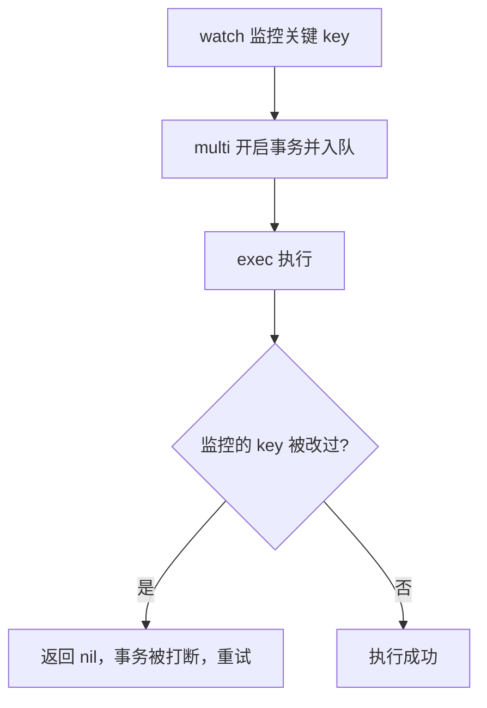

# 用乐观锁保证原子性：Redis 事务的 watch 机制

面试题：Redis 事务没法回滚、读又没有意义，那读写操作的原子性怎么保证？

上一篇留了个问题：multi 加 exec 只能保证多个写操作的原子性，读在事务外，会丢更新。Redis 给出两种解决办法，这篇讲第一种：乐观锁，核心就是一个 watch 命令。思想和 Java 里的乐观锁完全一致。

## 先给结论

- 乐观锁的关键命令是 watch：盯住一个或多个 key，多个 key 之间用空格分隔。
- 事务执行期间，被 watch 的 key 如果没被别的客户端修改，exec 才会成功。
- 如果被修改过，exec 返回 nil，代表事务失败，已入队的写操作全部作废。
- 失败后重新 get 最新值、重新计算、再开一轮事务重试，直到成功，写代码时就是一个循环。
- 这和 Java 里 CAS 失败重试是同一个思想：检测到冲突就拿着最新数据再来一遍。



## 深入细节：watch 怎么工作

watch 的作用是盯住一到多个 key，看这些 key 会不会在事务期间被别的客户端修改。如果没被修改，exec 执行时才会成功；如果被别的客户端改了，exec 会返回 nil，代表失败。

看转账的例子。先把数据恢复成初始状态，a 是 1000，b 也是 1000。开始事务之前，先用 watch 盯住这两个 key，相当于给它俩加一个监听器：

```bash
set a 1000, set b 1000
watch a b
multi
set a 500, set b 1500
exec
```

盯住之后，就可以安全地读了：get a 是 1000，get b 是 1000。现在要转 500，在应用层算好：a 应该是 500，b 应该是 1500。然后开事务，把两个写操作放进去。

注意关键点：如果 exec 还没执行，此时有别的客户端把 a 改了，会怎么样？我们复现一下：另一个客户端把 a 修改掉。再回到事务这边执行 exec，返回的不是 OK 了，是 nil，代表这个事务出错。原因是 watch 发现 a 和 b 的值被别人改过了，你手里拿的已经是过期数据，拿过期数据去执行写操作有风险，事务直接判失败。

失败之后怎么办？重新 get 到最新的 a 和 b 的值，在最新值的基础上重新运算，再试一遍。重新开一轮事务，这次在修改时把变化算进去，如果没人干扰，exec 就返回成功，说明事务执行期间没人动你的 key，更新安全落地。这样就不会出现把别人的修改覆盖掉的问题。

实际写代码时，整个过程放进一个循环：先 watch，循环里不断尝试，第一次不成功说明 key 被改过，就循环一次重新读最新值再试，直到 exec 返回成功才退出。这跟 Java 里乐观锁 CAS 失败后重试的思想是一样的。

## 面试怎么答

1. **先定位**：Redis 保证读写原子性的办法之一是乐观锁，核心命令 watch。
2. **再讲机制**：watch 监视 key，exec 时若 key 未被修改则事务成功，被改过则返回 nil 整体失败。
3. **讲失败处理**：nil 之后重新读最新值、重新计算、重开事务，典型写法是 while 循环直到成功。
4. **点出思想**：和 Java 乐观锁 CAS 同源，冲突检测加失败重试。

常见追问：

- **问**：watch 监视的 key 什么时候「被修改」的判定会失效？
  **答**：只要 key 的值发生过变化就算修改，exec 时校验版本，对不上就 nil。unwatch 可以手动取消监视，会话结束也会自动取消。
- **问**：另一种保证原子性的办法是什么？
  **答**：Lua 脚本。把读写逻辑写成一段脚本整体执行，执行期间不会有其他命令插入，天然原子。

## 常见误区

- **误区一**：把 watch 当成事务的一部分。watch 在 multi 之前执行，是事务外的监视指令。
- **误区二**：忽略 nil 之后的业务处理。不重试就等于操作失败，转账场景必须循环重试或走补偿。
- **误区三**：只记命令不记思想。面试官想听的是「乐观锁：冲突检测加重试」，和 CAS 是一套逻辑。
