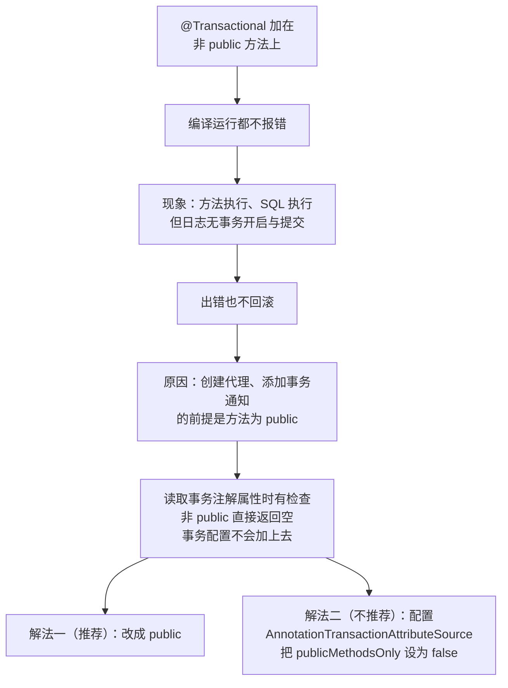

# Spring 事务失效场景四：@Transactional 加在了非 public 方法上

面试题：Spring 事务失效的几种场景及原因，这是第四种。

前三种场景多多少少和「异常怎么流动」有关，第四种是纯粹的「位置放错」：@Transactional 必须加在 public 方法上，加到包可见（默认权限）方法上形同虚设。这个错误很隐蔽，因为编译运行都不报错，只能从日志里看出事务没生效。

## 先给结论

- 结论先行：@Transactional 必须加在 public 方法上，加到非 public 方法上事务根本不生效。
- 现象：方法正常执行、SQL 正常执行，但日志里没有任何事务相关输出（没有开启事务、没有提交），出错也不会回滚。
- 原因：Spring 给目标方法创建代理、添加事务通知的前提条件就是方法为 public，读取事务注解属性时有检查，非 public 方法直接返回空，事务配置不会加上去。
- 解法一（推荐）：改成 public 方法。
- 解法二（不推荐）：配置 AnnotationTransactionAttributeSource 时把 publicMethodsOnly 参数设为 false，让注解对非 public 方法也生效。



## 深入细节：失效过程与原因

Service4 的 transfer 方法加了 @Transactional，但没有加 public 修饰符，是一个包内可见的方法。测试类和 Service4 同包，有权限访问这个方法，能正常调用。调用后方法执行了，三条 SQL 也执行了，但日志里没有任何事务相关信息：没有开启事务，没有提交事务。说明这个 @Transactional 注解根本没有生效。

这是 Spring 的默认规则：@Transactional 必须加在 public 方法上。规则背后的原因是，Spring 为方法创建代理、添加事务通知等一系列动作，前提就是方法 public。Spring 内部读取事务注解属性时有一个检查，发现方法不是 public，读取结果直接为空，返回不了事务属性，事务相关配置自然就不会加载。

```java
@Service
public class Service4 {
    @Autowired
    private AccountMapper accountMapper;

    @Transactional
    void transfer(int from, int to, int amount) throws FileNotFoundException {
        int fromBalance = accountMapper.findBalanceBy(from);
        if (fromBalance - amount >= 0) {
            accountMapper.update(from, balance - 1 * amount);
            accountMapper.update(to, amount);
        }
    }
}
```

测试代码本身没有任何问题：

```java
public class TestService4 {
    public static void main(String[] args) throws FileNotFoundException {
        GenericApplicationContext context = new GenericApplicationContext();
        AnnotationConfigUtils.registerAnnotationConfigProcessors(context);
        ConfigurationPropertiesBeanPostProcessor.register(context);
        context.refresh();
        Service4 bean = context.getBean(Service4.class);
        bean.transfer(1, 2, 500);
    }
}
```

## 深入细节：两种解法

**解法一：改成 public。** 把方法改成公共方法，事务恢复原样。再跑一遍测试，日志里事务相关信息全回来了：开启事务、提交、释放资源，一样不缺。

**解法二：放开 publicMethodsOnly 检查。** 如果就是不想加 public，可以在配置类里加一个新的 Bean，类型是 TransactionAttributeSource，实现类用 AnnotationTransactionAttributeSource。这个类控制注解的相关行为，默认构造参数的 publicMethodsOnly 是 true，也就是只对公共方法生效；改成 false，@Transactional 对非公共方法也会有效。

```java
@Configuration
@MapperScan("day04.tx.app.mapper")
public class AppConfig {
    @Bean
    public PlatformTransactionManager transactionManager(DataSource dataSource) {
        return new DataSourceTransactionManager(dataSource);
    }

    @Bean
    public TransactionAttributeSource transactionAttributeSource() {
        return new AnnotationTransactionAttributeSource(publicMethodsOnly: false);
    }
}
```

加上这段配置后，方法仍然不是 public，但事务日志回来了，说明注解对非公共方法生效了。不过这种解法虽然可行，并不推荐，记住「事务注解标在 public 方法上」才是正道。

这个错误比较隐蔽：不小心漏写 public 修饰符，编译不报错、运行不报错，只能通过日志观察事务有没有加上。所以务必记住：@Transactional 修饰的方法一定是 public。

## 面试怎么答

1. **先给结论**：@Transactional 必须加在 public 方法，非 public 方法上事务失效。
2. **再讲现象**：SQL 照常执行，但日志没有开启事务、提交事务的输出，异常也不回滚。
3. **讲原因**：Spring 创建代理、添加事务通知的前提是 public，读取注解属性时有检查，非 public 直接返回空。
4. **给解法**：首选改成 public；也可以配 AnnotationTransactionAttributeSource 把 publicMethodsOnly 设 false，但不推荐。

常见追问：

- **问**：private 方法上加 @Transactional 呢？
  **答**：一样失效，而且 private 方法连代理都绕不开，改 public 是唯一正路。
- **问**：为什么 Spring 要做 public 检查？
  **答**：动态代理（JDK 代理基于接口、CGLIB 基于继承）都要求方法可访问，非 public 方法无法被代理拦截，事务通知自然无从加起。

## 常见误区

- **误区一**：以为方法能被调用就等于注解生效。能调用是 Java 权限的事，事务生效是代理拦截的事，两码事。
- **误区二**：漏写 public 后到处查业务代码。先看日志里有没有事务开启输出，能少走弯路。
- **误区三**：用 publicMethodsOnly=false 当常规手段。它是逃生门不是常规配置，会让非 public 方法被代理，语义混乱。
