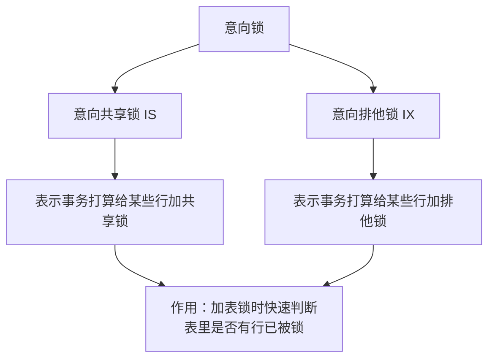

# 表级锁之意向锁：让表锁不用逐行检查

面试题：了解意向锁吗？它是干什么的？

表级锁的第三个小类是意向锁。它要解决的问题很实际：InnoDB 里 DML 加行锁，但又要支持 lock tables 这种表锁，加表锁时难道要逐行检查有没有行锁？意向锁用一个表级标记把这个检查简化掉。这篇讲机制、两种类型和演示。

## 先给结论

- 意向锁的主要目的是避免 DML 语句与表锁冲突。
- InnoDB 既支持行锁也支持表锁，DML 主要加行锁；若没有意向锁，加表锁的客户端得逐行检查是否已有行锁，工作量太大。
- 意向锁是表级的：DML 加行锁之前，先加一个表级意向锁；之后其他客户端加表锁时，只需和这个表级意向锁比较，不用逐行比。
- 分两种：意向共享锁（IS）和意向排他锁（IX）。
- 意向锁之间不互斥；IS 与表共享锁兼容、与表排他锁冲突；IX 与表共享锁、表排他锁都冲突。

## 深入细节：为什么需要意向锁

InnoDB 里的 DML，除 select 之外都会加锁：insert、update、delete，以及 select for update、select lock in share mode，加的都是行锁。

问题来了：DML 加了行锁之后，另一个客户端想加 lock tables 这种表锁，行不行？如果没有意向锁，加表锁的客户端必须去检查每一行数据上是不是加了行锁，因为要根据检查结果判断表锁和当前行锁是互斥还是共享，才能决定表锁能不能加上。但这意味着要检查第一行、第二行一直到最后一行的行锁情况，检查量工作量太大，效率非常低。

意向锁就是来解决这个问题的：DML 中只要加行锁之前，先加一个表级的意向锁。注意意向锁是表级的。这个表级意向锁加好之后，将来其他客户端加表锁时，不用每行每行比，直接看表上有没有这个表级意向锁，跟它做个比较，就能决定表锁能不能加。这样减少了表锁的判定成本，提升了效率。

## 深入细节：两种意向锁与兼容性

意向锁分两种：意向共享锁和意向排他锁。

**意向共享锁（IS）。** 加了 IS 之后，表锁中的共享锁仍然可以加，但表锁中的排他锁不能加。

**意向排他锁（IX）。** 加了 IX 之后，表锁中的共享锁和排他锁都不能加。这跟共享、排他本身的意思一致：IX 表示表内存在行级的排他意图，任何表级锁都会和它冲突。

**例外：意向锁之间不互斥。** 第一个客户端加意向共享锁，第二个客户端仍然能加意向排他锁，两者可以并存。原因是意向锁只是「意图声明」，真正的冲突由行锁和表锁之间裁决。

**哪些语句加哪种意向锁？** select lock in share mode 加意向共享锁（IS）；insert、update、delete 以及 select for update 加意向排他锁（IX）。

## 深入细节：两个演示

**演示一：IX 挡住所有表锁。** 客户端一开启事务，执行一条带锁的 DML，注意普通 select 不带锁，这里用 select for update。执行完，t 表上就加了一个意向排他锁。查 performance_schema 里的 data_locks 表，能看到 t 表当前有哪些行锁、哪些意向锁：列出的记录里，行锁不用管，看 lock_type 为 TABLE 的那条，类型是 IX，说明意向排他锁加上了。效果就是其他表锁加不上：客户端二执行 lock tables t read 想加表共享锁，不行，因为 IX 决定了表级共享锁和排他锁都不能加。

**演示二：IS 放行共享表锁。** 先把事务结束，意向锁随之释放。重新开事务，这次用 select lock in share mode，它加的是意向共享锁。再查 data_locks，最上面第一条 TABLE 记录类型是 IS。IS 的兼容性就不一样了：客户端执行 lock tables t read 加表共享锁，可以，大家都是共享的，互相兼容。但想加表级排他锁，lock tables t write，就会被阻塞。

排查用的这两个调试表（metadata_locks 和 data_locks）只有 MySQL 8 才有，5.7 没有，做实验前先确认版本。

一句话记住意向锁：它由 DML 的加锁操作顺带触发，先在表级挂个意向，其他表锁加锁前不用逐行比，只跟这个表级意向锁对比即可。核心作用就是避免 DML 与表锁冲突。

## 面试怎么答

1. **先答定位**：意向锁是表级锁的一种，作用是避免 DML 与表锁冲突。
2. **再讲问题**：没有它，加表锁要逐行检查行锁，效率低。
3. **讲机制**：DML 加行锁前先加表级意向锁，之后表锁只需和意向锁比对。
4. **补兼容性**：IS 与表共享兼容、与表排他冲突；IX 与两者都冲突；意向锁之间不互斥。能报出 select for update 加 IX、lock in share mode 加 IS 是加分项。

常见追问：

- **问**：意向锁是 InnoDB 自动加的还是手动加的？
  **答**：自动。执行带锁 DML 时引擎内部添加，不需要也不能手动加。
- **问**：怎么查看意向锁？
  **答**：MySQL 8 查 performance_schema.data_locks，看 lock_type 为 TABLE、lock_mode 为 IX 或 IS 的记录。

## 常见误区

- **误区一**：以为意向锁是行锁的一种。它是表级锁，是行锁的「表级代言人」。
- **误区二**：以为 IX 和 IS 会互相阻塞。意向锁之间不互斥，这是特意设计的。
- **误区三**：在 MySQL 5.7 上查 data_locks。这张表 8.0 才有，排查手段和版本要匹配。
