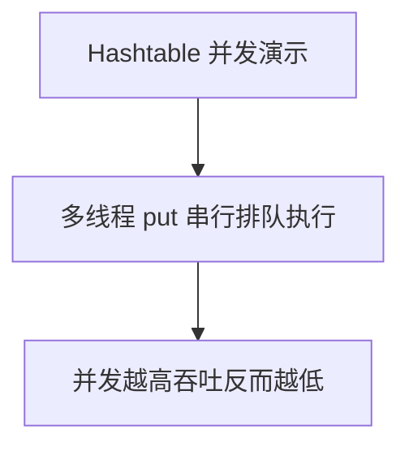

# Hashtable 演示：容量规律与索引计算

面试题：Hashtable 的底层是怎么工作的？

Hashtable 的特点和 HashMap 差别很大：容量不是 2 的幂、不需要二次哈希、整表一把锁。这篇用演示和源码把这三个点讲透，顺带解释 (hash & 0x7FFFFFFF) % tab.length 这行索引计算里每个部分的作用。

## 先给结论

- Hashtable 的容量不是 2 的 N 次方，初始容量是 11，每次扩容是上次容量乘 2 加 1，所以扩容后的容量仍是奇数（质数倾向）。
- 第一次扩容发生在第 9 个元素：11 乘 3 除以 4 约等于 8.25，超过 8 个元素就触发，扩容后 11 乘 2 加 1 等于 23。
- 索引直接用 (hash & 0x7FFFFFFF) % tab.length，不需要二次哈希，因为质数容量的分散性已经足够好。
- 0x7FFFFFFF 的作用是保证哈希码是正数：不屏蔽的话符号位可能让结果为负，负数取模还是负数，会越界。
- 并发上仍是整表一把锁：一个线程锁住，其他线程都不能访问，并发度很低。



## 深入细节：容量与扩容规律

Hashtable 的容量并不是 2 的 N 次方，这一点和 HashMap 系列完全不同。它的初始容量是 11，每次扩容是上次的容量乘 2 加 1，按这个规律容量始终落在奇数上。

第一次扩容需要几个元素？算一下：11 乘 3 除以 4，大概是 8.25，也就是第 9 个元素放入时会触发扩容。先放 8 个 key，1 到 8 依次放入，相安无事；放第 9 个 key，触发扩容。扩容后是乘 2 加 1：11 乘 2 是 22，再加 1 是 23，新容量就是 23。这是它和其他几个 Map 集合不一样的地方。

## 深入细节：索引计算与二次哈希

Hashtable 的哈希码计算不需要经过二次哈希。因为它的容量不是 2 的幂，而一般是质数，质数有比较好的哈希分散性，不需要二次哈希。

举个例子：放入 key a，a 的 hashCode 是 97，97 去模 23，余数是 5，直接就算出了索引位置，不用再做二次哈希的计算。这就是质数容量带来的便利。

看源码，Hashtable 的 put 方法直接拿 hashCode 和 table 的容量求余数：

```java
public synchronized V put(K key, V value) {
    // Make sure the value is not null
    if (value == null) {
        throw new NullPointerException();
    }

    // Makes sure the key is not already in the hashtable.
    Entry<?,?> tab[] = table;
    int hash = key.hashCode();
    int index = (hash & 0x7FFFFFFF) % tab.length;

    // Unchecked
    Entry<?,?> entry = (Entry<?,?>)tab[index];
    for(; entry != null; entry = entry.next) {
        if ((entry.hash == hash) && entry.key.equals(key)) {
            V old = entry.value;
            entry.value = value;
            return old;
        }
    }

    addEntry(hash, key, value, index);
    return null;
}
```

注意 index 计算里的 `hash & 0x7FFFFFFF`。0x7FFFFFFF 是正整数的最大值，按位与的作用是保证 hashCode 是个正数。如果不做这个屏蔽，hashCode 可能带着符号位也就是负数，负数去求模，结果还是负数，负数不能当数组索引，所以必须先用正数去计算取模。

方法上还能看到 synchronized 关键字，这正是 Hashtable 并发度低的根源：整个 Hashtable 一把锁，一个线程对它锁住了，其他线程就都不能访问。这部分大家都很熟悉，不用展开。

## 面试怎么答

1. **先答容量规律**：初始 11，扩容乘 2 加 1，第 9 个元素触发第一次扩到 23。
2. **再答索引计算**：(hash & 0x7FFFFFFF) % tab.length，不需要二次哈希，质数容量分散性好。
3. **解释掩码**：0x7FFFFFFF 保证哈希码为正，避免负数取模得到负索引。
4. **点出并发**：synchronized 加在 put 上，整表一把锁，并发度低，这也是它被 ConcurrentHashMap 取代的原因。

常见追问：

- **问**：为什么 HashMap 用 2 的幂而 Hashtable 用质数？
  **答**：2 的幂可以用位运算取模并配合二次哈希打散；Hashtable 走的路线是质数取模直接分散，不需要扰动函数。两条路线各自自洽。
- **问**：Hashtable 的 key 和 value 能为 null 吗？
  **答**：不能。put 方法里 value 为 null 直接抛 NullPointerException。

## 常见误区

- **误区一**：拿 HashMap 的容量规律套 Hashtable。Hashtable 是初始 11、乘 2 加 1，不是 16 起翻倍。
- **误区三**：只说「Hashtable 线程安全」不讲锁粒度。整表一把锁、并发度低才是面试想听的结论。
