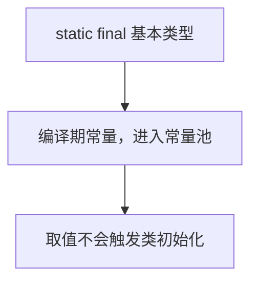

# 类加载：final 修饰基本类型变量的原理

这道面试题是类加载初始化时机的经典变种题：访问一个类的 `final static` 字段，到底会不会触发这个类的加载？很多人凭直觉回答「会」，但实测的结论是分类型的，`final` 修饰的基本类型压根不会触发加载。考官想看的正是你对「编译期常量」和类初始化时机之间关系的理解，以及能不能用字节码层面的证据把道理讲透。

## 先给结论

1. 访问 `final` 修饰的基本类型静态字段，不会触发所属类的加载，因为值在编译期就被复制到了使用方的类里。
2. 访问 `final` 修饰的引用类型静态字段，会触发加载并触发初始化，因为引用不是编译期常量，必须真的去读字段。
3. 值比较小的基本类型常量，直接写死在方法体的字节码指令里；数值超过 short 范围的，放进使用方类的常量池，用 `ldc` 指令去取。
4. 只要初始化执行了，加载必然已经发生，初始化是加载、链接之后的行为。
5. 调试器里看到的类地址指向元空间中的类数据，不是堆上的对象地址。



## 是什么

先看驱动实验的入口类：

```java
package day03.loader;
import java.io.IOException;

public class TestFinal {
    public static void main(String[] args) throws IOException {
        System.out.println(Student.c); // c 是 final static 基本类型
        System.in.read();
        System.out.println(Student.m); // m 是 final static 基本类型
        System.in.read();
        System.out.println(Student.n); // n 是 final static 引用类型
        System.in.read();
    }
}
```

被观察的那一方是 `Student`，本节要区分的三种字段全摆在了一起：

```java
package day03.loader;

public class Student {
    static int a = 0x77;
    static {
        System.out.println("Student.class init");
    }
    static int b = 0x88;

    static final int c = 0x99;
    static final int m = Short.MAX_VALUE + 1;
    static final Object n = new Object();

    int d = 0x55;
    int e = 0x66;
}
```

中间那段静态代码块是关键，它打印的 `Student.class init` 就是判断初始化到底有没有发生的探针。

`c` 和 `m` 是 `final` 修饰的基本类型，值分别是 153（`0x99`）和 32768（`Short.MAX_VALUE + 1`）；`n` 是 `final` 修饰的引用类型。每次打印之间用 `System.in.read()` 把程序阻塞住，方便用调试工具在任意位置观察类到底加载了没有。

实验方法是把跑起来的进程挂到 HSDB（HotSpot 调试器）上，用 Class Browser 查找 `day03.loader.Student` 这个类在不在。

- 执行到第一次打印，也就是访问 `Student.c` 之后，Class Browser 里找不到 `Student`。
- 继续执行，访问 `Student.m` 之后重新 attach，Class Browser 里仍然找不到 `Student`。
- 再继续，访问 `Student.n`，不用查也能看出来：控制台打印了类初始化的标志，而且这时候 Class Browser 里能找 `Student` 了。

三个现象合起来就是本节标题的答案：**`final` 修饰的基本类型静态字段，访问它不会导致类的加载；`final` 修饰的引用类型静态字段，访问它会同时导致加载和初始化。**

## 为什么这样设计

秘密不在 JVM，在编译器。一个 `final` 修饰的基本类型字段，如果它的值确定后终身不变，Java 语言就把它当作「常量变量」对待：谁用这个值，编译器就提前把数值复制一份给谁，使用方自己拿着值就能跑，根本不需要认识原类。

所以表面上是 `TestFinal` 用了 `Student`，实际上编译完之后 `TestFinal` 和 `Student` 之间没有任何关系，自然谈不上触发 `Student` 的加载。这就是为什么从现象上看「好像用了一下 Student，但实际上并没有真正用到 Student」。

引用类型做不到这一点：引用里存的是地址，地址要等程序跑起来、对象创建之后才有，编译期无法确定。所以访问 `final` 的引用类型字段，只能老老实实生成一条字段访问指令，先触发初始化把字段赋好，再读出来。初始化都执行了，说明加载和链接早就完成了。

## 深入细节

### 从字节码看「值被复制」

用 `javap -c` 反编译 `TestFinal`，只看 main 方法：

```asm
public static void main(java.lang.String[]) throws java.io.IOException;
descriptor: (Ljava/lang/String;)V
Flags: (0x8000) ACC_PUBLIC, ACC_STATIC

Code:
stack=2, locals=1, args_size=1
0: getstatic #7
3: push 153
6: invokevirtual #15
9: getstatic #21
12: invokevirtual #25
15: pop
```

结论一目了然：取 `c` 和取 `m` 的字节码里，和 `Student` 没有任何关系。取 `c` 的那行对应 `push 153`，数值 153 被直接写死在 main 方法的代码里。取 `m` 的那条是 `ldc`，`ldc` 的意思是「从常量池里加载一个常量」，它加载的是当前类常量池里的 31 号条目，而 31 号条目就是 32768。也就是说 `m` 的值同样被复制进了 `TestFinal` 自己的常量池，用的时候用自己的常量池就行，同样不需要 `Student`。

### 小值写死在方法里，大值进常量池

同样是基本类型常量，落地方式分两种，区别就在数值大小：

- 数值比较小的，直接写死在方法体的指令里；
- 数值超过 short 范围的，编译进使用方类的常量池，靠 `ldc` 指令按编号去取。

本节的例子正好一边一个：`c` 的值 153 直接出现在 main 方法代码中；`m` 的值 32768 超出了 short 的范围，被放进了常量池，通过 `ldc #31` 取用。两条路径都不需要原始类参与。

### 访问 n 时到底发生了什么

`n` 是 `final` 的引用类型字段。控制台打印类初始化标志说明初始化已经执行，既然初始化都执行了，加载肯定早就发生了。这时候内存里已经有了 `Student` 的类数据，在 Class Browser 里也能找到：

```text
public final class com.intellij.rt.execution.application.AppMainV2 @0x0000000080000000
public final class com.intellij.rt.execution.application.AppMainV2S1 @0x0000000000000000
public final class com.intellij.rt.execution.application.AppMainV2SAgent @0x0000000000000000
public final class day03.loader.Student @0x0000000000000000c01200
```

顺带说一句，Class Browser 里这个地址并不是堆内存地址，这个 class 也不是 Java 代码里那个 `Class` 对象，它指的是元空间中这个类的原始数据。点进去可以看到类的全部信息：类名、继承的父类、声明了哪些成员（静态成员和普通成员）、有哪些方法、常量池，都在里面。

### 常量池里的样子

从 `TestFinal` 常量池的终端输出也能看到 `n` 相关的引用条目和 `System.in.read()` 对应的 `Fieldref`、`NameAndType`：

```text
#38 = Utf8 in
#39 = Fieldref #16.#17 // java/io/PrintStream.println:(Ljava/lang/Object;)V
#40 = NameAndType #19:#20 // println:(I)V
#41 = Utf8 println
#42 = Methodref #16.#18 // java/io/PrintStream.println:(Ljava/lang/Object;)V
#43 = NameAndType #19:#20 // println:(I)V
#44 = Utf8 println
#45 = Utf8 in
#46 = Fieldref #16.#23 // java/io/InputStream.read:()I
#47 = NameAndType #24:#25 // read:()I
#48 = Utf8 read
```

这些是反编译输出，不用背，借它感受一件事：引用类型字段的访问在字节码层面保留了完整的符号引用链路，而基本类型常量的访问已经被常量值取代。

## 面试怎么答

面试时可以这样组织回答：

1. 先给分类结论：`final static` 基本类型访问不触发加载；`final static` 引用类型访问会触发加载和初始化。
2. 讲清原因：编译器把 `final` 基本类型常量当作常量变量，编译期就把值复制进使用方类，小值直接写进方法指令，超出 short 范围的进使用方常量池用 `ldc` 取。引用类型不是编译期常量，必须真正访问字段。
3. 用初始化反推加载：初始化是加载、链接之后的阶段，看到初始化标志就说明加载必然已完成。

常见追问：

- **问：为什么引用类型不能复制？** 引用存的是对象地址，编译期没有对象，地址无从得知，所以只能运行期访问字段。
- **问：`final static String` 呢？** 字符串常量也是编译期常量，和基本类型一样处理，会被内联进使用方，不触发加载。但这不是本节实验的内容，回答时点到为止即可。
- **问：那非 `final` 的静态字段呢？** 不是常量变量，值可能被改写，编译期不能内联，访问时必须真正操作原始类，会触发加载和初始化。

## 常见误区

- **误区一：用了某个类就一定会触发它的加载。** 如果用的只是它的编译期常量，编译器已经把值复制给你，原类加载这件事根本不会发生。
- **误区二：`final` 就等于不触发加载。** 关键看是不是基本类型（含字符串常量）。`final` 修饰的引用类型字段照样触发加载和初始化。
- **误区三：调试器里看到的类在内存里，就说明代码里引用了它。** 类数据在元空间里只代表加载发生过，不代表使用方的字节码里还保留着对它的引用。
