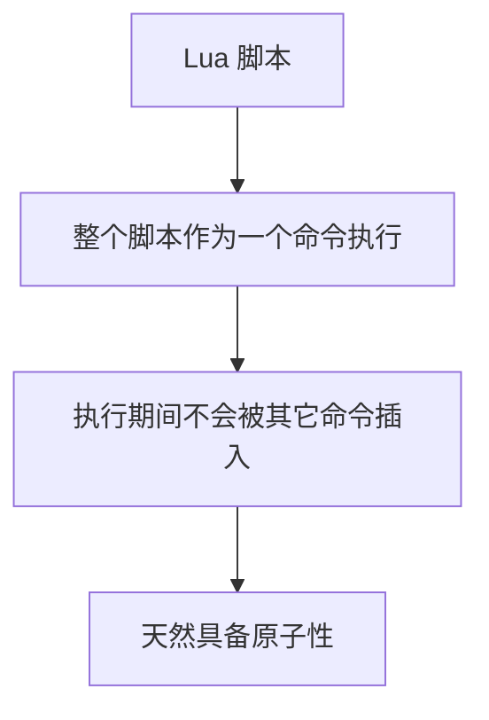

# Redis 事务：用 Lua 脚本保证原子性

这道面试题通常跟在 Redis 事务后面追问：`multi + exec` 之外还有什么办法保证原子性？答案就是 Lua 脚本。考官想看你是否知道 Redis 会把整个脚本当成一个整体执行，执行期间不会插入其他命令，以及你能不能把 `eval` 的 key、参数传递机制讲清楚。

## 先给结论

1. Redis 支持 Lua 脚本，脚本里的多条指令由服务器整体执行，具备原子性。
2. 执行脚本用 `eval` 命令，脚本后面先写 key 的个数，再依次写 key，最后写参数。
3. 脚本里用 `KEYS[1]`、`KEYS[2]` 引用传入的 key，用 `ARGV[1]` 引用传入的参数。
4. Lua 脚本里可以定义局部变量、做 if 判断、写循环，能力远超单条 Redis 命令，业务规则稍复杂时可以用它替代 `multi + exec`。
5. 脚本内调用 Redis 命令用 `redis.call`，命令返回的默认是字符串，做数学运算前要用 `tonumber` 转换。



## 是什么

Redis 支持 Lua 脚本，脚本的功能相当多：可以在里面定义局部变量、做 if 判断、写循环，换句话说，它突破了简单 Redis 命令做不了复杂事情的限制。更关键的是，Redis 能保证脚本里面多条指令执行的原子性。

执行一个 Lua 脚本通过 `eval` 命令，语法形式是：

```text
eval "脚本内容" key的个数 key1 key2 ... 参数1 参数2 ...
```

后面那段用双引号引起来的长字符串就是 Lua 脚本。还可以在执行时给脚本传一些信息，比如 key 和参数。例如 `eval "..." 2 a b 500`，其中 2 表示接下来的两个信息是 key（也就是 `a` 和 `b`），剩下的就叫参数，这里传了一个转账金额 500。

key 和参数中间都是用空格分割的，如果不写前面这个数字，脚本并不知道哪部分是 key、哪部分是参数，所以这个个数数字的作用就是把 key 和参数区分开。

## 为什么这样设计

`multi + exec` 的事务是命令的批量排队执行，遇到 exec 失败等问题时前面已经入队的命令会被丢弃，而且事务里做不了条件判断，逻辑稍复杂就力不从心。Lua 脚本把「判断加修改」整套逻辑搬到服务器端，一次传入、一次执行完，中间不可能有别的指令插队，对复杂业务规则更友好，所以它可以取代之前的 `multi + exec` 这种事务方式。

## 深入细节

### 脚本里怎么引用 key 和参数

传给脚本的 key 和参数，在脚本里都可以使用：

- `KEYS[1]` 代表引用第一个 key，也就是传入的 `a`；
- `KEYS[2]` 代表引用第二个 key，也就是传入的 `b`；
- 以此类推；
- 要引用参数用 `ARGV[1]`，表示引用第一个参数。

### 转账脚本逐行看

刚才一行写着的脚本可读性不好，格式化之后是这样，有任何一门语言基础都能看懂：

```lua
local a = tonumber(redis.call('get', KEYS[1]))
local b = tonumber(redis.call('get', KEYS[2]))
local c = tonumber(ARGV[1])
if a >= c then
    redis.call('set', KEYS[1], a - c)
    redis.call('set', KEYS[2], b + c)
    return 1
else
    return 0
end
```

逻辑就是转账逻辑。首先脚本里可以直接调用 Redis 指令，通过 `redis.call` 调 `get`、`set` 都可以。先调用 `redis.call('get', KEYS[1])` 拿到 A 的余额，`KEYS[1]` 就是 `a`；再拿 B 的余额。

要注意两点。第一，脚本里调用这些 `get` 方法，返回的结果默认还是字符串，所以得借助 Lua 的 `tonumber` 函数把字符串转换成数字，转换之后才能做数学运算。第二，从这里也能看出 Lua 脚本支持定义局部变量：`a` 代表 `KEYS[1]` 这个 key 对应的余额，`b` 是 B 的余额，`c` 这次读的是 `ARGV[1]`，也就是转账金额 500，同样转成数字。

A 的余额、B 的余额、转账金额都齐了，接下来就是大家都看得懂的逻辑：先判断 A 的余额是不是大于等于转账金额，条件成立说明有足够的钱可以转账，那么就修改两者的余额，A 减去转账金额，B 加上转账金额，通过调用 Redis 的 `set` 指令把新值更新到 `KEYS[1]`、`KEYS[2]` 里。都成功了 `return 1` 代表成功；如果中间有问题，比如余额不足，就会执行到 `else`，`return 0` 代表失败。最后这个 `end` 代表整个 Lua 运行结束。

### 实际跑一遍

先把 A 和 B 都设置成 1000，恢复到初始状态，然后执行 `eval`。可以看到脚本作为一个整体运行，中间不可能有其他指令插队，想插队也没地方插，因为整个从头到尾都是一个整体在运行。运行结果是 A 变成了 500，B 变成了 1500。

## 面试怎么答

回答时可以这样组织：

1. 先给方案：除了 `multi + exec`，还可以用 Lua 脚本保证原子性，执行入口是 `eval`。
2. 讲清机制：脚本由 Redis 服务器端整体执行，执行期间不会插入其他命令，因此多条指令之间具备原子性。
3. 讲清传参：`eval "脚本" key个数 key... 参数...`，脚本里用 `KEYS[n]` 取 key、用 `ARGV[n]` 取参数；脚本里用 `redis.call` 调 Redis 命令，返回值默认是字符串，运算前用 `tonumber` 转换。
4. 点明适用场景：业务规则带条件判断、逻辑比单纯几条命令复杂时，用 Lua 脚本替代事务更自然。

常见追问：

- **问：为什么 Lua 脚本能保证原子性？** 因为脚本在服务器端作为一个整体执行，从第一条到最后一条之间不会有其他命令插入，等价于一段串行执行完的逻辑。
- **问：key 个数那个数字不写行不行？** 不行。key 和参数都用空格分隔，不告诉脚本哪部分是 key，脚本就无法区分 `KEYS` 和 `ARGV`。
- **问：脚本里读出来的值能直接做加减吗？** 不能，`redis.call` 返回的是字符串，先用 `tonumber` 转成数字。

## 常见误区

- **误区一：Lua 脚本只是把多条命令打包发出。** 不是，脚本是在服务器端整体执行的，和客户端发一串命令有本质区别。
- **误区二：脚本执行期间可以插入其他命令。** 不能，整个脚本就是一个整体，其他指令没有插队的位置。
- **误区三：`redis.call` 的返回值可以直接参与数学运算。** 返回的是字符串，要先 `tonumber`。
