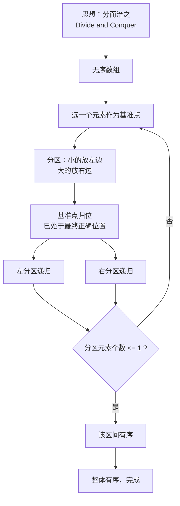

# 快速排序：算法描述

快速排序是面试手写算法的常客，而动手写之前必须先把算法描述讲清楚：每一轮的关键是分区操作，分区靠基准点，递归靠分而治之。这道描述题考的是你对快排骨架的理解，后面两种分区实现（单边循环、双边循环）都建立在这套描述上。

## 先给结论

1. 快速排序每一轮的关键操作是分区：先选一个基准点元素，把比基准点小的放左边分区，比基准点大的放右边分区。
2. 一轮分区成功后，基准点元素就处在它最终正确的位置上，因为比它小的都在左、比它大的都在右。
3. 对基准点左边的分区和右边的分区重复同样的算法，不断递归，直到分区内元素个数小于等于 1，整个数组有序。
4. 快速排序体现的是分而治之思想，英文 Divide and Conquer，简称 D and C。
5. 基准点可以随意选，选哪个元素都不影响算法的正确性。

## 是什么

快速排序每一轮的关键在于一个分区操作。分区的规则是：先在现有元素里选一个元素作为基准点元素，然后把比基准点小的元素放入它的左边分区，比基准点大的元素放入基准点右边的分区。

比如对一个无序数组分区，先选一个基准点。选谁？其实可以认为是随意选。假设选 4 作为基准点，那么将来就要把比 4 小的，也就是 1、2、3，放在 4 的左边；比 4 大的 5、7、9、8，放在它的右边。

先忽略分区过程，直接看结果：分区成功以后，比 4 小的 3、2、1 在它左边，比 4 大的 9、8、7、5 在它的右边。这里有个关键点：分区一旦成功，基准点元素就处在它最终正确的位置上了。因为比 4 小的都在它左边，比 4 大的都在它右边，所以 4 的位置已经固定下来，后续排序不会再动它。

## 深入细节

### 递归分区

理解了轮分区操作，接下来就是重复这个过程：把 4 左边的分区重复刚才的算法，4 右边的分区也重复刚才的算法，这样不断递归，就能得到一个有序的结果。

看 4 左边这个分区。假设这回选 1 作为基准点，那么比 1 小的将来要排在它左边，现在没有比 1 小的，没关系，它左边不排元素；比 1 大的 2、3 要排在 1 的右边。经过这一轮分区，2、3 排在 1 右边，分区的范围又缩小了，缩到 1 右边这两个元素组成的一个分区。再对这个分区内的元素重复同样的算法，一直到全部有序。

### 递归结束条件

什么时候算结束？当分区中的元素个数小于等于 1 的时候，也就是这个分区里没元素了，或者只剩一个元素，就说明它的最终结果已经达到有序。

这就是快速排序的描述：不断在子分区内重复分区过程。而这个「不断在子分区内重复」体现的正是分而治之的思想，它的英文叫 Divide and Conquer，简称 D and C。以后看到 D and C 这个缩写，要知道它的含义是分而治之。

### 基准点的选取

再说一次基准点：它可以随意选。选不同的元素当基准点，分区的过程和中间状态会不同，但只要满足「小的往左、大的往右」这条规则，每一轮结束基准点都会落在最终位置上，最终结果都是有序的。具体怎么选、怎么高效地分区，就是后面分区实现要讲的内容。

## 面试怎么答

回答时可以这样组织：

1. 一句话定义：快排每一轮做一次分区，用基准点把元素分成左小右大两部分，基准点落到最终位置。
2. 讲递归：左右两个子分区重复同样过程，直到子分区元素个数小于等于 1。
3. 点明思想：分而治之，Divide and Conquer，即 D and C。
4. 收尾预告：分区有不同实现，比如单边循环、双边循环，选基准点也有不同策略。

常见追问：

- **问：基准点选谁有讲究吗？** 可以随意选，选不同元素不影响正确性，但会影响分区效率和极端情况下的表现。
- **问：为什么一轮分区后基准点位置就固定了？** 小的全在左、大的全在右，正好就是有序数组中它该处的相对位置。
- **问：最坏情况下会怎样？** 本讲只描述算法，不展开复杂度；被追问时说明每次分区极度不均衡时递归深度会退化，这也是基准点选取策略存在的原因。

## 常见误区

- **误区一：分区后整个区间都有序了。** 只有基准点一个元素的位置是确定的，左右两部分仍然无序，要靠递归处理。
- **误区二：一轮只确定一个元素的位置，等于没干活。** 恰恰是这一个确定位置，把问题分成两个更小的子问题，分而治之靠它逐轮收敛。
- **误区三：必须选第一个元素当基准点。** 基准点可以随意选，这是规则允许的。

## 课件配套可视化 Demo

> 本算法的交互式可视化页面已随本系列一并打包：[demos/day01_quick_sort.html](demos/day01_quick_sort.html)（纯 Canvas 实现，无需任何外部依赖，直接用浏览器打开即可）。

页面用柱状图逐步演示基准值（pivot）选取、分区（partition）与递归缩区的全过程，可切换单边循环（Lomuto）与双边循环两种思路。本系列 163–201 快速排序博客（单边循环、双边循环、实现细节、特点总结）都能用同一页面边看边验证。
