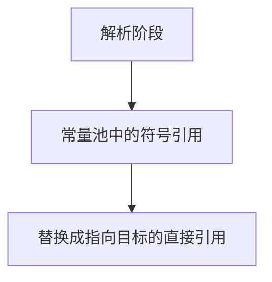

# 类加载：将符号引用变为直接引用

类加载三阶段里，链接中的「解析」是最容易被误判的一步。很多人（包括当年的我）默认链接在初始化之前就整体完成了，解析当然也早就做完。实际上解析不是一步到位的，而是一点一点完成的。这道面试题考的就是这个细节，能用调试工具指着常量池里 unresolved class 变成 class 的过程讲，回答会非常扎实。

## 先给结论

1. 解析是链接中的一个步骤，作用是把常量池中的符号引用解析为直接引用。
2. 符号引用就是一类名字之类的符号，此时目标类还没有加载，并不知道它在内存中的真实位置。
3. 解析不是一步到位的，而是一点一点、按需完成的，初始化之后仍然可能发生解析。
4. 目标类被加载并初始化后，它有了确定的地址，常量池里的 unresolved class 条目就变成真正的 class，符号引用随之变成直接引用。
5. 常量池里存的是类运行过程中要用到的常量数据，包括数值、类名等。

## 是什么

先复习已经验证过的结论：类的加载、类的初始化都是懒惰执行的；类对象存储在方法区中；静态变量的赋值在初始化阶段完成，例外是 `final` 修饰的基本类型静态变量，可以认为是在加载阶段完成赋值；初始化方法的实现原理是把所有静态变量赋值和静态代码块集中成一个方法，在初始化阶段执行。

这些之外还剩最后一个没讲的点：链接中的解析步骤。

以前对解析的理解是有偏差的：过去认为先完成加载，再执行链接，最后执行初始化，初始化完了链接的这些步骤肯定都执行完了，也就是初始化之后不会再执行解析。但实际上并不是这样，解析不是一步到位的，它是一点一点来完成的。

## 深入细节

### 实验准备

准备一个叫 TestResolution 的类，resolution 就是解析的意思。这个类中会用到三个静态内部类 A、B、C，每次暂停一下，然后创建 A 的实例，触发 A 的加载和初始化；再暂停一下，创建 B 的实例，触发 B 类的加载、链接、初始化；最后创建 C 的实例。

### 符号引用长什么样

程序跑起来后停在读取输入那行，此时 A、B、C 都还没有加载和初始化。打开调试工具连上进程，先看加载的类：只有 TestResolution 自己，并没有内部类 A。

进 TestResolution 的常量池。常量池说白了就是类的运行过程中需要用到的一些常量数据，包括一些数值、类名等等。TestResolution 后面的代码要用到 A、B、C，但这些类刚开始并没有被加载到内存里，所以对于 TestResolution 来讲，它仅仅知道有 A 这么个东西，具体 A 在内存中什么位置，它并不知道。此时它的常量池中只保留了 A、B、C 的符号引用。

往下找常量池，可以看到它引用了一个类，这个类的名字是 `day03.loader.TestResolution$A`。因为它是内部类，所以是外面这个类的名字加个 `$`，然后才是 A。这个类名就称之为符号引用，因为 A 还没有被加载，并不知道它的真实位置。B 和 C 都是一个意思，从条目前的描述也能看出来，这里写的是 unresolved class，意思就是未解析的类，或者说未解析的符号。

### 解析发生时

继续运行，A 被加载和初始化了，A 会在初始化时打印一行语句。重新连上调试工具，看当前加载的类型，里面已经有 `TestResolution$A` 了。再回到 TestResolution 的常量池，往下看就会看到不一样的地方：刚才那个 unresolved class 没有了，变成了一个 class。A 类型已经被加载、也被初始化，所以这个类的地址也就知道了。

这就是所谓的把符号引用变成直接引用。既然是直接引用了，点这个链接进去，就能找到关联的 A 的相关信息。

再看一个。继续运行，B 被创建出来。重新连接后看当前加载的类，TestResolution 以及 A、B 都有了。回到 TestResolution 的常量池，往下看，又多了一个被解析的：B 也不是 unresolved class 了，也变成了一个正常的 class，符号引用变成了直接引用。知道了 B 的地址，就能得到 B 的进一步详细信息，包括它有哪些成员、有哪些方法。对于 TestResolution 来讲，它就可以获取这些信息了。

### 这说明什么

三个类的解析不是在建类时就一次性做完的，而是随着各自的加载、初始化逐步发生的。初始化之后解析依然在进行，这就是「解析不是一步到位」的直接证据。

## 面试怎么答

回答时可以这样组织：

1. 先定位：解析是链接中的一个步骤，把常量池中的符号引用解析为直接引用。
2. 讲符号引用：类刚建好时，用到的其他类还只是常量池里的一个类名符号，标着 unresolved class，不知道对方在内存里的位置。
3. 讲解析时机：解析按需发生，目标类加载初始化后拿到确定地址，符号引用升级为直接引用，之后就能访问目标类的成员、方法等详细信息。
4. 纠正常见误解：不要以为初始化之前链接（含解析）就整体完成，解析是一点一点完成的。

常见追问：

- **问：符号引用和直接引用的区别？** 符号引用只是一串符号（类名、方法名描述），与内存布局无关；直接引用指向内存中的实际地址，能直接访问目标。
- **问：解析发生在链接的哪个环节？** 解析是链接阶段的步骤之一，但它不保证在初始化前全部完成，具体条目按使用时机逐个解析。
- **问：常量池里还有什么？** 类运行过程中需要的常量数据，数值、类名等等都在里面。

## 常见误区

- **误区一：初始化之前链接的所有步骤都做完了。** 解析是一点一点完成的，初始化之后仍会按需解析新的符号引用。
- **误区二：常量池里的类名就是直接引用。** 那只是符号引用，标着 unresolved class，目标类加载后才会变成直接引用。
- **误区三：内部类的名字是随便拼的。** 内部类的二进制名字是外部类名加 `$` 再加内部类名，比如 `TestResolution$A`。
