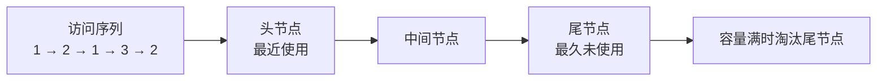
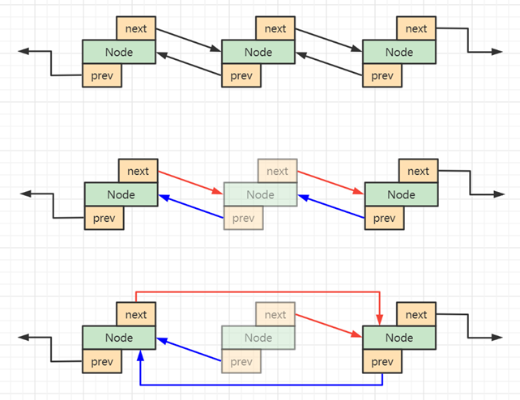
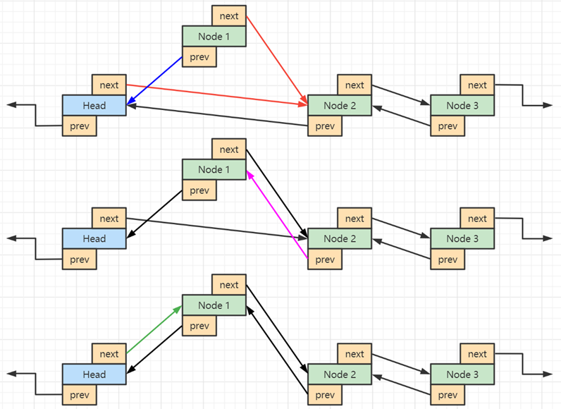
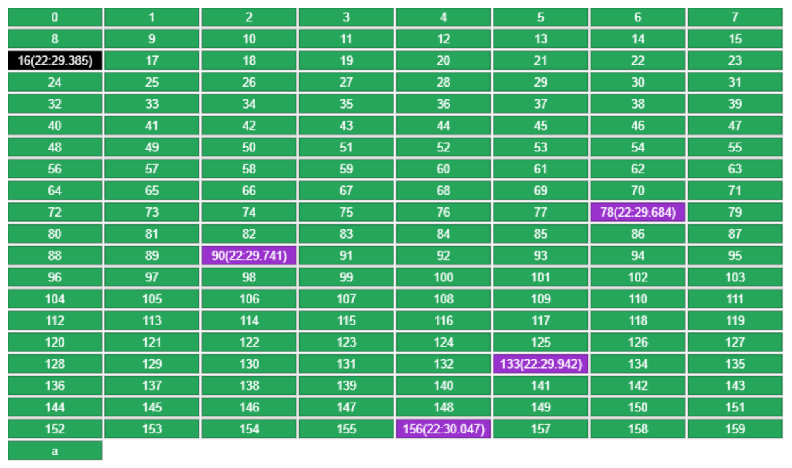
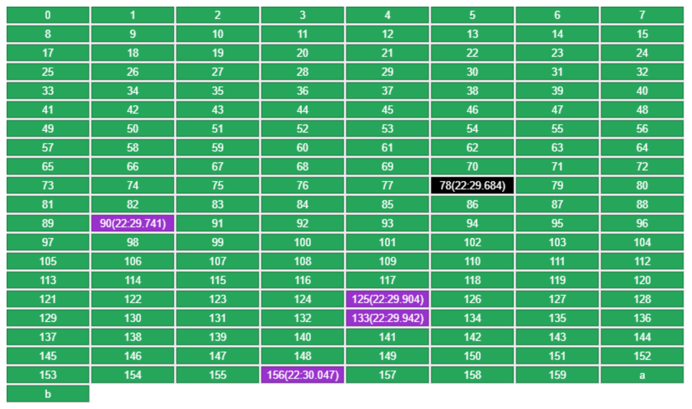
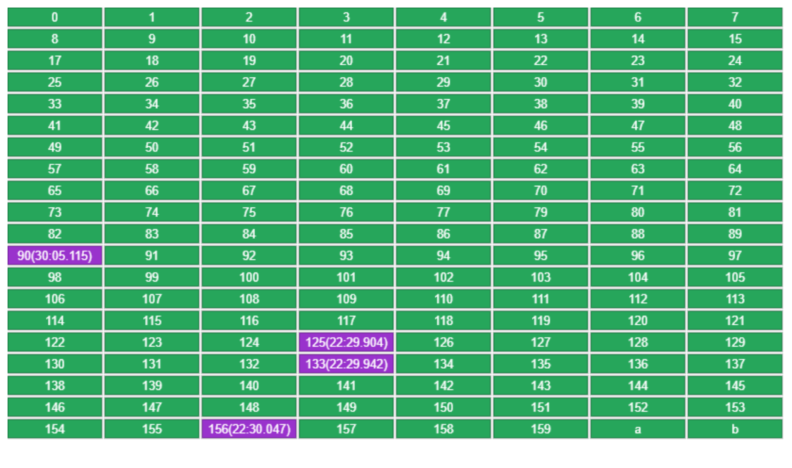

# LRU Cache：演示

LRU 是缓存淘汰策略里最经典的一个，面试问缓存基本必问。这道演示题要你讲清两层：LRU 的判定规则（什么数据该留、什么该淘汰），以及两种实现思路（链表法和随机取样法）各自的适用场景。能顺带说出 Redis 为什么不用链表法，回答就完整了。

## 先给结论

1. 缓存用内存实现，内存大小有限，必须把价值不大、使用较少的数据淘汰掉，把内存留给更常用、更有价值的数据。
2. LRU 全称 Least Recently Used，最近最少使用，把最近最少使用的 key 从缓存中淘汰掉。
3. LRU 的规则可以从两方面理解：时间上新的留、老的淘汰；访问过某个 key，它就变成最新的，会被留下来。
4. 常见实现有两种：链表法和随机取样法。
5. 链表法最容易实现，但每个节点要记前驱和后驱指针，占内存较多；Redis 用的是随机取样法，每次随机抽少量 key，按访问时间挑最老的淘汰。



## 是什么

缓存的实现方式是使用内存，但内存大小毕竟有限，不能把所有数据都加载到内存里。因此一些价值不大、使用较少的数据，就应该从缓存中淘汰掉，把内存留给更常使用、更有价值的数据。这涉及淘汰策略的概念，LRU 就是其中一种，它决定哪些数据该留、哪些数据该淘汰。

LRU 的全称是 Least Recently Used，直接翻译就是把最近最少使用的这些 key 从缓存中淘汰掉。理解它可以从两个方面入手。

一是时间：按 key 放入缓存的先后顺序，新的留下。刚放进去的数据，可以认为它的价值较高；比较老的就淘汰掉。

二是访问更新：如果你访问了某个 key，虽然它可能原来是个老数据，但你访问了它，说明它的使用价值比较高。所以当你访问某个 key 的时候，这个 key 就变成最新的，自然会被留下来，而更老的数据则会被淘汰掉。

这就是 LRU 的实现思想。

## 深入细节

### 链表法

实现方式常见的有两种，第一种是链表法，最容易实现。把最近访问的这些 key 都移动到链表头，不常访问的 key 自然会靠近链表尾。一旦将来超过内存容量或者 key 个数限制，就把尾部的 key 移除。头部留的是新的、经常访问的，尾部留的是不常访问的、较老的 key。

演示一下。先放入三个 key：97、43、56。放入之后顺序是这样的：最先放进去的 56 靠近链表尾，43 是第二个放进去的，97 是最新放进去的，最新放的靠近头，最老放的靠近尾。

把容量故意设小，设为 3，最多放三个 key。再放第四个 key，比如放一个 1，放进去的时候最老的那个 key 就被淘汰掉了，可以看到 56 被淘汰，1 被放入靠近头的部分。

如果满了之后按规则应该淘汰 43，但是你访问了一下 43，get 了它。get 意味着你用了它，43 就会移到链表头，97 靠后放，1 也靠后放。这样下次淘汰肯定不会淘汰 43，因为你用了它证明它有价值、用得频繁。所以如果再放一个 2，被淘汰的就是 97。

把上面的演示落成代码，核心是双向链表加一张哈希表：

```java
static class Node {
    Node prev;
    Node next;
    String key;
    Object value;

    public Node(String key, Object value) {
        this.key = key;
        this.value = value;
    }

    // (prev <- node -> next)
    public String toString() {
        StringBuilder sb = new StringBuilder(128);
        sb.append("(");
        sb.append(this.prev == null ? null : this.prev.key);
        sb.append("<-");
        sb.append(this.key);
        sb.append("->");
        sb.append(this.next == null ? null : this.next.key);
        sb.append(")");
        return sb.toString();
    }
}

public void unlink(Node node) {          // 摘下来
    node.prev.next = node.next;
    node.next.prev = node.prev;
}

public void toHead(Node node) {          // 插到头（最近使用）
    node.prev = this.head;
    node.next = this.head.next;
    this.head.next.prev = node;
    this.head.next = node;
}
```

`get` 命中后要把它移到头部，`put` 超过容量就淘汰尾节点：

```java
public Object get(String key) {
    Node node = this.map.get(key);
    if (node == null) {
        return null;
    }
    unlink(node);
    toHead(node);                        // 访问过，变成最新的
    return node.value;
}

public void put(String key, Object value) {
    Node node = this.map.get(key);
    if (node == null) {
        node = new Node(key, value);
        this.map.put(key, node);
    } else {
        node.value = value;
        unlink(node);
    }
    toHead(node);
    if (map.size() > limit) {            // 超容量，淘汰最久未使用的
        Node last = this.tail.prev;
        this.map.remove(last.key);
        unlink(last);
    }
}
```

构造函数里 `head`、`tail` 是两个哨兵节点，不存数据，只是为了让 `unlink`、`toHead` 不用判空：

```java
public LruCache1(int limit) {
    this.limit = Math.max(limit, 2);
    this.head = new Node("Head", null);
    this.tail = new Node("Tail", null);
    head.next = tail;
    tail.prev = head;
    this.map = new HashMap<>();
}
```

### 随机取样法

Redis 并没有采用链表法，因为链表每个节点都要记录它的前驱 previous 跟后继 next，这两个指针消耗内存比较多。Redis 用的是一种随机取样法。

大概思想是：每次只随机抽少量的几个 key，比如说抽五个，这五个 key 都会记录它们最近的访问时间，然后按照访问时间的先后次序，把较老的那个 key 挑出来淘汰掉。

演示一下。假设缓存里已有从 0 到 159 一共 160 条数据，节点之间没有用链表连接，但每个节点都记录了自己的键值和放入的时间，访问某个 key 时这个时间会更新。

设置上限就是最多 160 个 key。现在 put 一个 a，变成 161 个就放不下了，于是按时间先后淘汰。put 之后它先随机挑 5 个值，比如挑到了 36、71、97、90、92、145，从它们的时间先后顺序上看，36 最老，是 9 点 33 分 755 毫秒放进去的，其他都比它大。所以随机挑五个，这五个里面找一个时间最老的淘汰，36 被淘汰，a 保留在最前端，因为 a 是最新放进去的。

注意它只留了四个，连同下次再随机挑一个，凑成五个，这五个里面再找一个最小的。比如再 put 一个 b，又超过限制，这回随机到的是 9，连同上次剩的 4 个，这五个里挑一个时间最早的，9 是 33 分 06 秒 631 毫秒，比其他更早，所以它被淘汰掉。b 放入以后，9 就没了。

这几个 key 如果你访问了，时间会更新。比如下一个按顺序该淘汰 71，先 get 一下 71，它的时间就变成最新的，下次淘汰就不会淘汰它。所以再下次就算它在被挑到的五个当中，也不会被淘汰。

再来个 c，这回随机挑出的五个里有 88，88 比 90 还早，所以淘汰的是 88。虽然没有演示出预想中淘汰 90 的效果，但思想很明确：挑五个，然后选出时间最老的进行淘汰。Redis 就是这么干的。

## 面试怎么答

回答时可以这样组织：

1. 先给定义：LRU 是 Least Recently Used，淘汰最近最少使用的 key，内存有限所以必须淘汰。
2. 讲规则：时间上老的淘汰，访问即刷新，访问过的 key 变新。
3. 讲实现一：链表法，访问的挪到链表头，超容删尾部；简单但每节点两个指针，内存开销大。
4. 讲实现二：随机取样法，Redis 的做法，随机抽几个（比如五个）按访问时间挑最老的淘汰，省内存。

常见追问：

- **问：Redis 为什么不用链表法？** 链表每个节点要记 previous 和 next 两个指针，内存占用多，Redis 对内存敏感，所以用随机取样法近似 LRU。
- **问：随机取样法能保证淘汰真正最老的吗？** 不保证，它是近似淘汰，只在随机抽到的样本里挑最老的，但省内存，工程上够用。
- **问：访问一个 key 会发生什么？** 链表法里它会被移到链表头；随机取样法里它的访问时间被更新为最新。

## 常见误区

- **误区一：LRU 看的是访问次数。** 看的是最近有没有被访问，访问即刷新成最新，不是统计次数。
- **误区二：Redis 用的是精确 LRU。** Redis 用随机取样法，是近似 LRU，每次只在样本里挑最老的淘汰。
- **误区三：链表法零成本。** 每个节点要存前后指针，内存开销大，这也是 Redis 放弃它的原因。

## 课件配套可视化 Demo

> 本算法的交互式可视化页面已随本系列一并打包：[demos/day06_lru.html](demos/day06_lru.html)（纯前端实现，直接用浏览器打开即可）。

页面用链表节点图动态演示「访问即移到头部、淘汰尾部」的 LRU 命中与淘汰过程，可手动触发查询/新增观察指针变化。本系列 165–193 LRU 博客（断开链接、链入头节点、查询新增、LinkedHashMap 实现、测试）都能用同一页面对照。

> 补充：Redis 实际用近似 LRU（随机采样淘汰）做内存 maxmemory 淘汰，课件另提供 redis 版可视化 [demos/day06_lru_redis.html](demos/day06_lru_redis.html)，可对照本文手写 LRU，理解工程实现与理论 LRU 的差异

## 课件配图
> 以下配图取自阶段七课件对应讲义，与上文讲解一一对应，可作为图文对照辅助理解。
**LRU Cache 实现**（课件讲义图示）







