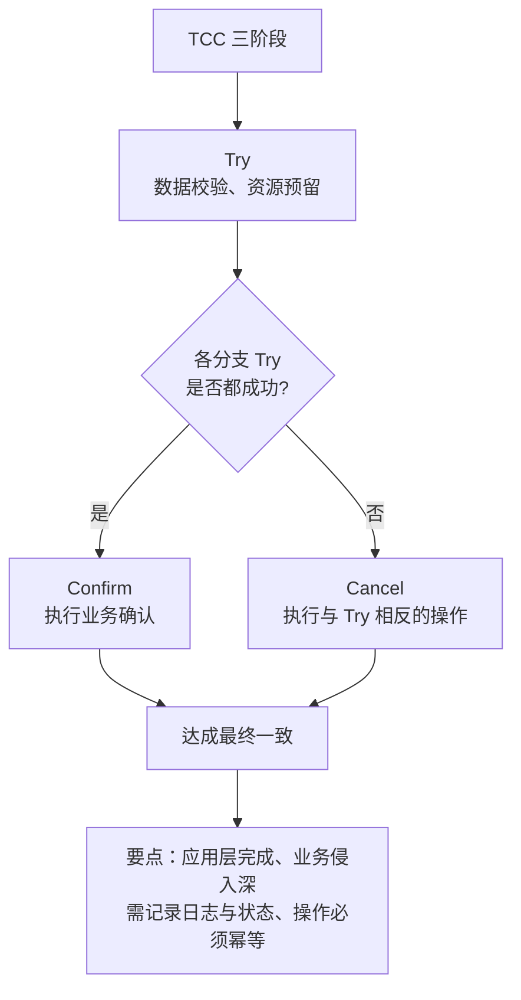

# 分布式事务：TCC 事务补偿

TCC 是分布式事务的第二类经典方案，也是面试区分度最大的一题。很多人背得出 Try、Confirm、Cancel 三个单词，但讲不清 Try 到底做什么、为什么说它本质还是两阶段提交、以及幂等和日志为什么是硬要求。把这几点讲透，回答就立住了。

## 先给结论

1. TCC 是 Try、Confirm、Cancel 三个阶段的缩写，是一种事务补偿型的分布式事务方案。
2. Try 阶段对数据做校验、做资源预留，但不对核心数据做最终状态变更；Confirm 才执行最终变更。
3. 只要有一个参与者的 Try 出问题，事务管理器就向所有参与者发 Cancel，执行与 Try 相反的操作，释放预留的资源。
4. TCC 本质上还是两阶段提交，但它不借助数据库驱动，而是在应用层完成，可以自研或用第三方 TCC 框架。
5. 代价：业务侵入比较深（要增加中间状态）、每个服务节点要配置 TCC 框架并记录操作日志和状态以便宕机恢复、三个阶段都必须考虑幂等。

## 是什么

TCC 分别指 Try、Confirm、Cancel。

Try 是指对数据做校验、做资源预留，它不对核心数据做状态变更。如果 Try 这一步没有问题，才会通知所有的事务参与者执行业务确认，也就是最终执行变更。如果其中有一些参与者返回有问题，就由事务管理器向所有参与者发送 Cancel，Cancel 里面执行与 Try 相反的一些操作，把预留的资源释放掉。

## 深入细节

### 业务场景

假设有多个服务：订单服务负责下单，库存服务负责扣减库存，积分服务在下单成功后做一些积分的调整增加，仓储服务收到下单成功后要做出库，此外还有余额服务参与扣款。这些服务可能分别部署在不同节点上，需要对这些操作进行原子性控制：要么大家都成功，要么大家都失败。

通过 TCC 来做，首先需要一个事务管理器，由它去协调这些事务的进行。它先向每一个服务发送一个 Try 操作，重点是执行资源的预留。

### Try 阶段：只做中间状态

订单服务不要直接把订单状态改成最终的已支付状态，而是改成一个中间状态，也就是支付中（Paying）。库存服务也不要直接执行最终的库存扣减，而是执行一个库存冻结或者叫库存预留的操作，比如在数据库表里多加一列，保留预留的库存数。积分服务类似，不直接增加积分，而是来一个积分的预增。仓储服务不要直接出库，来一个预出库。余额服务则先做余额预扣。

Try 阶段做的就是对这些资源不做最终的状态变更，只做中间状态的变更。

### Confirm 阶段：真正变更

如果订单、库存、积分、仓储（以及余额）这些服务 Try 阶段的所有操作都成功了，向事务管理器返回了 OK，那么就进入第二个阶段，Confirm 阶段。事务管理器认为大家都没问题，实行接下来的确认，也就是真正的变更：订单状态设置为已支付（Paid），库存真正去扣减，积分真正去增加，预出库变成真正出库，余额预扣变成真正扣减。这些请求一发，如果都 OK，事务就成功了，结束了。

### Cancel 阶段：补偿

还有一种情况：Try 阶段有的服务没有成功。比如预下单、库存冻结这些都 OK，但是积分这边出现了 error，返回给管理器说没有成功。那接下来这个事务就要取消，进入 Cancel 阶段。事务管理器向各个服务都发送 Cancel 请求：订单状态本来是支付中，现在设成取消（Canceled）；库存本来冻结了，现在把它解开，去除冻结；积分预增，取消这个预增；预出库，取消这个预出；余额预扣，去除预扣。各个服务都撤销 OK 了，把这个信息返回给管理器，管理器让这个事务最终结束。

### TCC 的要点

第一，它本质上还是两阶段提交，但和前面的 2PC 不一样：2PC 借助底层的数据库驱动来完成分布式事务，是在数据库驱动层完成的；TCC 是在应用层完成的，可以自研 TCC 框架或者使用第三方 TCC 框架。

第二，业务侵入比较深。Try、Confirm、Cancel 都得对业务改动比较大，要增加一些中间状态；而且需要在每一个服务节点上配置 TCC 框架，去监测各个服务的日志状态。为什么要记录日志状态？万一这些服务在跟管理器通信的过程中挂掉了，把日志记录下来，将来还可以恢复。

第三，三个阶段（Try、Confirm、Cancel）都必须考虑幂等。因为要考虑到通信超时等情况，如果请求重发了，操作不幂等就有可能添加重复的数据。

## 面试怎么答

回答时可以这样组织：

1. 定义：TCC 是 Try、Confirm、Cancel 三阶段的事务补偿方案。
2. 走流程：Try 做校验和资源预留（中间状态，如支付中、库存冻结、积分预增、预出库）；全员成功则 Confirm 做真正变更；任一失败则 Cancel 做逆向操作释放资源。
3. 与 2PC 对比：本质都是两阶段提交，但 2PC 在数据库驱动层，TCC 在应用层，无数据库驱动依赖，靠自研或第三方框架。
4. 主动谈代价：业务侵入深、要加中间状态；每节点配 TCC 框架、记日志以便恢复；三阶段全部要幂等。

常见追问：

- **问：Try 和 Confirm 的区别？** Try 只留中间状态和预留资源，不动最终数据；Confirm 才把中间状态推到终态、把预留转成真实扣减。
- **问：为什么必须幂等？** 网络超时会导致请求重发，Try、Confirm、Cancel 都可能重复执行，不幂等会出现重复扣减、重复解冻这类问题。
- **问：日志是干什么用的？** 服务与管理器通信中断时，靠本地记录的日志和状态做恢复，避免参与者状态不一致。

## 常见误区

- **误区一：Try 阶段就在改业务数据。** Try 只做校验和资源预留，改的是中间状态，最终变更留给 Confirm。
- **误区二：TCC 和 2PC 是一回事。** 阶段上都是两段，但 2PC 在数据库驱动层、TCC 在应用层，侵入性和恢复手段完全不同。
- **误区三：Cancel 只有失败时才写。** 三阶段的代码都要写，而且都要考虑幂等，Cancel 的逆向操作同样可能被重复调用。
