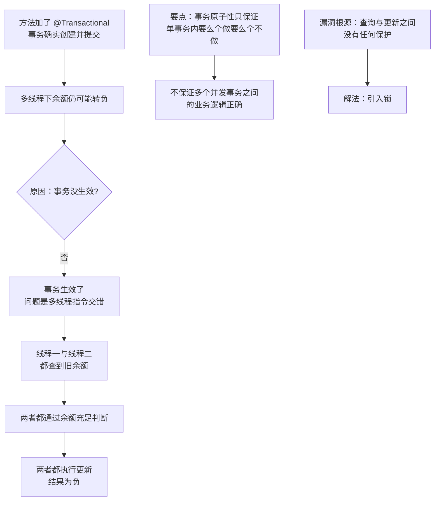

# Spring 事务失效场景七：原子性失效

这是事务失效系列里最颠覆认知的一个：方法规规矩矩加了 `@Transactional`，日志里事务也确实创建并提交了，但多线程一跑，余额还是转成了负数。这个场景要讲明白的道理是：数据库事务的原子性不等于业务并发正确性，`@Transactional` 管的是单个事务内的原子提交，管不了多个线程之间的指令交错。情况七和随后的情况八其实是同一个问题，最后会用同一段代码演示。

## 先给结论

1. 加了 `@Transactional` 的方法，在多线程下仍可能出现业务错误，比如余额被转成负数。
2. 原因不是事务没生效，而是多线程产生了指令交错：两个线程都查到了旧的余额，都通过了余额充足判断，都执行了更新。
3. 事务的原子性只保证单个事务内的操作要么全做要么全不做，不保证多个并发事务之间的业务逻辑正确。
4. 查询和更新之间没有任何保护，两个线程可以交替执行，这是漏洞的根源。
5. 这类问题的解法要引入锁（和随后的锁失效场景是同一类问题）。



## 是什么

先读一下之前的 transfer 方法：

```java
@Transactional(rollbackFor = Exception.class)
public void transfer(int from, int to, int amount) {
    int fromBalance = accountMapper.findBalanceBy(from);
    logger.debug("更新前各余额为：{}", fromBalance);
    if (fromBalance - amount >= 0) {
        accountMapper.update(from, balance - 1 * amount);
        accountMapper.update(to, amount);
    }
}
```

逻辑是：先查询 from 账户的余额，把余额跟转账金额做比较，看看余额是否充足。余额充足了才能执行后续的两次更新操作；余额不足，肯定不能执行后面的更新。

这段逻辑单看没问题，但实际上多线程下它是有问题的。演示代码里准备两个线程 T1 和 T2，为了区分打印结果，一个用紫红色、一个用深蓝色（只是控制打印颜色）。T1 线程做转账，T2 线程做一模一样的转账。注意 from 账户的余额只有一千块钱，如果 T1 转走一千，T2 发现余额是零，这个转账就不应该执行成功；不能发现是零了还转一千，那就转成负数了。

## 深入细节

### 跑一遍：转成负数

测试代码用 CountDownLatch 让主线程等待，等 T1、T2 都执行完了，主线程再去看余额。按理来讲 from 账户余额应该是零：第一次转账减一千减成零，第二次发现是零就不应该再转。如果是负数，那就说明有问题。

```java
public static void main(String[] args) throws InterruptedException {
    GenericApplicationContext context = new GenericApplicationContext();
    AnnotationConfigUtils.registerAnnotationConfigProcessors(context.getDefaultListableBeanFactory());
    context.registerBean(AppConfig.class);
    context.refresh();

    Service7 bean = context.getBean(Service7.class);

    CountDownLatch latch = new CountDownLatch(2);
    new MyThread(() -> {
        bean.transfer(from: 1, to: 2, amount: 1000);
        latch.countDown();
    }, name: "t1", color: "boldMagenta").start();

    new MyThread(() -> {
        bean.transfer(from: 1, to: 2, amount: 1000);
        latch.countDown();
    }, name: "t2", color: "boldBlue").start();

    latch.await();
    System.out.println(bean.findBalance(accountNo: 1));
}
```

结果转账转成负数了。看数据库，from 账户已经转成了负一千，to 账户因为收了两次一千变成了三千。虽然总金额还是两千，但业务上不正确，不能把这个账户转成负数。

### 原因：指令交错

为什么出现这个问题？多线程下，虽然这个方法加了 `@Transactional`，希望它里面的操作是原子的，但多线程会产生指令交错的问题，一旦指令交错，代码就有漏洞。

从日志输出能明显看出交替执行的效果：先是蓝色线程（T2）的代码，又执行了红色线程（T1）的代码。问题主要出在查询这儿：红色线程先执行了查询，查 from 账户的余额，但它查询完了还没来得及执行更新的时候，蓝色线程也执行了查询。这里没有任何锁的保护，所以两个线程可以交替执行。

两个线程查询到的都是 1000，这很明显：红色线程查到了 1000，还没来得及执行下面的更新，数据库里的余额还是 1000，所以蓝色线程仍然能把这个 1000 查出来。两个人都查到了充足的余额，余额条件都成立，因此都会进入接下来的更新操作。最终蓝色线程执行了两次更新，红色线程也执行了两次更新，from 账户就变成了负数。事务日志里能看到这个交错：

```text
[INFO] - Creating new transaction with name [day04.tx.app.service.Service7.transfer]: PROPAGATION_REQUIRED,ISOLATION_DEFAULT,...
[DEBUG] - Switching JDBC Connection [HikariProxyConnection@90317128 wrapping com.mysql.cj.jdbc.ConnectionImpl@fa5080f] to manual commit
[DEBUG] - Preparing: select balance from account where accountNo=?
[DEBUG] - Parameters: 1(Integer)
[DEBUG] - Total: 1
[DEBUG] - 更新前各余额为：1000
[DEBUG] - Preparing: update account set balance=balance? where accountNo=?
[DEBUG] - Parameters: -1000(Integer), 1(Integer)
[DEBUG] - Updates: 1
[DEBUG] - Preparing: update account set balance=balance? where accountNo=?
[DEBUG] - Parameters: 1000(Integer), 2(Integer)
[DEBUG] - Updates: 1
[DEBUG] - Initiating transaction commit
[DEBUG] - Committing JDBC transaction on Connection [HikariProxyConnection@90317128 wrapping com.mysql.cj.jdbc.ConnectionImpl@fa5080f]
```

演示代码里 update 那行写的是 `balance - 1 * amount`，这是笔误，正确写法是按查出来的余额扣减：

```java
accountMapper.update(from, fromBalance - amount);
```

查库确认现场：

```sql
select * from account;
```

怎么解决这个错误？先思考，解法在下一个场景给出：要给这类操作加保护，而这又引出新的失效场景（锁失效）。

## 面试怎么答

回答时可以这样组织：

1. 先承认场景：`@Transactional` 加对了，事务日志也正常，但多线程下余额校验形同虚设。
2. 讲清机理：两个线程都通过查询拿到旧余额，校验条件都成立，更新交错执行，前查后更之间没有保护。
3. 点出本质：事务原子性针对单个事务，并发正确性要靠锁或数据库层面的并发控制。
4. 收尾：解法是给临界区加锁，但加锁又有讲究，直接加在方法上会引出锁失效的问题。

常见追问：

- **问：把隔离级别调高能解决吗？** 隔离级别解决的是事务间的可见性问题，这里的漏洞是业务层面的读写交错，根本上要在应用层加锁或利用数据库行锁。
- **问：为什么总金额是对的还是错？** 总金额守恒只说明加减没丢，但 from 账户透支，违反了业务规则，一致性不等于正确性。
- **问：`@Transactional` 到底保证了什么？** 保证单个事务内操作的原子性、一致性、隔离性、持久性，不保证跨线程的业务时序。

## 常见误区

- **误区一：加了 `@Transactional` 就高枕无忧。** 事务只覆盖单个事务内部，多线程交错的漏洞它看不见。
- **误区二：数据库总金额对就说明没问题。** 透支、超卖这类业务错误在总额上往往看不出来。
- **误区三：这是事务失效。** 事务没失效，是并发下的业务逻辑漏洞，解法在锁上，不在事务配置上。
