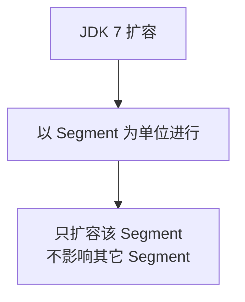

# ConcurrentHashMap v7：演示扩容

扩容是 ConcurrentHashMap v7 面试里最容易答错的一题：很多人以为整个 Map 一起扩容，实际上 Segment 数组从构造那一刻起就固定了，能扩容的只是每个 Segment 里的小数组，而且是各扩各的。这道演示题要讲清三层：谁不能扩容、谁按什么触发扩容、为什么头插法在这里不会死链。

## 先给结论

1. Segment 数组的容量不能扩容，构造方法指定并发度后，Segment 数组容量就固定为并发度，不随元素增多自动调整。
2. 能扩容的是 Segment 里面的 HashEntry 小数组，按负载因子（默认 0.75）判断：元素个数超过小数组容量的四分之三时触发扩容。
3. 小数组扩容每次容量翻倍。
4. 每个小数组根据各自的元素数量独立扩容，互不干扰。
5. v7 中多个 key 哈希相同时构成链表用头插法，但不会像普通 HashMap 1.7 那样死链，因为每个线程操作 Segment 时都加了锁，其他线程无法干扰它的扩容。

## 是什么

先强调一点：Segment 数组的容量其实是不能扩容的。它的容量在什么时候确定？当我们构造方法指定了并发度以后，将来这个 Segment 数组的容量就固定为这个并发度，不会说随着元素增多还能自动调整，它一开始就固定了。

能扩容的是里面 HashEntry 这个小数组。小数组会根据负载因子（默认四分之三）判断是否扩容：元素个数超过了数组容量的四分之三，就触发扩容。

## 深入细节

### 触发小数组扩容

演示：有一个 key A，它放在 Segment 12 这个索引处。为了触发这个小数组的扩容，接下来的元素也得放到 Segment 12 这个小数组里。所以再来一个 key B，把 B 的 hashCode 固定成 97，让它跟 A 一样。这样它们计算出来的 Segment 下标也都一样，才能触发扩容。

B 放进去的时候触发了扩容：因为元素个数变成了 2，超过了小数组容量的四分之三。扩容就是每次容量翻倍。

再放一个 key C 不会触发扩容：元素个数是 3，并没有超过容量的四分之三。再来一个 key D 就会触发：这回超过了四分之三，容量翻倍成 8。

### 头插法为什么不死链

ConcurrentHashMap v7 中，多个 key 的 hash 值计算出来一样、Segment 下标也一样，它们构成链表的时候用的是头插法。但这里的头插法并不会构成死链：因为每个线程在操作这个 Segment 的时候都是加了锁的，加了锁，其他线程就不会来干扰它的扩容。因此即使你用头插法，也不会像普通 HashMap 那样造成死链。

这也是分段锁设计带来的直接好处：锁的粒度落在 Segment 上，一个 Segment 的扩容过程被完整保护起来。

### 各扩各的，互不干扰

再看一个关键特性：小数组扩容是各扩各的，互不干扰。Segment 12 的小数组已经扩容成 8，其他的数组并不会跟着一起变，不会跟它保持一致。

演示：key 40 计算出来的 Segment 下标是 0，它会放在 Segment 0 里。往这个位置再放一个 key 50，把 50 的 hashCode 固定得跟 40 一样。这样 50 也落到 Segment 0，触发的是 0 位置这个小数组的扩容。也就是说每个小数组各自根据各自的元素数量进行扩容，互不干扰。

## 面试怎么答

回答时可以这样组织：

1. 先纠偏：Segment 数组不扩容，容量由构造时的并发度决定，固定不变。
2. 再讲小数组：按负载因子（默认 0.75）触发，元素超过容量四分之三就扩容，每次翻倍。
3. 讲独立性：每个 Segment 的小数组按自己的元素数量分别扩容，互不影响。
4. 讲安全性：小数组内部用头插法成链，但 Segment 加锁保证扩容过程独占，不会出现普通 HashMap 1.7 的并发死链。

常见追问：

- **问：并发度定了之后还能改吗？** 不能，Segment 数组构造时定死，这正是「并发度固定」的含义。
- **问：为什么 CHM v7 头插不死链，HashMap 1.7 会？** CHM v7 对 Segment 加了锁，扩容时其他线程进不来；HashMap 1.7 没有这把锁，并发迁移才会死链。
- **问：负载因子默认值？** 0.75，超过四分之三触发小数组扩容。

## 常见误区

- **误区一：ConcurrentHashMap 扩容和 HashMap 一样整体翻倍。** v7 里只有小数组翻倍，Segment 数组不动。
- **误区二：所有 Segment 的小数组同步扩容。** 各扩各的，谁的元素够了谁扩。
- **误区三：头插法一定死链。** 死链发生在无锁并发迁移的场景，CHM v7 的 Segment 锁挡住了这种交错。
