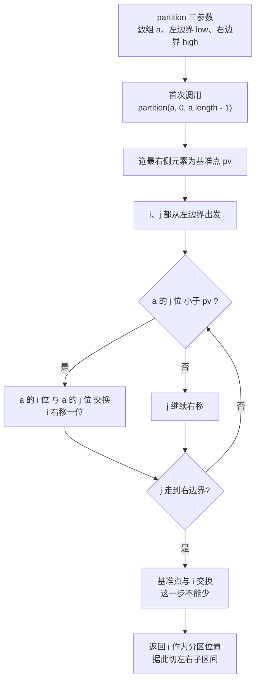

# 快速排序：单边循环（Lomuto）实现 · 分区

上一篇讲清了单边循环的四个要点，这一篇落到代码：写出 partition 方法，让基准点元素移动到正确位置，左边都比它小、右边都比它大。这个方法是快排的心脏，返回值还决定了下一轮递归的区间边界，面试手写快排基本就是写它。

## 先给结论

1. partition 方法的作用是完成一轮分区：把基准点元素移动到正确位置，左边都比它小，右边都比它大。
2. 方法三个参数：待分区数组、左边界 low、右边界 high；首次调用是 `partition(a, 0, a.length - 1)`。
3. 返回值是基准点元素所在的正确索引（就是 i 的最终值），用它确定下一轮分区的上下边界。
4. 实现骨架：选最右侧为基准点 pv，i 和 j 都从左边界出发，j 负责找到比 pv 小的元素就与 i 交换并让 i 右移，循环结束后基准点与 i 交换，返回 i。
5. 最后一步基准点与 i 的交换不能少，少了基准点就还停在最右侧。



## 是什么

提前准备好一个 partition 方法，它的作用就是完成一轮分区，让一个基准点元素移动到它正确的位置，左边的都比它小，右边的都比它大。这是这个方法的意图。

它有三个参数：第一个是数组，待分区的数组；第二个和第三个分别是 low 和 high，代表了分区的上下边界。要分区总得确定从哪儿开始到哪儿结束。所以调用的时候，数组上边界是 0，下边界一开始是数组长度减 1：

```java
int[] a = {5, 3, 7, 2, 9, 8, 1, 4};
partition(a, 0, a.length - 1);
```

partition 函数还应该有一个返回值。一轮分区完了以后，基准点元素就确定了它的正确位置，根据这个索引可以确定下一次分区的上下边界。比如某一轮基准点的索引是 3，那么左侧区间就是 0 到 2，右侧区间就是 4 到 7。这两个边界怎么推算出来的？必须知道上一轮已经确定的基准点索引。所以这个方法要返回基准点元素所在的正确索引。最终 i 所指向的就是基准点元素的位置，所以返回 i 的值就可以了。

## 深入细节

### 代码实现

第一步是选择基准点。选最右侧的元素作为基准元素，也就是上边界 h 对应的元素，叫 pv。接下来两个变量 i 和 j：i 的初始值是分区的左边界，从 l 开始；j 也从 l 开始，但 j 要向后移动，所以把 j 写成循环里面的变量。

j 从 l 开始，到哪为止？它不用移动到基准点这个元素，只要移动到基准点之前的元素就可以，所以只要小于 h 就行。

循环里做什么？j 的职责就是找到比基准点小的元素，找到了就与 i 进行交换。交换直接用以前写好的 swap 方法。每次交换完，i 要往右再移动一下，因为 i 代表下一次要交换的目标索引。等循环结束，j 就把所有比基准点小的元素都交换到 i 的左边去了。

最后还差一步：把基准点这个元素跟当前 i 所指向的元素再做一次交换。基准点所在的是 h，与 i 交换。这样一轮分区就结束了，基准点左侧的都比它小，右侧的都比它大，这时候 i 的值就是基准点元素的正确位置，作为返回值返回，供后续递归划分左右子分区时确定边界。

```java
private static int partition(int[] a, int l, int h) {
    int pv = a[h]; // 基准点元素
    int i = l; // i 指针
    int j = l; // j 指针
    for (int j = l; j < h; j++) {
        if (a[j] < pv) {
            swap(a, i, j);
            i++;
        }
    }
    swap(a, h, i);
    return i;
}
```

```java
private static void swap(int[] a, int i, int j) {
    int temp = a[i];
    a[i] = a[j];
    a[j] = temp;
}
```

### 验证

用数组 `{5, 3, 7, 2, 9, 8, 1, 4}` 跑一遍。循环结束后打印数组和 i，能看到这个状态：i 的左边是 3、2、1，i 以及它右边的是 5、9、8、7。最后基准点与 i 交换，相当于把这里的 4 和这里的 5 交换，一轮分区结束，i 的值是 3，也就是基准点 4 的正确位置。

```java
System.out.println(Arrays.toString(a) + " i=" + i);
```

### 总结

pv 是基准点元素；i 是待交换元素的目标，也决定了小于基准点元素的分区边界；j 最简单，不断向右移动，找到一个比基准点小的就与 i 交换。别忘了最后一次要把基准点元素跟 i 元素做一个交换。另外返回值代表的是基准点元素所在的正确索引。

下一节看如何给这个分区代码加上递归，变成完整的快排。

## 面试怎么答

回答时可以这样组织：

1. 先讲方法意图和签名：partition 完成一轮分区，参数是数组加左右边界，返回基准点正确索引。
2. 讲指针分工：pv 取最右，i 和 j 都从 l 出发，j 找小于 pv 的元素就与 i 交换并 i++。
3. 讲收尾：循环结束 swap(h, i)，返回 i。
4. 讲返回值的用途：按索引把区间切成左右两半，递归处理。
5. 强调边界：j 循环到 h 之前为止，基准点本身不参与扫描。

常见追问：

- **问：为什么 j 的循环条件是小于 h？** h 位置是基准点自己，不需要扫自己，扫到它前一个元素就够。
- **问：i 为什么也要初始化成 l？** i 是小于基准点区域的边界，初始时这个区域为空，边界就在最左。
- **问：如果所有元素都比基准点大？** 一次交换都不发生，i 停在 l，最后基准点与 a[l] 交换，基准点到最前面，符合「左边都比它小」（为空）。

## 常见误区

- **误区一：忘了最后基准点与 i 交换。** 少这一步，基准点还停在最右侧，分区不完整。
- **误区二：把返回值当成分区长度或布尔值。** 返回值是基准点的正确索引，递归切区间的唯一依据。
- **误区三：j 扫到 h。** h 是基准点自身，扫到它会把自己也比一遍，逻辑错误。
