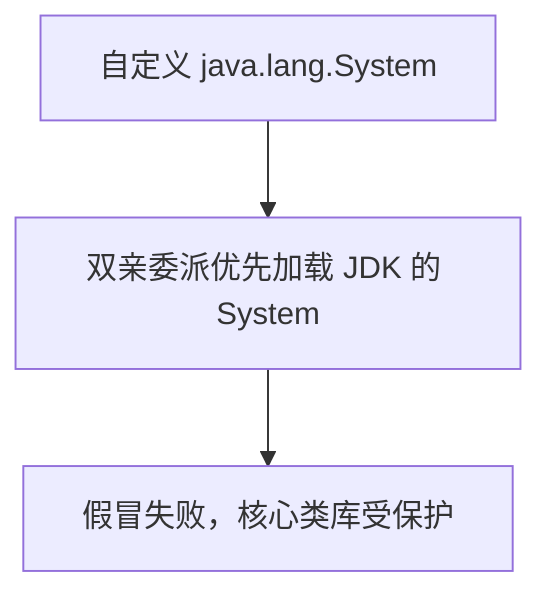

# 类加载：能假冒一个 System 类吗

这是一道经典面试题，也是网上错误解答的高发区：「能不能自己写一个 `java.lang.System` 替换掉真正的 System？」有网友说可以，办法是自定义类加载器、不走双亲委派。这个说法是错的。把错在哪讲清楚，双亲委派的设计目的也就顺明白了。

## 先给结论

1. 自己写 `java.lang.System` 替换真正的 System，不行。
2. 「自定义类加载器不走双亲委派就能加载假冒 System」这个说法是错的。
3. 假设一：自定义加载器若走双亲委派，真正的 System 会被启动类加载器优先加载，假冒的没机会。
4. 假设二：不走双亲委派，加载假冒 System 时必须先加载它的父类 `java.lang.Object`，而没有上级加载器根本找不到 Object，加载失败。
5. 实际上轮不到这两个假设：类名以 `java` 开头时，加载阶段的 preDefineClass 检查直接抛安全异常；JDK 9 以上包名与模块绑定，写这种类连编译都过不了。



## 是什么

原题是这么问的：能不能自己写一个类叫 `java.lang.System`，也就是自己写一个假冒的 System，能替换掉那个真正的 System 类？

某网友的回答是：可以。采用另类的方法，自定义一个类加载器。为了避免双亲委派机制（用了双亲委派，肯定由上级优先加载真正的 System，就没机会加载假冒的），他写一个特殊的类加载器；而且系统类加载器要到特定目录下找类，假冒的 System 放在另一个目录，跟系统目录分开；系统类加载器找不到假冒的 System，自己的类加载器找到特殊目录下的 System，而又没实现双亲委派，就可以实现假冒 System 的加载。

这个说法肯定不对。他错在认为「自己编写一个类加载器、不实现双亲委派就能加载一个假冒的 System」。

## 深入细节

### 两个假设都不成立

假设一：如果自己写的类加载器用了双亲委派，那肯定是优先由上级类加载器，最终由启动类加载器，找到真正的 `java.lang.System`，自然不会加载假冒的。

假设二：那不用双亲委派，绕过上下级关系，自己去加载。有新的问题：你的类加载器去加载假冒的 System 时，类加载需不需要加载这个类的父类？需要。所以它必须加载 System 的父类，也就是 `java.lang.Object`。而没有双亲委派、没有上级，你找得到 `java.lang.Object` 吗？找不到。所以加载过程中找不到它需要的类，肯定失败。

### 实际：安全检查直接拦下

但上面两个都还只是假设。实际操作一下就会发现，如果你自定义类加载器加载的是 `java` 打头的类（指类全名，包括包名，只要包名是 java 打头的），直接报安全异常，根本轮不到加载。

提前写好一个例子：包名采用 java 打头，加载这个类的时候就报异常。其实自定义类加载器一样报异常，因为不管是自定义类加载器还是应用程序类加载器，加载类时都会走到 ClassLoader 的 defineClass 方法，而这个方法中会调用 preDefineClass。这个方法里对类的名字做一些检查，其中一段逻辑是：如果类名是 java 打头的，而且这个类加载器不是平台类加载器（JDK 16 起扩展类加载器变成了平台类加载器），就会抛出 SecurityException，提示包名被禁止。也就是说，即使写了这种想假冒的类，由于人家做了安全检查，这种类根本没办法加载，在加载阶段就会失败。自定义加载器最终也会走到 defineClass，道理一样。

### JDK 9 以上：包名与模块绑定

另外，如果用的是 JDK 9 以上的版本，这些包名跟模块都进行了绑定。以 java 打头的一些包，比如 `java.lang`、`java.util` 等等，都跟模块绑定了。如果编写这样的类，编译的时候都过不了。

做个实验：建一个 `java.lang` 包，写一个假冒的 System 类，随便写点代码，看能不能通过编译。还没到运行加载那个阶段，编译就直接报错了，提示 `java.lang` 这个程序包已经存在于一个叫 `java.base` 的模块中。意思是这些包名已经跟系统模块绑定，不允许再重复写这些包名，这些包名相当于被 `java.base` 模块占用了。

再看 JDK 16 里类加载器与模块的关系。当前环境有三个类加载器：应用程序类加载器、平台类加载器（没有扩展类加载器了，换成了平台类加载器）、启动类加载器。三个类加载器分别加载一些模块，启动类加载器加载的模块中最重要的是 `java.base`。进到 `java.base` 里看一眼，`java.lang.System` 实际上就在 `java.base` 模块里。某一个模块绑定了哪些包，主要看 ModuleInfo 这个 class，里面列出了当前模块绑定的包名，自己编写的类都不能用这些包，被 `java.base` 占用了，再写这样的包，编译的时候就过不了。

打印类加载器与模块的示例代码：

```java
public class TestJDK9ClassLoader {
    public static void main(String[] args) {
        ClassLoader apploader = TestJDK9ClassLoader.class.getClassLoader();
        System.out.println(apploader + "==========");
        showPackages(apploader);
        ClassLoader platformLoader = apploader.getParent();
        System.out.println(platformLoader + "==========");
        showPackages(platformLoader);
        ClassLoader bootLoader = getBootLoader(platformLoader);
        System.out.println(bootLoader + "==========");
        showPackages(bootLoader);
    }
    private static ClassLoader getBootLoader(ClassLoader platformLoader) {
        return platformLoader.getParent();
    }
    public static void showPackages(ClassLoader cl) {
        // 代码省略，用于打印类加载器的包信息
    }
}
```

所以想写一个假冒的 `java.lang.System`，上面两步假设都过不了，实际操作时编译和加载两道关卡都做了检查，都不会让你过。

### 双亲委派的目的

借这个题总结双亲委派的作用，就两点：

第一，让上级类加载器加载过的类对下级共享。上级已经加载过的 System、Object 这些类，下级用就行了，反之不行。这样你的类才能依赖、才能使用到 JDK 提供的这些核心类。

第二，让类的加载有优先次序，保证核心类能够优先加载。

## 面试怎么答

回答时可以这样组织：

1. 直接给结论：不能，自定义类加载器不走双亲委派也做不到。
2. 讲两道假设：走委派则真 System 被上级加载；不走委派则连父类 Object 都找不到，加载失败。
3. 讲实际防线：类名 java 开头触发 preDefineClass 安全检查，直接抛安全异常；JDK 9 以上包名与模块绑定，编译期就报错（`java.lang` 已被 `java.base` 占用）。
4. 收尾：双亲委派一是共享上级加载的类、保证核心类可用，二是规定加载次序、核心类优先。

常见追问：

- **问：为什么不用双亲委派反而加载不了 Object？** 没有上级可问，自己的加载器只在特殊目录里找，找不到 JDK 核心类，校验父类这一环就断了。
- **问：抛安全异常的是哪个环节？** 加载时 ClassLoader 的 defineClass 会调 preDefineClass 检查类名，非平台类加载器加载 java 开头的类名会抛 SecurityException。
- **问：JDK 9 之后多了哪道关卡？** 模块化，包名与模块绑定，`java.lang` 这类包被 `java.base` 占用，写同名包编译直接失败。

## 常见误区

- **误区一：自定义类加载器就能为所欲为。** 安全检查（preDefineClass）和模块绑定两道关卡，自定义加载器同样绕不过。
- **误区二：不走双亲委派是万能后门。** 不走委派连核心类的父类都找不到，加载直接失败。
- **误区三：双亲委派只是加载顺序。** 它还保证上级加载的类对下级共享，你的代码才用得上 JDK 核心类。
- **误区四：换个目录放就能骗过加载。** 类名以 java 开头这一条就过不了检查，跟目录无关。
