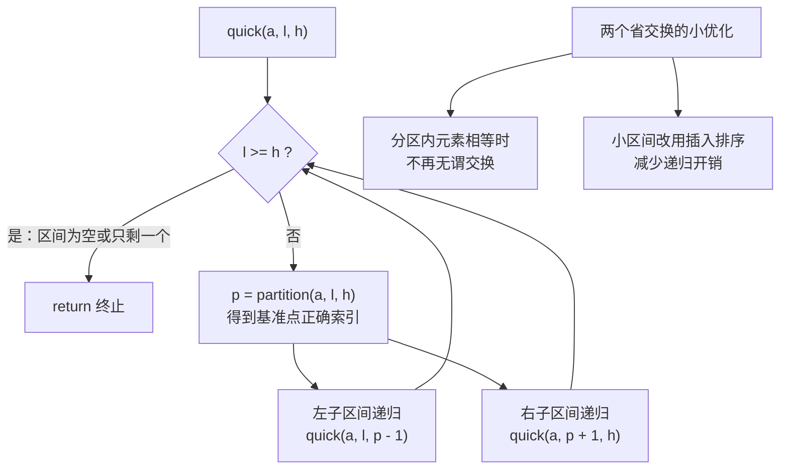

# 快速排序：单边循环（Lomuto）实现 · 递归

分区方法写好了，这篇把它包成递归，组成完整的快排。核心就两件事：一是借 partition 返回的基准点索引切出左右子区间，分别递归；二是把递归终止条件写全，区间元素小于等于 1 就收手。顺手再讲两个省交换的小优化。

## 先给结论

1. 调用一次 partition 能找到基准点元素的正确位置，借这个索引把剩余元素划分成左右两个子区间。
2. 对每个子区间重复调用 partition，区间越缩越小，直到区间内元素个数小于等于 1，表示该区间有序。
3. 递归要配一个独立的方法 quick，参数和 partition 一样：数组加左右边界，无返回值。
4. 左边区间递归边界是 l 到 p 减 1，右边区间是 p 加 1 到 h。
5. 终止条件是 l >= h：l 等于 h 表示只剩一个元素；p 减 1 小于 l 时会出现 l 大于 h，表示区间为空，两种都直接 return。



## 是什么

上节课实现了 partition 分区方法。调用一次 partition 的效果，就是能够找到基准点元素的正确位置，并且借助这个正确位置（索引值），把剩余的元素划分成两个区间：左边子区间和右边子区间。然后针对每个子区间内再重复调用 partition，进一步缩小范围，直到区间内元素个数小于等于 1，表示这个区间有序。所有区间都有序，整个数组就有序了。

这个操作要不断调用 partition 并且每次缩小范围，用递归比较方便，所以单独准备一个方法配合递归。方法名就叫 quick，参数跟 partition 一样：数组、左边界、右边界。它的目的是不断调用 partition，并且每次调用后根据返回的索引不断缩小范围。

## 深入细节

### quick 方法

一上来先调一次 partition，数组参数和左右边界原封不动传进去，得到第一次分区后基准点的正确索引值 p。有了这个索引值，就可以缩小分区范围。

左边的范围：还是继续调用 quick 递归，数组原封不动传进去，左边界不需要变，但右边界不再是 h，而是 p 减 1。右边的分区差不多：左边界是 p 加 1，右边界还是 h。这样在 quick 方法内不断缩小左右边界，一轮一轮调用，区间范围越来越小。

什么时候是个头？区间内元素个数小于等于一的时候就到头了。怎么判断？当 h 和 l 重叠，也就是 l 等于等于 h 时，表示里面只剩一个元素，没必要继续递归，直接 return。还有一种情况：如果返回的 p 恰巧跟 l 相等，那 p 减 1 作为右边界时，h 其实小于 l，所以还要考虑 l 大于 h 的情况，它也表示区间内只有一个元素或者根本没有元素，同样结束递归。两种情况合起来就是 l >= h 时 return。

```java
void quick(int[] a, int l, int h) {
    if (l >= h) {
        return;
    }
    int p = partition(a, l, h);
    quick(a, l, p - 1);
    quick(a, p + 1, h);
}
```

写完以后，把之前一次 partition 的调用换成这个 quick 调用。用数组 {5, 3, 7, 2, 9, 8, 1, 4} 验证，运行后排好序了，变成 1、2、3、4、5、7、8、9。

这就是基于递归方式的实现。当然还有非递归的版本，但递归版本更好理解，以递归版本为准。

### 两个省交换的小优化

讲 partition 时没提的细节，这里补两个优化点。

第一，最后基准点与 i 交换时，如果 i 和 h 指向同一个元素，交换没有意义。比如某一轮基准点的索引对应 3，i 的索引也是 3，这时候就没必要交换，可以加一个判断：i 不等于 h 时才交换。

第二，循环内 j 找到比基准点小的值时要与 i 交换，但如果 j 和 i 指向同一个元素（都指向 bar 这个元素的情况），交换同样没意义。加一个判断：i 不等于 j 时才交换，这样减少一次交换。但不管是否交换，i 的值都应该继续向前走一个，i++ 不能省。

Lomuto 的伪代码里并没有这两个判断，它们只是小优化，不写对结果没有影响，加了之后就是少两次交换，最终效果一样。

## 面试怎么答

回答时可以这样组织：

1. 先讲 quick 的骨架：终止条件 l >= h，先 partition 拿索引 p，再递归左右两个子区间。
2. 讲边界切法：左区间 l 到 p 减 1，右区间 p 加 1 到 h。
3. 讲终止条件为什么是 l >= h：覆盖「只剩一个元素」（l == h）和「区间为空」（p 减 1 后右边界小于左边界）两种情况。
4. 主动提优化：i == j、i == h 时跳过无意义交换，i++ 必须保留。

常见追问：

- **问：为什么还要判断 l 大于 h？** p 可能等于 l，此时 p 减 1 会让右边界小于左边界，左子区间为空，不拦就会栈溢出或空转。
- **问：递归有非递归写法吗？** 有，用栈或队列存待处理区间，迭代展开；面试写递归版即可，更好懂。
- **问：i == j 时跳过交换，i++ 还能省吗？** 不能省，i 右移是维护边界的核心动作，与是否交换无关。

## 常见误区

- **误区一：终止条件只写 l == h。** p 减 1 可能小于 l，必须写 l >= h 才能覆盖空区间。
- **误区二：递归边界写成 l 到 p。** p 位置已经是基准点最终位置，左边只到 p 减 1。
- **误区三：优化时把 i++ 也省了。** 交换可省，i 右移不可省。
