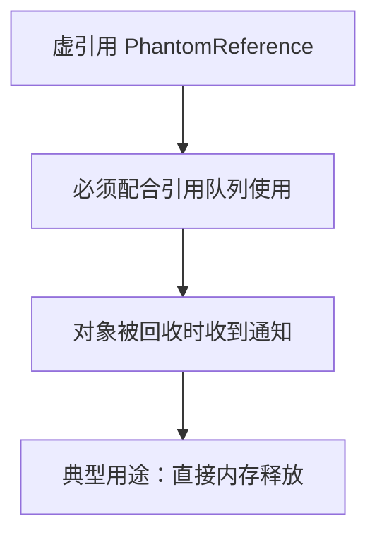

# 四种引用：虚引用

虚引用是四种引用里最特殊的一个：它不影响对象存活，唯一的存在感是对象被回收后把自己塞进引用队列，通知你去清理外部资源。单独讲概念容易空，这篇用一个完整例子走一遍：自定义虚引用类、注册引用队列、触发 GC、轮询队列做清理，再补一个串池导致不回收的对照实验。

## 先给结论

1. 虚引用必须配合引用队列使用，对象被回收后虚引用自身会入队。
2. 虚引用不决定对象能否被回收，它的价值是回收通知：让你知道该清理外部资源了。
3. 用法：自定义类继承 PhantomReference，构造里调用 `super(referent, queue)`，再提供一个释放外部资源的方法。
4. 典型流程：建引用队列、创建虚引用对象、触发 GC、轮询队列取出虚引用、调用清理方法。
5. 被引用对象如果用字符串字面量创建（进串池有强引用），不会被回收，对应虚引用也不会入队。



## 是什么

一般来讲，我们都要继承一下虚引用对象。这里自己写一个 MyResource 类，继承 PhantomReference。虚引用有一个有参构造，我们必须调用一下，所以提供一个有参构造。构造里两个参数：一个是虚引用关联的那个真正对象，第二个就是引用队列。这样调用了父类的构造方法。

虚引用是为了解决这样一个问题：将来 Java 对象被垃圾回收的时候，也要顺带去释放一些外部占用的资源。所以一般要给虚引用对象提供一个释放外部资源的方法，将来垃圾回收完了，调用这个方法来清理释放外部资源。

## 深入细节

### MyResource 类

```java
static class MyResource extends PhantomReference<String> {
    public MyResource(String referent, ReferenceQueue<? super String> queue) {
        super(referent, queue);
    }

    public void clean() {
        LoggerUtils.get().debug("clean");
    }
}
```

### 使用流程

因为待会儿这些虚引用对象都要用一个引用队列，所以首先创建一个引用队列对象。引用队列创建好了之后，又创建一个集合，集合里面添加三个 MyResource 对象，每个 MyResource 里面引用一个字符串：字符串 A、字符串 B、还有字符串 C。

现在的 list 跟 A、B、C 这三个字符串之间并没有强引关系，它们中间隔了一道虚引用。垃圾回收的时候，会不会把 A、B、C 回收掉？可以回收。垃圾回收的时候，内存不够就会把弱、软、虚这些引用关联的对象回收掉。

```java
ReferenceQueue<String> queue = new ReferenceQueue<>();
List<MyResource> list = new ArrayList<>();
list.add(new MyResource(new String("A"), queue));
list.add(new MyResource(new String("B"), queue));
list.add(new MyResource(new String("C"), queue));

System.gc();

while (true) {
    MyResource ref = (MyResource) queue.poll();
    if (ref == null) {
        break;
    }
    ref.clean();
}
```

接下来主动调用 `System.gc()`，触发一次垃圾回收。垃圾回收之后，A、B、C 这三个字符串对象会被真正回收掉，但回收掉了以后它会同时做一件事：把虚引用对象加入到后面的 queue 里面去。加到队列里面去，这样就知道哪些虚引用对象关联的那个对象被垃圾回收掉了。

怎么取？写一个 while 循环，用 queue 的 poll 方法从队列里面取元素，取出来的元素如果不为空，就检查一下它是不是虚引用类型（instanceof MyResource），是的话就调用它的 clean 方法做一个清理操作。如果队列里没有元素了，那就结束循环。

运行一下：可以看到调用了三次 clean 方法。因为这三个字符串对象都被垃圾回收了，所以这三个关联的虚引用对象都被加入到 queue 里，对它们进行相应的清理操作，把它们占用的资源都释放掉。

### 对照实验：不用 new 创建字符串

刚才创建字符串对象都用了 new。如果没有 new，用字符串字面量创建，会不会被回收掉？不会。new 创建的字符串对象在堆里面，现在又没有别的地方引用它，所以垃圾回收一旦发生就会把它占用的资源释放掉。但不用 new 的话，这个字符串对象还会在字符串常量池中存储一份，有一个强引用，所以不会被回收。

把其中一个改成不用 new 创建，那么将来垃圾回收的时候，它不会被回收，队列里相当于只有第一个引用和第二个引用对象，中间这个引用对象就不会加入队列。测一下：这回只发生了两次回收。

## 面试怎么答

回答时可以这样组织：

1. 先给定位：虚引用（PhantomReference）必须配合引用队列，不影响对象回收，只做回收通知。
2. 讲用法：继承 PhantomReference，构造传对象和队列；对象回收后虚引用入队，轮询队列做清理。
3. 讲场景：释放外部资源，典型如 DirectByteBuffer 的直接内存，由 Reference Handler 线程配合队列清理。
4. 补对照：被引用对象若是字符串字面量（串池强引用），不会被回收，虚引用也不会入队，演示里 clean 次数从三次变两次。

常见追问：

- **问：虚引用的 get 能拿到对象吗？** 不能，虚引用的 get 始终返回 null，本来就不该通过它访问对象。
- **问：为什么轮询不到还要循环？** poll 非阻塞，取空说明当前没有新入队的引用，演示里直接 break，实际生产由 Reference Handler 线程持续处理。
- **问：串池为什么会影响回收？** 字面量在串池里有一份强引用，对象可达就不回收，虚引用自然不入队。

## 常见误区

- **误区一：虚引用能阻止对象被回收。** 它不影响回收判断，四种引用里只有强引用能阻止。
- **误区二：虚引用可以单独使用。** 必须配引用队列，入队通知是它唯一的用途。
- **误区三：new String 和字面量一样。** new 的在堆上无其他引用即可被回收，字面量被串池强引用持有，回收不了。
